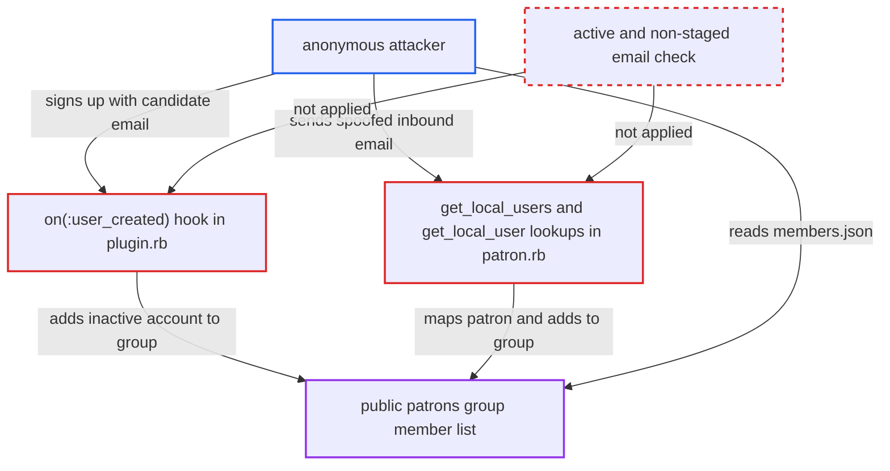

# Patreon sync grants patron group membership to unverified accounts, leaking patron emails

| Field | Value |
|---|---|
| ID | `find_019KXPBBgQPgrydkRhMEoaZM` |
| Severity | **Medium** |
| Status | open |
| CWE | CWE-287 — Improper Authentication |
| Created | 2026-10-27T21:44:49.971385Z |
| Claude Security | https://claude.ai/security/findings/find_019KXPBBgQPgrydkRhMEoaZM |

## Description

An anonymous attacker can learn whether a given email address belongs to a paying patron of the creator, which Patreon treats as private. They only need to know the candidate address and have the Patreon plugin configured with a public mapped group (the seeded default). The plugin links patrons to accounts and adds them to groups without checking that the account's email is verified. This happens in the `on(:user_created)` hook in `plugin.rb` and in the sync lookups in `patron.rb`.

1. **Attacker** signs up with a candidate email address. The normal signup form `POST /u` is used, and the account stays `active: false` until the email is confirmed.
2. **the hook `on(:user_created)`** runs when the new account is created. `User#after_create` triggers it at signup, before the email is confirmed, and it looks the address up in the Patreon `users` cache with `Patreon::Patron.all.key(user.email)`. ([`plugins/discourse-patreon/plugin.rb:58-73`](https://github.com/cx-benchmark/discourse/blob/e08ed05b4b1ef773b2de7948a8f88a7c182a3520/plugins/discourse-patreon/plugin.rb#L58-L73))
3. **`Patreon::Patron.sync_groups_by`** adds the inactive account to every group mapped to the patron's tiers. It calls `group.add user` and never checks that the user is `active` or not staged. ([`plugins/discourse-patreon/lib/patron.rb:45-67`](https://github.com/cx-benchmark/discourse/blob/e08ed05b4b1ef773b2de7948a8f88a7c182a3520/plugins/discourse-patreon/lib/patron.rb#L45-L67))
4. **the default `patrons` group** exposes its member list to anyone. The group is seeded with `visibility_level: public`, and `Group#listed_users` does not filter out inactive users. ([`plugins/discourse-patreon/lib/seed.rb:13-22`](https://github.com/cx-benchmark/discourse/blob/e08ed05b4b1ef773b2de7948a8f88a7c182a3520/plugins/discourse-patreon/lib/seed.rb#L13-L22))
5. **Attacker** reads `/g/patrons/members.json` and looks for the new username. If the username is listed, the candidate email belongs to a patron. If it is not, it does not. ([`plugins/discourse-patreon/lib/seed.rb:13-22`](https://github.com/cx-benchmark/discourse/blob/e08ed05b4b1ef773b2de7948a8f88a7c182a3520/plugins/discourse-patreon/lib/seed.rb#L13-L22))

## Assessment

The attacker is an anonymous internet user who knows candidate email addresses. The Patreon plugin must be configured and synced, and a mapped patron group must be publicly visible, as the seeded `patrons` group is by default. The main route is the signup form, handled by the `on(:user_created)` hook. There are two other ways in. The scheduled sync (`Patreon::Patron.get_local_users`) and the webhook path (`get_local_user`) match patrons through `UserEmail` rows without filtering `active` or `staged`. So an unactivated signup, or a staged user created from a spoofed inbound email sent as the target address, is also mapped to the patron and added to the group.

Impact: The attacker can confirm, one address at a time, whether an email belongs to a patron, which is private supporter data. The attacker can also put the `patreon_id` custom field on an account the real patron cannot activate. That blocks the real patron from registering the same email until unactivated users are purged (`purge_unactivated_users_grace_period_days`). Group benefits are not directly usable, because the attacker cannot log in without activating. So the harm is disclosure plus a nuisance to the real patron.

## Recommendation

Patron-to-user mapping and group grants happen for accounts whose email is not verified, such as inactive signups and staged users. The plugin wrongly assumes that a matching `UserEmail` proves ownership.

Fix criteria: Only active, non-staged users with a confirmed email are linked to a `patreon_id` or added to patron groups. The `user_created` hook defers until activation, for example by acting on `user_confirmed_email` or activation instead. The sync and webhook lookups exclude `active: false` and `staged: true` accounts. To verify, sign up with a patron's email without activating. Confirm the account is in no patron group and has no `patreon_id` custom field. Then activate it and confirm the grant happens.

## Evidence

**https://github.com/cx-benchmark/discourse**

- [`plugins/discourse-patreon/plugin.rb:58-73`](https://github.com/cx-benchmark/discourse/blob/e08ed05b4b1ef773b2de7948a8f88a7c182a3520/plugins/discourse-patreon/plugin.rb#L58-L73)
- [`plugins/discourse-patreon/lib/patron.rb:45-67`](https://github.com/cx-benchmark/discourse/blob/e08ed05b4b1ef773b2de7948a8f88a7c182a3520/plugins/discourse-patreon/lib/patron.rb#L45-L67)
- [`plugins/discourse-patreon/lib/patron.rb:113-162`](https://github.com/cx-benchmark/discourse/blob/e08ed05b4b1ef773b2de7948a8f88a7c182a3520/plugins/discourse-patreon/lib/patron.rb#L113-L162)
- [`plugins/discourse-patreon/lib/seed.rb:13-22`](https://github.com/cx-benchmark/discourse/blob/e08ed05b4b1ef773b2de7948a8f88a7c182a3520/plugins/discourse-patreon/lib/seed.rb#L13-L22)

