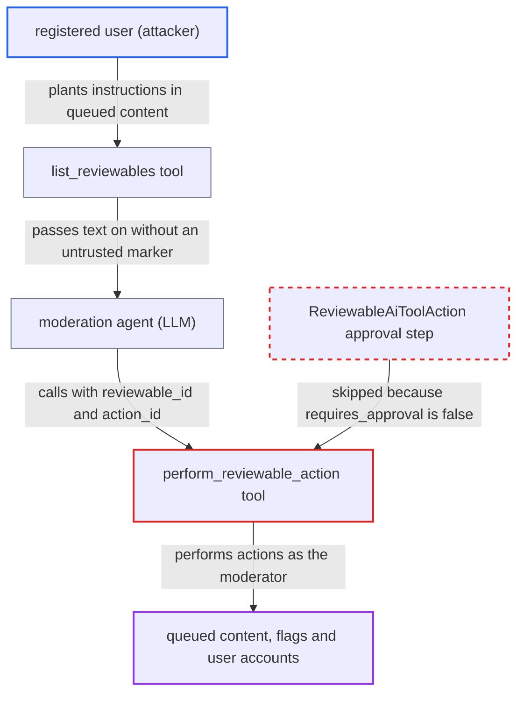

# perform_reviewable_action bypasses agent require_approval, so prompt-injected queue content triggers moderation actions

| Field | Value |
|---|---|
| ID | `find_01NeJpGQ7zLZyXgHPqnPNmPb` |
| Severity | **Medium** |
| Status | open |
| CWE | CWE-1427 — Prompt injection |
| Created | 2026-10-27T21:17:25.623168Z |
| Claude Security | https://claude.ai/security/findings/find_01NeJpGQ7zLZyXgHPqnPNmPb |

## Description

A registered user can make a moderation agent approve their own queued content or account, dismiss flags against them, or hide or delete other users' content and accounts. This needs an admin to have given a moderators' custom agent the `list_reviewables` and `perform_reviewable_action` tools with `require_approval` on, and it depends on the model following the injected text. The tool `perform_reviewable_action` hard-codes `requires_approval?` to `false`, so the approval setting never applies to it.

1. **attacker (any registered user)** puts instructions into content that lands in the review queue. This can be a flagged post, a queued post from a TL0 or watched-word user, or a pending user.
2. **the tool `list_reviewables`** returns the queued text to the model unmarked. Post title and raw, flagged post excerpt, topic title, score reasons and notes go into the model's context with no untrusted-content marker. ([`plugins/discourse-ai/lib/agents/tools/list_reviewables.rb:196-219`](https://github.com/cx-benchmark/discourse/blob/e08ed05b4b1ef773b2de7948a8f88a7c182a3520/plugins/discourse-ai/lib/agents/tools/list_reviewables.rb#L196-L219))
3. **moderator** asks the agent to triage the queue. This is a routine request, and it is what makes the agent read the attacker's text.
4. **the model** emits a `perform_reviewable_action` call with a `reviewable_id` and `action_id` taken from the injected text. Both values come from the LLM, so injected instructions can pick the target and the action.
5. **the tool class `PerformReviewableAction`** reports that it needs no approval. `requires_approval?` is hard-coded to `false`, so the agent's `require_approval` flag is ignored for this tool. ([`plugins/discourse-ai/lib/agents/tools/perform_reviewable_action.rb:40-42`](https://github.com/cx-benchmark/discourse/blob/e08ed05b4b1ef773b2de7948a8f88a7c182a3520/plugins/discourse-ai/lib/agents/tools/perform_reviewable_action.rb#L40-L42))
6. **the method `Bot#tool_requires_approval?`** returns false for this tool. It routes a tool to the approval queue only if the tool opts in or declares `mandatory_approval?`, and this tool does neither. ([`plugins/discourse-ai/lib/agents/bot.rb:591-595`](https://github.com/cx-benchmark/discourse/blob/e08ed05b4b1ef773b2de7948a8f88a7c182a3520/plugins/discourse-ai/lib/agents/bot.rb#L591-L595))
7. **the method `invoke_tool`** runs the tool immediately. The call is queued for approval only when `tool_requires_approval?` is true, so otherwise it falls through to `tool.invoke`. ([`plugins/discourse-ai/lib/agents/bot.rb:819-824`](https://github.com/cx-benchmark/discourse/blob/e08ed05b4b1ef773b2de7948a8f88a7c182a3520/plugins/discourse-ai/lib/agents/bot.rb#L819-L824))
8. **the tool `perform_reviewable_action`** calls `reviewable.perform` with the moderator's guardian. The chosen action runs at once, including `delete_user`, `delete_and_agree`, `agree_and_hide`, `approve_post` and `approve_user`, with no human confirmation. ([`plugins/discourse-ai/lib/agents/tools/perform_reviewable_action.rb:99-107`](https://github.com/cx-benchmark/discourse/blob/e08ed05b4b1ef773b2de7948a8f88a7c182a3520/plugins/discourse-ai/lib/agents/tools/perform_reviewable_action.rb#L99-L107))

## Assessment

The attacker is any registered user who can get content into the review queue: a flagged post, a queued post, or a pending user. The admin must have added `list_reviewables` and `perform_reviewable_action` to a custom agent used by moderators, with `require_approval` enabled. The tool ships in `Agent.all_available_tools` but in no default agent. A moderator then asks the agent to triage the queue. Success also depends on the LLM following the injected text. If `require_approval` is off, all moderation tools run immediately by design, so the flaw matters where approval was enabled.

Impact: The attacker can steer moderator-level review decisions. They can approve their own queued posts or pending account, dismiss flags against them, hide or delete other users' flagged content, and delete accounts through `delete_user` or `delete_and_agree`. Actions are limited to what the moderator's guardian allows on items in the queue. They are irreversible and skip the approval the admin configured. No data is disclosed.

## Recommendation

(1) `PerformReviewableAction.requires_approval?` returns `false`, so `Bot#tool_requires_approval?` never sends this tool through `ReviewableAiToolAction`. LLM-chosen queue actions run immediately under the moderator's authority.

Fix criteria: With `require_approval` enabled, every `perform_reviewable_action` call creates a pending approval item instead of calling `reviewable.perform`. Irreversible actions (`delete_user*`, `delete_and_agree`, `approve_*`) may be given mandatory approval. A test shows that an agent with `require_approval` and this tool returns `pending_approval` for an LLM-issued call. The test also shows the target reviewable stays pending until a human approves.

(2) `list_reviewables` returns attacker-authored queued raw text, post excerpts, titles and notes to the model without marking them as untrusted data. This makes injection easier.

Fix criteria: Review-queue content returned to the model is delimited and labelled as untrusted user data, as other content-reading tools do, so the model is told not to follow instructions in it. Every content field in the tool result carries such a marker.

## Evidence

**https://github.com/cx-benchmark/discourse**

- [`plugins/discourse-ai/lib/agents/tools/perform_reviewable_action.rb:40-42`](https://github.com/cx-benchmark/discourse/blob/e08ed05b4b1ef773b2de7948a8f88a7c182a3520/plugins/discourse-ai/lib/agents/tools/perform_reviewable_action.rb#L40-L42)
- [`plugins/discourse-ai/lib/agents/bot.rb:591-595`](https://github.com/cx-benchmark/discourse/blob/e08ed05b4b1ef773b2de7948a8f88a7c182a3520/plugins/discourse-ai/lib/agents/bot.rb#L591-L595)
- [`plugins/discourse-ai/lib/agents/bot.rb:819-824`](https://github.com/cx-benchmark/discourse/blob/e08ed05b4b1ef773b2de7948a8f88a7c182a3520/plugins/discourse-ai/lib/agents/bot.rb#L819-L824)
- [`plugins/discourse-ai/lib/agents/tools/perform_reviewable_action.rb:99-107`](https://github.com/cx-benchmark/discourse/blob/e08ed05b4b1ef773b2de7948a8f88a7c182a3520/plugins/discourse-ai/lib/agents/tools/perform_reviewable_action.rb#L99-L107)
- [`plugins/discourse-ai/lib/agents/tools/list_reviewables.rb:196-219`](https://github.com/cx-benchmark/discourse/blob/e08ed05b4b1ef773b2de7948a8f88a7c182a3520/plugins/discourse-ai/lib/agents/tools/list_reviewables.rb#L196-L219)
- [`plugins/discourse-ai/lib/agents/tools/list_reviewables.rb:170-186`](https://github.com/cx-benchmark/discourse/blob/e08ed05b4b1ef773b2de7948a8f88a7c182a3520/plugins/discourse-ai/lib/agents/tools/list_reviewables.rb#L170-L186)
- [`plugins/discourse-ai/config/locales/client.en.yml:978-979`](https://github.com/cx-benchmark/discourse/blob/e08ed05b4b1ef773b2de7948a8f88a7c182a3520/plugins/discourse-ai/config/locales/client.en.yml#L978-L979)
- [`plugins/discourse-ai/lib/agents/tools/perform_reviewable_action.rb:150-151`](https://github.com/cx-benchmark/discourse/blob/e08ed05b4b1ef773b2de7948a8f88a7c182a3520/plugins/discourse-ai/lib/agents/tools/perform_reviewable_action.rb#L150-L151)
- [`plugins/discourse-ai/lib/agents/tools/delete_topic.rb:38-40`](https://github.com/cx-benchmark/discourse/blob/e08ed05b4b1ef773b2de7948a8f88a7c182a3520/plugins/discourse-ai/lib/agents/tools/delete_topic.rb#L38-L40)

