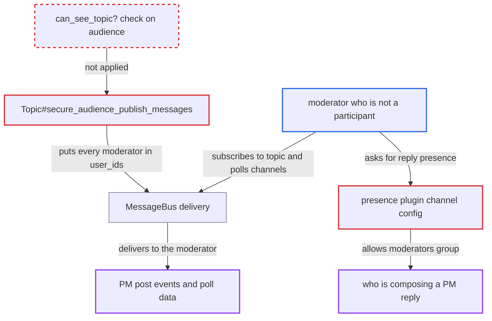

# PM real-time broadcasts and presence reach all moderators, not only PM participants

| Field | Value |
|---|---|
| ID | `find_01DuuNrwa41J6j7FfmgTjgKp` |
| Severity | **Medium** |
| Status | open |
| CWE | CWE-863 — Incorrect authorization |
| Created | 2026-10-27T22:06:54.206945Z |
| Claude Security | https://claude.ai/security/findings/find_01DuuNrwa41J6j7FfmgTjgKp |

## Description

A moderator who is not an admin and not a participant can receive live updates from private messages (PMs) they are not allowed to open. The updates include who posts and likes, who is typing, and poll titles, options and tallies. The cause is `Topic#secure_audience_publish_messages`, which adds every admin and moderator to a PM's audience. The presence plugin makes the same choice. Ordinary post bodies are not sent, so the leak is partial.

1. **moderator** subscribes to `/topic/<n>` and `/polls/<n>` channels for PM topic ids. The attacker posts to `/message-bus/<client_id>/poll` with last_id 0 to pull the backlog, or long-polls for live events, and needs only an ordinary moderator session. ([`config/initializers/004-message_bus.rb:69-74`](https://github.com/cx-benchmark/discourse/blob/e08ed05b4b1ef773b2de7948a8f88a7c182a3520/config/initializers/004-message_bus.rb#L69-L74))
2. **`Topic#secure_audience_publish_messages`** builds the PM audience from the staff role. It starts the `user_ids` list with every admin and moderator, then adds the PM's allowed users and allowed-group members. ([`app/models/topic.rb:2266-2278`](https://github.com/cx-benchmark/discourse/blob/e08ed05b4b1ef773b2de7948a8f88a7c182a3520/app/models/topic.rb#L2266-L2278))
3. **post and poll publishers** send PM events to that audience. Post changes, likes, stats updates and poll votes go out with the poster, the liker, `last_poster`, `posts_count` and the serialized poll. ([`app/models/post.rb:252-286`](https://github.com/cx-benchmark/discourse/blob/e08ed05b4b1ef773b2de7948a8f88a7c182a3520/app/models/post.rb#L252-L286))
4. **MessageBus** delivers the events to the moderator. MessageBus checks only `user_ids` and `group_ids`, so no `can_see_topic?` check runs on the channel. ([`config/initializers/004-message_bus.rb:69-74`](https://github.com/cx-benchmark/discourse/blob/e08ed05b4b1ef773b2de7948a8f88a7c182a3520/config/initializers/004-message_bus.rb#L69-L74))
5. **moderator** reads the PM activity and poll data. The same moderator cannot open the PM over HTTP, because `can_see_topic?` allows only admins and users in `topic.all_allowed_users`. ([`lib/guardian/topic_guardian.rb:254-256`](https://github.com/cx-benchmark/discourse/blob/e08ed05b4b1ef773b2de7948a8f88a7c182a3520/lib/guardian/topic_guardian.rb#L254-L256))
6. **moderator** also fetches presence for `/discourse-presence/reply/<pm_id>`. The presence plugin adds the moderators auto-group to `allowed_group_ids`, so the moderator sees who is composing a reply in any PM. ([`plugins/discourse-presence/plugin.rb:15-23`](https://github.com/cx-benchmark/discourse/blob/e08ed05b4b1ef773b2de7948a8f88a7c182a3520/plugins/discourse-presence/plugin.rb#L15-L23))

## Assessment

The attacker is a moderator who is not an admin, with an ordinary logged-in session. They poll `/message-bus/<client_id>/poll` for `/topic/<n>` and `/polls/<n>` channels over sequential topic ids. They use last_id 0 to pull the backlog, or they long-poll. A second route is a GET of presence for `/discourse-presence/reply/<pm_id>`. Participants need to do nothing beyond normal PM use.

Impact: For PMs they cannot read, the moderator learns which topic ids are active PMs, who posts and likes in them (usernames, avatars), when activity happens and who is replying. For PMs with polls they also get the poll title, option text, tallies and, for public polls, the voter lists. Ordinary post bodies are not in the payloads, and the report finds no integrity or availability impact.

## Recommendation

(1) `Topic#secure_audience_publish_messages` builds a PM's audience from the staff role (`admin OR moderator`) instead of from who may see the topic. Every `/topic/<id>` and `/polls/<id>` broadcast for a PM therefore reaches non-participant moderators.

Fix criteria: A PM's broadcast audience is exactly the users for whom `Guardian#can_see_topic?` holds: allowed users, allowed-group members and admins. A non-participant moderator subscribes to `/topic/<pm_id>` and `/polls/<pm_id>`, both live and backlog, while posts, likes and poll votes happen in the PM, and receives nothing. Participants still receive every event.

(2) The presence plugin adds the moderators auto-group to `allowed_group_ids` of the PM reply-presence channel. Non-participant moderators can therefore see who is composing a reply in a PM they cannot see.

Fix criteria: Only users who can see the PM may view `/discourse-presence/reply/<pm_id>`. A non-participant moderator who fetches presence state or subscribes to its updates is refused or gets nothing.

## Evidence

**https://github.com/cx-benchmark/discourse**

- [`app/models/topic.rb:2266-2278`](https://github.com/cx-benchmark/discourse/blob/e08ed05b4b1ef773b2de7948a8f88a7c182a3520/app/models/topic.rb#L2266-L2278)
- [`lib/guardian/topic_guardian.rb:254-256`](https://github.com/cx-benchmark/discourse/blob/e08ed05b4b1ef773b2de7948a8f88a7c182a3520/lib/guardian/topic_guardian.rb#L254-L256)
- [`app/models/post.rb:252-286`](https://github.com/cx-benchmark/discourse/blob/e08ed05b4b1ef773b2de7948a8f88a7c182a3520/app/models/post.rb#L252-L286)
- [`plugins/poll/lib/poll.rb:557-564`](https://github.com/cx-benchmark/discourse/blob/e08ed05b4b1ef773b2de7948a8f88a7c182a3520/plugins/poll/lib/poll.rb#L557-L564)
- [`plugins/discourse-presence/plugin.rb:15-23`](https://github.com/cx-benchmark/discourse/blob/e08ed05b4b1ef773b2de7948a8f88a7c182a3520/plugins/discourse-presence/plugin.rb#L15-L23)
- [`config/initializers/004-message_bus.rb:69-74`](https://github.com/cx-benchmark/discourse/blob/e08ed05b4b1ef773b2de7948a8f88a7c182a3520/config/initializers/004-message_bus.rb#L69-L74)

