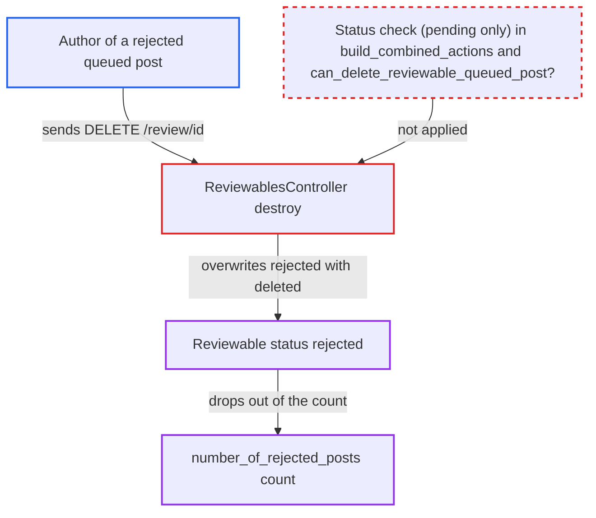

# Queued-post author can relabel a staff-rejected reviewable as deleted via DELETE /review/:id

| Field | Value |
|---|---|
| ID | `find_01QDHvxJARBbHKPeSJev2Zrd` |
| Severity | **Medium** |
| Status | open |
| CWE | CWE-863 — Incorrect Authorization |
| Created | 2026-10-27T21:44:07.067452Z |
| Claude Security | https://claude.ai/security/findings/find_01QDHvxJARBbHKPeSJev2Zrd |

## Description

A registered user whose queued post staff rejected can change that moderation verdict from `rejected` to `deleted`. This lowers the user's rejected-post count and removes the record from the review queue's `rejected` filter, so a repeat offender can tidy the history moderators judge them by. It works because the author's `delete` action is offered and allowed whatever the reviewable's status, in `ReviewableQueuedPost#build_combined_actions` and `Guardian#can_delete_reviewable_queued_post?`.

1. **Staff member** rejects the user's queued post. A rejected queued post has no target post, which matters for the later checks.
2. **Post author** sends `DELETE /review/<id>.json` for their own reviewable. The author knows the id from the pending page, and the lookup only matches their own records. ([`app/controllers/reviewables_controller.rb:192-205`](https://github.com/cx-benchmark/discourse/blob/e08ed05b4b1ef773b2de7948a8f88a7c182a3520/app/controllers/reviewables_controller.rb#L192-L205))
3. **`destroy` in `ReviewablesController`** skips `ensure_can_see` and loads the record with `find_by_flagger_or_queued_post_creator`. `destroy` is the only action exempt from `ensure_can_see`, and the lookup has no status filter, so a rejected record is found. ([`app/controllers/reviewables_controller.rb:192-205`](https://github.com/cx-benchmark/discourse/blob/e08ed05b4b1ef773b2de7948a8f88a7c182a3520/app/controllers/reviewables_controller.rb#L192-L205))
4. **`can_review_target?` in `Reviewable`** passes because the rejected post has no target. With no target post it returns true, so the `delete` action is built for the author. ([`app/models/reviewable.rb:1184-1187`](https://github.com/cx-benchmark/discourse/blob/e08ed05b4b1ef773b2de7948a8f88a7c182a3520/app/models/reviewable.rb#L1184-L1187))
5. **`Guardian#can_delete_reviewable_queued_post?`** approves the author. It checks only `reviewable.target_created_by_id == @user.id` and ignores status; `build_combined_actions` also adds `delete` outside its `if pending?` guard. ([`lib/guardian.rb:296-302`](https://github.com/cx-benchmark/discourse/blob/e08ed05b4b1ef773b2de7948a8f88a7c182a3520/lib/guardian.rb#L296-L302))
6. **`perform_delete`** returns `:deleted`, so `Reviewable#transition_to` overwrites `rejected` with `deleted`. `perform_delete` always returns a success result with `:deleted`, and the stored staff verdict is replaced. ([`app/models/reviewable_queued_post.rb:221-223`](https://github.com/cx-benchmark/discourse/blob/e08ed05b4b1ef773b2de7948a8f88a7c182a3520/app/models/reviewable_queued_post.rb#L221-L223))
7. **`User#number_of_rejected_posts`** no longer counts the reviewable. It counts only queued posts with status `rejected`, so the count moderators see goes down. ([`app/models/user.rb:1765-1772`](https://github.com/cx-benchmark/discourse/blob/e08ed05b4b1ef773b2de7948a8f88a7c182a3520/app/models/user.rb#L1765-L1772))

## Assessment

The attacker is any registered user whose queued post was held for approval and then rejected by staff. They need no special setting and no victim action. They already know the reviewable id from their pending page, and the lookup only matches their own records. Approved queued posts are not affected for ordinary authors. Once approved, the target is a `Post`, `can_review_post?` fails, and `actions_for` returns nothing.

Impact: An ordinary user can change a staff decision on their own queued post from `rejected` to `deleted`. The record leaves the `rejected` queue filter and `User#number_of_rejected_posts` goes down. Moderators use that count on the admin page (`staff_info`), in `FlaggedUserSerializer#rejected_posts_count` and in the MCP `GetUserModerationSummary` tool. The impact is limited to the status and the counters derived from it. The `post_rejected` staff action log, any DSA statement of record and a reviewable history entry naming the author stay in place. Nothing is disclosed and other users' content is untouched.

## Recommendation

`ReviewableQueuedPost#build_combined_actions` offers the author's `delete` action whatever the reviewable's status, and `Guardian#can_delete_reviewable_queued_post?` ignores status. A non-staff author can therefore overwrite a staff verdict on a reviewed record.

Fix criteria: A non-staff author may withdraw a queued post only while it is `pending`. After staff reject a user's queued post, `DELETE /review/:id` from that user fails, the reviewable stays `rejected` and `number_of_rejected_posts` does not change. A pending queued post can still be withdrawn by its author, and API-admin deletion keeps working as designed.

## Evidence

**https://github.com/cx-benchmark/discourse**

- [`app/models/reviewable_queued_post.rb:66`](https://github.com/cx-benchmark/discourse/blob/e08ed05b4b1ef773b2de7948a8f88a7c182a3520/app/models/reviewable_queued_post.rb#L66)
- [`lib/guardian.rb:296-302`](https://github.com/cx-benchmark/discourse/blob/e08ed05b4b1ef773b2de7948a8f88a7c182a3520/lib/guardian.rb#L296-L302)
- [`app/controllers/reviewables_controller.rb:192-205`](https://github.com/cx-benchmark/discourse/blob/e08ed05b4b1ef773b2de7948a8f88a7c182a3520/app/controllers/reviewables_controller.rb#L192-L205)
- [`app/models/reviewable.rb:1184-1187`](https://github.com/cx-benchmark/discourse/blob/e08ed05b4b1ef773b2de7948a8f88a7c182a3520/app/models/reviewable.rb#L1184-L1187)
- [`app/models/reviewable_queued_post.rb:221-223`](https://github.com/cx-benchmark/discourse/blob/e08ed05b4b1ef773b2de7948a8f88a7c182a3520/app/models/reviewable_queued_post.rb#L221-L223)
- [`app/models/user.rb:1765-1772`](https://github.com/cx-benchmark/discourse/blob/e08ed05b4b1ef773b2de7948a8f88a7c182a3520/app/models/user.rb#L1765-L1772)

