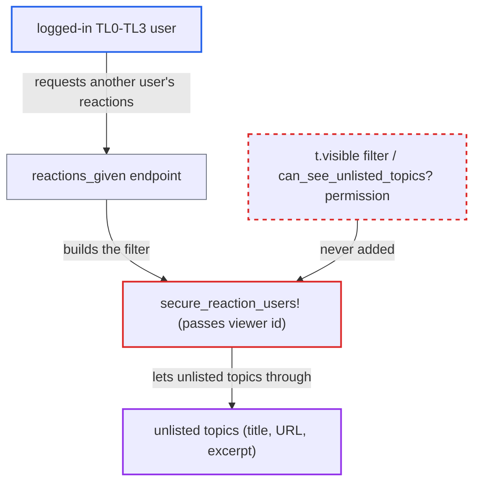

# Reactions-given listing passes viewer id as target, dropping unlisted-topic filter

| Field | Value |
|---|---|
| ID | `find_015ivFn8uWTBJfeaef4mLEiK` |
| Severity | **Medium** |
| Status | open |
| CWE | CWE-863 — Incorrect authorization |
| Created | 2026-10-27T21:41:46.386287Z |
| Claude Security | https://claude.ai/security/findings/find_015ivFn8uWTBJfeaef4mLEiK |

## Description

Any logged-in user below trust level 4 can see titles, URLs and excerpts of unlisted topics that staff removed from listings, and can then open those topics. The attack works on topics in categories the attacker can already read. The cause is `secure_reaction_users!`, which passes the viewer's id to `UserAction.apply_common_filters` where core expects the target user's id, so the `t.visible` filter is never added.

1. **attacker (TL0–TL3 user)** requests another user's reactions-given list. The request is `GET /discourse-reactions/posts/reactions.json?username=<target>`, with a target such as a staff member who reacted in unlisted topics. ([`plugins/discourse-reactions/app/controllers/discourse_reactions/custom_reactions_controller.rb:26-65`](https://github.com/cx-benchmark/discourse/blob/e08ed05b4b1ef773b2de7948a8f88a7c182a3520/plugins/discourse-reactions/app/controllers/discourse_reactions/custom_reactions_controller.rb#L26-L65))
2. **the action `reactions_given`** accepts the request after only basic checks. It requires login, `can_see_profile?` and `can_see_user_actions?`, and its own joins filter `t.deleted_at` but not `t.visible`. ([`plugins/discourse-reactions/app/controllers/discourse_reactions/custom_reactions_controller.rb:26-65`](https://github.com/cx-benchmark/discourse/blob/e08ed05b4b1ef773b2de7948a8f88a7c182a3520/plugins/discourse-reactions/app/controllers/discourse_reactions/custom_reactions_controller.rb#L26-L65))
3. **the method `secure_reaction_users!`** calls `UserAction.apply_common_filters` with `current_user.id`. Core defines that parameter as the target user whose activity is listed, but the plugin passes the viewer's id. ([`plugins/discourse-reactions/app/controllers/discourse_reactions/custom_reactions_controller.rb:358-368`](https://github.com/cx-benchmark/discourse/blob/e08ed05b4b1ef773b2de7948a8f88a7c182a3520/plugins/discourse-reactions/app/controllers/discourse_reactions/custom_reactions_controller.rb#L358-L368))
4. **the helper `UserAction.apply_common_filters`** skips the `t.visible` clause. It adds the clause only when `guardian.user.id != user_id`, which is always false when the viewer's own id is passed. ([`app/models/user_action.rb:458-460`](https://github.com/cx-benchmark/discourse/blob/e08ed05b4b1ef773b2de7948a8f88a7c182a3520/app/models/user_action.rb#L458-L460))
5. **`UserReactionSerializer`** returns reactions on unlisted topics. Each entry carries the topic id, title, slug, URL and a 300-character post excerpt, and the attacker can page through results with `before_reaction_user_id`. ([`plugins/discourse-reactions/app/controllers/discourse_reactions/custom_reactions_controller.rb:26-65`](https://github.com/cx-benchmark/discourse/blob/e08ed05b4b1ef773b2de7948a8f88a7c182a3520/plugins/discourse-reactions/app/controllers/discourse_reactions/custom_reactions_controller.rb#L26-L65))
6. **attacker** opens the leaked topic URL. `can_see_topic?` does not check `visible`, so the whole topic is readable.

## Assessment

The attacker is any logged-in user at trust level 0 to 3. No staff role and no victim action are needed. The plugin setting `discourse_reactions_enabled` defaults to true, so the endpoint is live in the shipped configuration. The attacker picks a target who has reacted in unlisted topics, for example a staff member, and requests that user's reactions-given list.

Impact: The attacker learns the titles, URLs and excerpts of unlisted topics in categories they can already read. With the URL they can read the whole topic. Nothing is modified. Read-restricted categories, private messages, hidden posts, whispers and deleted content stay filtered.

## Recommendation

`secure_reaction_users!` passes the viewer's id to `UserAction.apply_common_filters` in the parameter core defines as the target user. The viewer-versus-target check that hides unlisted topics (`t.visible`) therefore never runs, which bypasses the `can_see_unlisted_topics?` permission.

Fix criteria: The visibility filter is evaluated for the actual target user. A viewer who is neither the target nor allowed to see unlisted topics gets no entries for topics with `visible = false`. A test shows that a TL0–TL3 user requesting another user's reactions-given list gets no reactions on unlisted topics, while the target user and staff still get them. The existing category, PM, whisper and hidden-post filtering is unchanged.

## Evidence

**https://github.com/cx-benchmark/discourse**

- [`plugins/discourse-reactions/app/controllers/discourse_reactions/custom_reactions_controller.rb:358-368`](https://github.com/cx-benchmark/discourse/blob/e08ed05b4b1ef773b2de7948a8f88a7c182a3520/plugins/discourse-reactions/app/controllers/discourse_reactions/custom_reactions_controller.rb#L358-L368)
- [`app/models/user_action.rb:458-460`](https://github.com/cx-benchmark/discourse/blob/e08ed05b4b1ef773b2de7948a8f88a7c182a3520/app/models/user_action.rb#L458-L460)
- [`plugins/discourse-reactions/app/controllers/discourse_reactions/custom_reactions_controller.rb:26-65`](https://github.com/cx-benchmark/discourse/blob/e08ed05b4b1ef773b2de7948a8f88a7c182a3520/plugins/discourse-reactions/app/controllers/discourse_reactions/custom_reactions_controller.rb#L26-L65)
- [`lib/guardian/topic_guardian.rb:268-270`](https://github.com/cx-benchmark/discourse/blob/e08ed05b4b1ef773b2de7948a8f88a7c182a3520/lib/guardian/topic_guardian.rb#L268-L270)
- [`plugins/discourse-reactions/config/settings.yml:2-4`](https://github.com/cx-benchmark/discourse/blob/e08ed05b4b1ef773b2de7948a8f88a7c182a3520/plugins/discourse-reactions/config/settings.yml#L2-L4)

