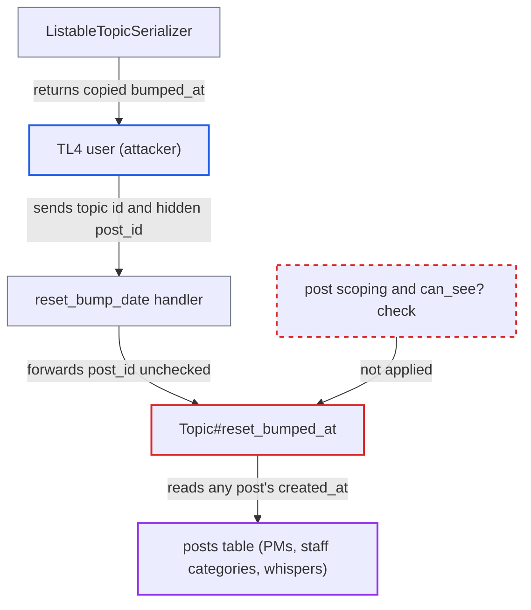

# reset_bump_date honours a post_id the caller cannot see, leaking private posts' timestamps

| Field | Value |
|---|---|
| ID | `find_01YXmqnGgL2Xfm8Fu4Eu32MP` |
| Severity | **Medium** |
| Status | open |
| CWE | CWE-639 — Insecure direct object reference |
| Created | 2026-10-27T21:19:05.936798Z |
| Claude Security | https://claude.ai/security/findings/find_01YXmqnGgL2Xfm8Fu4Eu32MP |

## Description

A trust-level-4 (TL4) user, or staff, can learn whether any post id exists and its exact creation time, even for private messages, staff-only categories and whispers they cannot see. Only metadata leaks, not content, topic or author. The cause is that `Topic#reset_bumped_at` looks up the caller-supplied `post_id` across all posts, and `reset_bump_date` checks only the target topic.

1. **attacker (TL4 user)** picks a topic they can see and sends a reset request with a post id they cannot see. The request is `PUT /t/T/reset-bump-date/P.json`, where T is a visible topic such as their own and P is the id of a private message post, a staff-category post or a whisper. ([`config/routes.rb:1543`](https://github.com/cx-benchmark/discourse/blob/e08ed05b4b1ef773b2de7948a8f88a7c182a3520/config/routes.rb#L1543))
2. **the handler `reset_bump_date`** authorises only the target topic and forwards `params[:post_id]`. It calls `guardian.ensure_can_update_bumped_at!` (staff or TL4) and `guardian.ensure_can_see!(topic)`, but never checks the post. ([`app/controllers/topics_controller.rb:1327-1340`](https://github.com/cx-benchmark/discourse/blob/e08ed05b4b1ef773b2de7948a8f88a7c182a3520/app/controllers/topics_controller.rb#L1327-L1340))
3. **the method `Topic#reset_bumped_at`** loads the post with `Post.find_by(id: post_or_post_id)` and copies its `created_at` into `bumped_at`. The lookup is not limited to the topic's own posts and no `guardian.can_see?(post)` call is made. The topic is saved with `validate: false`. ([`app/models/topic.rb:2113-2133`](https://github.com/cx-benchmark/discourse/blob/e08ed05b4b1ef773b2de7948a8f88a7c182a3520/app/models/topic.rb#L2113-L2133))
4. **attacker** reads the topic back from a topic list such as `/latest.json` or `/topics/created-by/<me>.json`. `ListableTopicSerializer` returns `bumped_at`, which now holds the hidden post's creation time. If `bumped_at` does not change, post P is missing or deleted. ([`app/serializers/listable_topic_serializer.rb:10`](https://github.com/cx-benchmark/discourse/blob/e08ed05b4b1ef773b2de7948a8f88a7c182a3520/app/serializers/listable_topic_serializer.rb#L10))

## Assessment

The attacker is a logged-in user who is TL4 or staff, because `can_update_bumped_at?` allows only those. They need a topic they can see, such as their own. They use a session with a CSRF token or a user API key. No victim action is needed. The shipped UI never sends `post_id`, so the parameter is reachable only through the API.

Impact: The attacker can check whether a live post exists for any post id and read its exact `created_at`, including posts in private messages, staff-only categories and whispers. Content, topic and author are not exposed, and sequential ids already narrow the time, so the leak is limited. The only write is the `bumped_at` of a topic the user may already reset, which changes list order and nothing else.

## Recommendation

`Topic#reset_bumped_at` resolves the caller-supplied post id against all posts instead of the topic's own posts, so the controller's topic-level authorisation does not cover the referenced post.

Fix criteria: A `post_id` given to `reset_bump_date` is honoured only when the post belongs to the target topic and is visible to the acting user. Otherwise the request is rejected or ignored and `bumped_at` is not touched. Calling the endpoint with a post id from a private message or restricted-category topic leaves `bumped_at` unchanged and returns an error. An in-topic post id still works.

## Evidence

**https://github.com/cx-benchmark/discourse**

- [`app/controllers/topics_controller.rb:1327-1340`](https://github.com/cx-benchmark/discourse/blob/e08ed05b4b1ef773b2de7948a8f88a7c182a3520/app/controllers/topics_controller.rb#L1327-L1340)
- [`app/models/topic.rb:2113-2133`](https://github.com/cx-benchmark/discourse/blob/e08ed05b4b1ef773b2de7948a8f88a7c182a3520/app/models/topic.rb#L2113-L2133)
- [`config/routes.rb:1543`](https://github.com/cx-benchmark/discourse/blob/e08ed05b4b1ef773b2de7948a8f88a7c182a3520/config/routes.rb#L1543)
- [`app/serializers/listable_topic_serializer.rb:10`](https://github.com/cx-benchmark/discourse/blob/e08ed05b4b1ef773b2de7948a8f88a7c182a3520/app/serializers/listable_topic_serializer.rb#L10)

