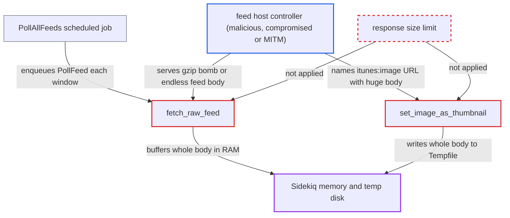

# RSS polling downloads feed body and itunes:image without any size limit

| Field | Value |
|---|---|
| ID | `find_01XfTeJHBLMqsWzjrS7KHqft` |
| Severity | **Medium** |
| Status | open |
| CWE | CWE-400 — Uncontrolled Resource Consumption |
| Created | 2026-10-27T21:36:05.527296Z |
| Claude Security | https://claude.ai/security/findings/find_01XfTeJHBLMqsWzjrS7KHqft |

## Description

A server that hosts an RSS feed can crash the Sidekiq background worker or fill its temp disk. It does this by sending an endless or gzip-compressed oversized response. The attacker needs no Discourse account, but an admin must already have added the feed, or the feed's `itunes:image` must point at the attacker's host. `fetch_raw_feed` and `set_image_as_thumbnail` read the responses with no size limit.

1. **an admin** adds a feed URL to the enabled RSS polling plugin. This precondition is outside the attacker's control. The attacker only needs to control, compromise or intercept the host that serves the feed, or the host named by an item's `itunes:image`.
2. **the scheduled job `PollAllFeeds`** enqueues `PollFeed` for every enabled feed. It runs every 5 minutes and enqueues once per `rss_polling_frequency` window, so no user action is needed and the fetch repeats each cycle. ([`plugins/discourse-rss-polling/app/jobs/jobs/discourse_rss_polling/poll_all_feeds.rb:5-15`](https://github.com/cx-benchmark/discourse/blob/e08ed05b4b1ef773b2de7948a8f88a7c182a3520/plugins/discourse-rss-polling/app/jobs/jobs/discourse_rss_polling/poll_all_feeds.rb#L5-L15))
3. **`fetch_raw_feed`** downloads the feed and appends every chunk to an in-memory String. The only bound is a per-read timeout (`rss_polling_feed_request_timeout`, default 30 s). The block throws `:done` only for non-2xx responses, so a successful response is buffered whatever its size. ([`plugins/discourse-rss-polling/app/services/discourse_rss_polling/rss_feed/action/fetch_feed.rb:50-77`](https://github.com/cx-benchmark/discourse/blob/e08ed05b4b1ef773b2de7948a8f88a7c182a3520/plugins/discourse-rss-polling/app/services/discourse_rss_polling/rss_feed/action/fetch_feed.rb#L50-L77))
4. **`FinalDestination#get`** keeps reading and inflates gzip content until the server closes the connection. `safe_get` requests gzip and sets `decode_content = true`. The 5 MB and 10 s caps exist only in `#resolve`, so a few MB of compressed data can inflate to gigabytes. A server that keeps sending never hits the per-read timeout. ([`lib/final_destination.rb:507-539`](https://github.com/cx-benchmark/discourse/blob/e08ed05b4b1ef773b2de7948a8f88a7c182a3520/lib/final_destination.rb#L507-L539))
5. **`set_image_as_thumbnail`** downloads the feed-supplied `itunes:image` URL into a Tempfile with no cap. `image_link` is the raw `href` of the item's `itunes:image` element, so the feed chooses this URL. Nothing checks `SiteSetting.max_image_size_kb` before the file goes to `UploadCreator`. ([`plugins/discourse-rss-polling/app/jobs/jobs/discourse_rss_polling/poll_feed.rb:197-222`](https://github.com/cx-benchmark/discourse/blob/e08ed05b4b1ef773b2de7948a8f88a7c182a3520/plugins/discourse-rss-polling/app/jobs/jobs/discourse_rss_polling/poll_feed.rb#L197-L222))
6. **the Sidekiq process** runs out of memory or temp disk space. The only memory guard is an RSS check every 30 minutes, which is far too slow. The likely result is an OOM kill or forced restart that takes every in-flight job with it. ([`lib/demon/sidekiq.rb:48-72`](https://github.com/cx-benchmark/discourse/blob/e08ed05b4b1ef773b2de7948a8f88a7c182a3520/lib/demon/sidekiq.rb#L48-L72))

## Assessment

The attacker controls the host serving a feed that an admin added to the enabled RSS polling plugin. The same applies to the host that an item's `itunes:image` names. Examples are a malicious or compromised publisher, a lapsed domain, or a man-in-the-middle on an `http://` feed. Someone who can add an item to the feed can also set the `itunes:image` URL. No Discourse account is needed. The admin-added feed is the precondition. The admin feed-test action (`RssFeed::Test`) reaches the same unbounded fetch in a web worker, where the Pitchfork 30 s timeout bounds it.

Impact: Sidekiq memory grows until the process is OOM-killed or restarted, which kills every in-flight background job such as email, notifications and webhooks. The thumbnail download can instead fill the temp disk. This repeats every poll cycle until an admin disables the feed. No data is disclosed or modified, and the web front stays up.

## Recommendation

The feed XML download in `fetch_raw_feed` and the thumbnail download in `set_image_as_thumbnail` read untrusted response bodies with no upper bound. Other remote downloads in the codebase are limited.

Fix criteria: Both fetches stop reading, by throwing `:done` or aborting, once a configured maximum has been received. `fetch_raw_feed` uses a bounded feed size. The thumbnail uses `SiteSetting.max_image_size_kb`, or `FileHelper.download` with `max_file_size`. Polling a feed whose body and `itunes:image` both exceed the limits makes the job abort early with bounded memory and disk use. It also records a poll error.

## Evidence

**https://github.com/cx-benchmark/discourse**

- [`plugins/discourse-rss-polling/app/services/discourse_rss_polling/rss_feed/action/fetch_feed.rb:50-77`](https://github.com/cx-benchmark/discourse/blob/e08ed05b4b1ef773b2de7948a8f88a7c182a3520/plugins/discourse-rss-polling/app/services/discourse_rss_polling/rss_feed/action/fetch_feed.rb#L50-L77)
- [`plugins/discourse-rss-polling/app/jobs/jobs/discourse_rss_polling/poll_feed.rb:197-222`](https://github.com/cx-benchmark/discourse/blob/e08ed05b4b1ef773b2de7948a8f88a7c182a3520/plugins/discourse-rss-polling/app/jobs/jobs/discourse_rss_polling/poll_feed.rb#L197-L222)
- [`lib/final_destination.rb:507-539`](https://github.com/cx-benchmark/discourse/blob/e08ed05b4b1ef773b2de7948a8f88a7c182a3520/lib/final_destination.rb#L507-L539)
- [`plugins/discourse-rss-polling/app/models/discourse_rss_polling/feed_item.rb:71-73`](https://github.com/cx-benchmark/discourse/blob/e08ed05b4b1ef773b2de7948a8f88a7c182a3520/plugins/discourse-rss-polling/app/models/discourse_rss_polling/feed_item.rb#L71-L73)
- [`plugins/discourse-rss-polling/app/jobs/jobs/discourse_rss_polling/poll_all_feeds.rb:5-15`](https://github.com/cx-benchmark/discourse/blob/e08ed05b4b1ef773b2de7948a8f88a7c182a3520/plugins/discourse-rss-polling/app/jobs/jobs/discourse_rss_polling/poll_all_feeds.rb#L5-L15)
- [`lib/demon/sidekiq.rb:48-72`](https://github.com/cx-benchmark/discourse/blob/e08ed05b4b1ef773b2de7948a8f88a7c182a3520/lib/demon/sidekiq.rb#L48-L72)

