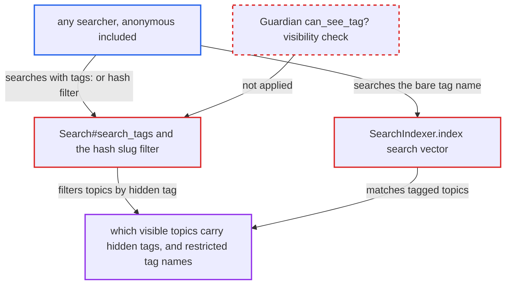

# Search tag filters bypass hidden-tag visibility, exposing staff-only tag assignments

| Field | Value |
|---|---|
| ID | `find_017aJyCNoY81WvRKePZxvj95` |
| Severity | **Medium** |
| Status | open |
| CWE | CWE-862 — Missing Authorization |
| Created | 2026-10-27T21:13:24.813411Z |
| Claude Security | https://claude.ai/security/findings/find_017aJyCNoY81WvRKePZxvj95 |

## Description

Any searcher, anonymous included, can learn which visible topics staff have labelled with a hidden tag. They can also learn which restricted tag and tag group names exist. The search filters `tags:`, `-tags:` and `#slug` resolve names without a visibility check, and the indexer puts hidden tag names in the search text. Topic content and tag names in results stay protected.

1. **attacker** sends a search request naming a hidden tag. The request is `GET /search?q=tags:<name>`, `q=%23<name>` or `q=<name>`, and no login is needed while `allow_anonymous_search` is true, which is its default. ([`lib/search.rb:807-813`](https://github.com/cx-benchmark/discourse/blob/e08ed05b4b1ef773b2de7948a8f88a7c182a3520/lib/search.rb#L807-L813))
2. **the `tags:` filter** passes the raw term to `search_tags`. The term goes through unchanged, so the filter never asks whether the searcher may see this tag. ([`lib/search.rb:807-813`](https://github.com/cx-benchmark/discourse/blob/e08ed05b4b1ef773b2de7948a8f88a7c182a3520/lib/search.rb#L807-L813))
3. **`Search#search_tags`** looks up the tag ids with `Tag.where_name(tags).pluck(:id)` and filters `topic_tags` by them. For `a+b` terms it matches `tags.name` directly in SQL. Neither path checks the searcher's guardian. ([`lib/search.rb:939-970`](https://github.com/cx-benchmark/discourse/blob/e08ed05b4b1ef773b2de7948a8f88a7c182a3520/lib/search.rb#L939-L970))
4. **the `#slug` filter** falls back to `Tag.where_name(category_slug)` and `TagGroup.find_id_by_slug(category_slug)`. This lets `#<hidden-tag>` or `#<restricted-tag-group>` filter topics by restricted tags, again with no guardian check. ([`lib/search.rb:680-705`](https://github.com/cx-benchmark/discourse/blob/e08ed05b4b1ef773b2de7948a8f88a7c182a3520/lib/search.rb#L680-L705))
5. **`posts_query`** returns the topics the searcher may read that carry the restricted tag. Nothing on this path removes hidden tags from the tag filters, so the returned set shows which topics have the tag. ([`lib/search.rb:1226-1300`](https://github.com/cx-benchmark/discourse/blob/e08ed05b4b1ef773b2de7948a8f88a7c182a3520/lib/search.rb#L1226-L1300))
6. **`SearchIndexer.index`** also lets a bare search for the tag name match tagged topics. It writes every tag name of a topic, hidden tags and synonyms included, into each post's search vector at weight C. ([`app/services/search_indexer.rb:305-322`](https://github.com/cx-benchmark/discourse/blob/e08ed05b4b1ef773b2de7948a8f88a7c182a3520/app/services/search_indexer.rb#L305-L322))

## Assessment

The attacker is any visitor allowed to search. Anonymous visitors qualify by default, because `allow_anonymous_search` defaults to true. No victim action is needed. There are three ways in: the `tags:` or `-tags:` filter, the `#slug` filter (for tags and for tag groups), and a bare search for the tag name that matches the indexed tag text. By trying names, the attacker can also find which restricted tag and tag group names are in use.

Impact: The attacker learns which otherwise-readable topics staff labelled with hidden tags, such as moderation, legal or customer-tier labels. They also learn which restricted tag and tag group names exist. Topic content stays behind the normal category, PM and whisper filters, and tag names are stripped from the serialized topics, so only restricted tag metadata is disclosed.

## Recommendation

(1) `Search#search_tags` and the `#slug` filter in `lib/search.rb` resolve tag names and tag group slugs from the raw search term. They skip the tag visibility rules (`DiscourseTagging.visible_tags`, `filter_visible`, `hidden_tag_names`) that other listing paths apply.

Fix criteria: Tag and tag group resolution in the search filters matches only tags and tag groups the searcher's guardian may see. Hidden ones behave like an unknown tag. Verify that as an anonymous or regular user, `tags:<hidden>`, `-tags:<hidden>`, `tags:a+<hidden>`, `#<hidden>` and `#<staff-tag-group-slug>` return exactly what an unknown tag returns. Verify that as staff they still work.

(2) `SearchIndexer.update_posts_index` writes hidden tag names into every post's search vector. A plain-term search for a hidden tag name therefore reveals tagged topics to users who cannot see the tag.

Fix criteria: Tags from restricted tag groups are either left out of the indexed tag text, or matches on the tag weight are limited to tags the searcher can see. Verify that a regular user searching the bare hidden tag name gets no topics that match only through the tag. Verify that staff still do.

## Evidence

**https://github.com/cx-benchmark/discourse**

- [`lib/search.rb:939-970`](https://github.com/cx-benchmark/discourse/blob/e08ed05b4b1ef773b2de7948a8f88a7c182a3520/lib/search.rb#L939-L970)
- [`lib/search.rb:807-813`](https://github.com/cx-benchmark/discourse/blob/e08ed05b4b1ef773b2de7948a8f88a7c182a3520/lib/search.rb#L807-L813)
- [`lib/search.rb:680-705`](https://github.com/cx-benchmark/discourse/blob/e08ed05b4b1ef773b2de7948a8f88a7c182a3520/lib/search.rb#L680-L705)
- [`lib/search.rb:1226-1300`](https://github.com/cx-benchmark/discourse/blob/e08ed05b4b1ef773b2de7948a8f88a7c182a3520/lib/search.rb#L1226-L1300)
- [`app/services/search_indexer.rb:305-322`](https://github.com/cx-benchmark/discourse/blob/e08ed05b4b1ef773b2de7948a8f88a7c182a3520/app/services/search_indexer.rb#L305-L322)
- [`app/controllers/tags_controller.rb:534`](https://github.com/cx-benchmark/discourse/blob/e08ed05b4b1ef773b2de7948a8f88a7c182a3520/app/controllers/tags_controller.rb#L534)
- [`app/controllers/search_controller.rb:287-290`](https://github.com/cx-benchmark/discourse/blob/e08ed05b4b1ef773b2de7948a8f88a7c182a3520/app/controllers/search_controller.rb#L287-L290)
- [`lib/guardian/tag_guardian.rb:4-9`](https://github.com/cx-benchmark/discourse/blob/e08ed05b4b1ef773b2de7948a8f88a7c182a3520/lib/guardian/tag_guardian.rb#L4-L9)
- [`lib/topic_query.rb:1380-1388`](https://github.com/cx-benchmark/discourse/blob/e08ed05b4b1ef773b2de7948a8f88a7c182a3520/lib/topic_query.rb#L1380-L1388)

