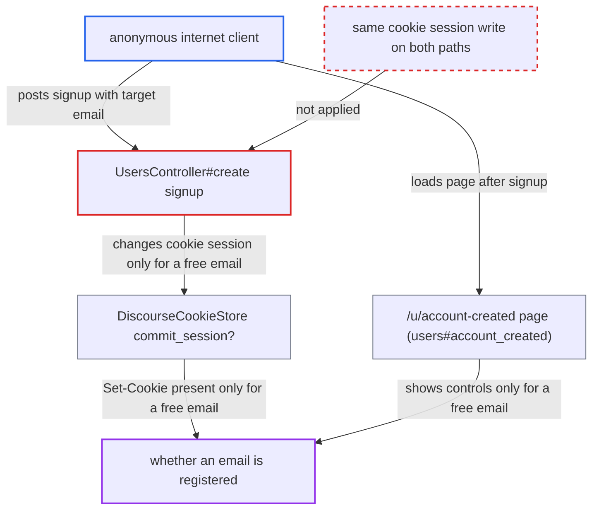

# Session Set-Cookie emitted only on real signup reveals registered emails

| Field | Value |
|---|---|
| ID | `find_016CWDc9tyABUd8eAVADr4E2` |
| Severity | **Medium** |
| Status | open |
| CWE | CWE-204 — Information exposure |
| Created | 2026-10-27T22:34:16.174962Z |
| Claude Security | https://claude.ai/security/findings/find_016CWDc9tyABUd8eAVADr4E2 |

## Description

An anonymous internet client can check whether any email address has an account, even though `hide_email_address_taken` is on (the default) to hide that. The signup response sets a `_forum_session` cookie only for an unregistered email. The cause is that `UsersController#create` writes to the cookie session only when it really creates the user.

1. **attacker** calls `GET /session/hp.json` with a cookie jar. This public endpoint hands out the honeypot and challenge values and fixes `server_session_id` in the attacker's cookie jar before signup. ([`app/controllers/session_controller.rb:832-841`](https://github.com/cx-benchmark/discourse/blob/e08ed05b4b1ef773b2de7948a8f88a7c182a3520/app/controllers/session_controller.rb#L832-L841))
2. **attacker** sends `POST /u.json` with a fresh username, a valid password, the honeypot values and the target email. `create` skips CSRF verification, so no CSRF-token session write hides the difference between the two cases. ([`app/controllers/users_controller.rb:89-95`](https://github.com/cx-benchmark/discourse/blob/e08ed05b4b1ef773b2de7948a8f88a7c182a3520/app/controllers/users_controller.rb#L89-L95))
3. **the action `create`** saves the user and writes `session[SessionController::ACTIVATE_USER_KEY]` when the email is free. This write changes the cookie session, and it happens only when `user.save` succeeds. ([`app/controllers/users_controller.rb:823-841`](https://github.com/cx-benchmark/discourse/blob/e08ed05b4b1ef773b2de7948a8f88a7c182a3520/app/controllers/users_controller.rb#L823-L841))
4. **the action `create`** writes only to the Redis-backed `server_session` when the email is already registered. The cookie session stays unchanged, while the response body is the same as in the free-email case. ([`app/controllers/users_controller.rb:844-857`](https://github.com/cx-benchmark/discourse/blob/e08ed05b4b1ef773b2de7948a8f88a7c182a3520/app/controllers/users_controller.rb#L844-L857))
5. **the cookie store `DiscourseCookieStore`** sends `Set-Cookie: _forum_session` only if the session hash changed. `commit_session?` makes the cookie header appear for a free email and stay absent for a registered one. ([`lib/action_dispatch/session/discourse_cookie_store.rb:11-31`](https://github.com/cx-benchmark/discourse/blob/e08ed05b4b1ef773b2de7948a8f88a7c182a3520/lib/action_dispatch/session/discourse_cookie_store.rb#L11-L31))
6. **attacker** reads the response headers, or loads `/u/account-created`, to learn the answer. A `Set-Cookie: _forum_session` header means the email was free. The `account_created` page fills in `username`, `email` and `show_controls` only when `session[ACTIVATE_USER_KEY]` is present, so the resend and change-email controls also appear only for a free email. ([`app/controllers/users_controller.rb:1146-1167`](https://github.com/cx-benchmark/discourse/blob/e08ed05b4b1ef773b2de7948a8f88a7c182a3520/app/controllers/users_controller.rb#L1146-L1167))

## Assessment

The attacker is an anonymous internet client and needs no login. The target must be a well-formed signup with `hide_email_address_taken` on, which is the default. The attacker makes `GET /session/hp.json` with a cookie jar, then `POST /u.json` with a fresh username, a valid password, the honeypot values and the target email. A `Set-Cookie: _forum_session` header in the response means the email was free. Activation controls on `/u/account-created` mean the same. No header means the email is registered. No defense has to be evaded.

Impact: The attacker learns whether any chosen email address has an account, which defeats `hide_email_address_taken`. Each probe of a free address creates an inactive account and mails that address. The per-IP limit `max_new_accounts_per_registration_ip` (default 3) caps how many free answers one IP gets, but not how many taken answers. No existing data is modified and the service is not degraded.

## Recommendation

The cookie session is changed (`session[ACTIVATE_USER_KEY]`) only on the real-creation path at `app/controllers/users_controller.rb:834`. `DiscourseCookieStore#commit_session?` then sends `Set-Cookie` only on that path, and `users#account_created` shows controls only when that key is present.

Fix criteria: With `hide_email_address_taken` on, the response headers of a well-formed signup do not depend on whether the email is registered. This includes whether `Set-Cookie: _forum_session` is present. The `/u/account-created` page that follows is also the same in both cases. Check this by diffing the full HTTP responses of a taken-email and a free-email signup from equivalent cookie jars. Also diff the account-created page that follows.

## Evidence

**https://github.com/cx-benchmark/discourse**

- [`app/controllers/users_controller.rb:823-841`](https://github.com/cx-benchmark/discourse/blob/e08ed05b4b1ef773b2de7948a8f88a7c182a3520/app/controllers/users_controller.rb#L823-L841)
- [`app/controllers/users_controller.rb:844-857`](https://github.com/cx-benchmark/discourse/blob/e08ed05b4b1ef773b2de7948a8f88a7c182a3520/app/controllers/users_controller.rb#L844-L857)
- [`lib/action_dispatch/session/discourse_cookie_store.rb:11-31`](https://github.com/cx-benchmark/discourse/blob/e08ed05b4b1ef773b2de7948a8f88a7c182a3520/lib/action_dispatch/session/discourse_cookie_store.rb#L11-L31)
- [`lib/freedom_patches/request_server_session.rb:3-7`](https://github.com/cx-benchmark/discourse/blob/e08ed05b4b1ef773b2de7948a8f88a7c182a3520/lib/freedom_patches/request_server_session.rb#L3-L7)
- [`app/controllers/users_controller.rb:1146-1167`](https://github.com/cx-benchmark/discourse/blob/e08ed05b4b1ef773b2de7948a8f88a7c182a3520/app/controllers/users_controller.rb#L1146-L1167)
- [`frontend/discourse/app/controllers/signup.js:560-570`](https://github.com/cx-benchmark/discourse/blob/e08ed05b4b1ef773b2de7948a8f88a7c182a3520/frontend/discourse/app/controllers/signup.js#L560-L570)
- [`app/services/user_activator.rb:63-72`](https://github.com/cx-benchmark/discourse/blob/e08ed05b4b1ef773b2de7948a8f88a7c182a3520/app/services/user_activator.rb#L63-L72)
- [`app/controllers/users_controller.rb:89-95`](https://github.com/cx-benchmark/discourse/blob/e08ed05b4b1ef773b2de7948a8f88a7c182a3520/app/controllers/users_controller.rb#L89-L95)
- [`app/controllers/session_controller.rb:832-841`](https://github.com/cx-benchmark/discourse/blob/e08ed05b4b1ef773b2de7948a8f88a7c182a3520/app/controllers/session_controller.rb#L832-L841)

