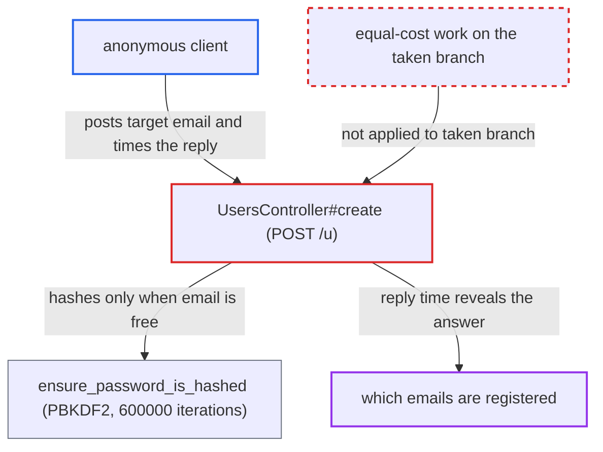

# Signup response time reveals whether an email is already registered despite hide_email_address_taken

| Field | Value |
|---|---|
| ID | `find_0149sqnexB3v6VbWxN5LGZty` |
| Severity | **Medium** |
| Status | open |
| CWE | CWE-208 — Observable timing discrepancy |
| Created | 2026-10-27T22:20:49.152713Z |
| Claude Security | https://claude.ai/security/findings/find_0149sqnexB3v6VbWxN5LGZty |

## Description

An anonymous internet client can find out whether any email address already has an account, even though `hide_email_address_taken` is on by default to hide this. The attacker only has to time the response to `POST /u`. `UsersController#create` returns the same body for both cases, but a taken email returns quickly after validation. A free email first runs a slow 600,000-iteration PBKDF2 hash and the account-creation writes.

1. **attacker** fetches the honeypot and challenge values from `GET /session/hp`. These are the only gate on anonymous signup, and any client can get them. ([`app/controllers/users_controller.rb:2179-2198`](https://github.com/cx-benchmark/discourse/blob/e08ed05b4b1ef773b2de7948a8f88a7c182a3520/app/controllers/users_controller.rb#L2179-L2198))
2. **attacker** posts to `POST /u` with the target address as `email`, plus a fresh username and a password. No login is needed, and one request answers one address. ([`app/controllers/users_controller.rb:823-857`](https://github.com/cx-benchmark/discourse/blob/e08ed05b4b1ef773b2de7948a8f88a7c182a3520/app/controllers/users_controller.rb#L823-L857))
3. **the handler `UsersController#create`** calls `user.save`, which validates the new user. If the email is already registered, validation fails because the `primary_email` errors include 'taken'. The code then queues an `account_exists` mail and renders the generic 'check your email' body right away. ([`app/controllers/users_controller.rb:823-857`](https://github.com/cx-benchmark/discourse/blob/e08ed05b4b1ef773b2de7948a8f88a7c182a3520/app/controllers/users_controller.rb#L823-L857))
4. **the hook `ensure_password_is_hashed`** derives the password hash only when the record is actually saved. This is a `before_save` hook using PBKDF2-HMAC-SHA256 at 600,000 iterations. It runs only when validation passed, so only for a free email. ([`app/models/user_password.rb:56-63`](https://github.com/cx-benchmark/discourse/blob/e08ed05b4b1ef773b2de7948a8f88a7c182a3520/app/models/user_password.rb#L56-L63))
5. **the handler `UsersController#create`** on the free-email path, also inserts the account records, runs the `after_create` hooks and calls `activation.finish` before responding. It then renders an identical body, but the response arrives much later than on the taken path. ([`app/controllers/users_controller.rb:823-857`](https://github.com/cx-benchmark/discourse/blob/e08ed05b4b1ef773b2de7948a8f88a7c182a3520/app/controllers/users_controller.rb#L823-L857))
6. **attacker** compares the response time with the expected fast and slow times. A fast 'check your email' answer means the address already has an account. One delayed by the hashing and writes means it was free. ([`config/application.rb:159-160`](https://github.com/cx-benchmark/discourse/blob/e08ed05b4b1ef773b2de7948a8f88a7c182a3520/config/application.rb#L159-L160))

## Assessment

The attacker is an anonymous internet client who needs no account. They fetch the honeypot and challenge from `GET /session/hp`, then post `POST /u` with the target email, a fresh username and a password, and time the response. `hide_email_address_taken` is on by default, so the bodies are identical and only timing differs. Volume is bounded only by the global per-IP request tracker. `SpamHandler.should_prevent_registration_from_ip?` also limits 'free' answers to 3 TL0 accounts per `ip_address` (`max_new_accounts_per_registration_ip: 3`). 'Taken' answers create no account, so they can be repeated without limit. `create` has no dedicated rate limiter.

Impact: The attacker learns whether arbitrary email addresses belong to registered accounts, which is the disclosure `hide_email_address_taken` exists to prevent. The probes are noisy. A free address gets an unactivated account and a signup mail, and a taken address's owner gets an `account_exists` mail. No existing data is changed and no service is degraded.

## Recommendation

In `UsersController#create` the taken-email branch returns right after validation, while the free-email branch first does the password hashing and account creation. The identical 'check your email' response can therefore be told apart by timing, and `create` has no throttle of its own.

Fix criteria: The time to answer a signup with an already registered email is indistinguishable from one that creates an account. For example, the taken path does an equivalent-cost derivation and defers the remaining work, or account creation and hashing move off the request path for both branches. Timing both outcomes from a client shows overlapping distributions. A per-IP and per-email throttle on `create` bounds bulk probing of address lists.

## Evidence

**https://github.com/cx-benchmark/discourse**

- [`app/controllers/users_controller.rb:823-857`](https://github.com/cx-benchmark/discourse/blob/e08ed05b4b1ef773b2de7948a8f88a7c182a3520/app/controllers/users_controller.rb#L823-L857)
- [`app/models/user_password.rb:56-63`](https://github.com/cx-benchmark/discourse/blob/e08ed05b4b1ef773b2de7948a8f88a7c182a3520/app/models/user_password.rb#L56-L63)
- [`app/models/user.rb:990-1000`](https://github.com/cx-benchmark/discourse/blob/e08ed05b4b1ef773b2de7948a8f88a7c182a3520/app/models/user.rb#L990-L1000)
- [`config/application.rb:159-160`](https://github.com/cx-benchmark/discourse/blob/e08ed05b4b1ef773b2de7948a8f88a7c182a3520/config/application.rb#L159-L160)
- [`app/controllers/users_controller.rb:2179-2198`](https://github.com/cx-benchmark/discourse/blob/e08ed05b4b1ef773b2de7948a8f88a7c182a3520/app/controllers/users_controller.rb#L2179-L2198)
- [`lib/spam_handler.rb:4-24`](https://github.com/cx-benchmark/discourse/blob/e08ed05b4b1ef773b2de7948a8f88a7c182a3520/lib/spam_handler.rb#L4-L24)
- [`config/site_settings.yml:995-998`](https://github.com/cx-benchmark/discourse/blob/e08ed05b4b1ef773b2de7948a8f88a7c182a3520/config/site_settings.yml#L995-L998)

