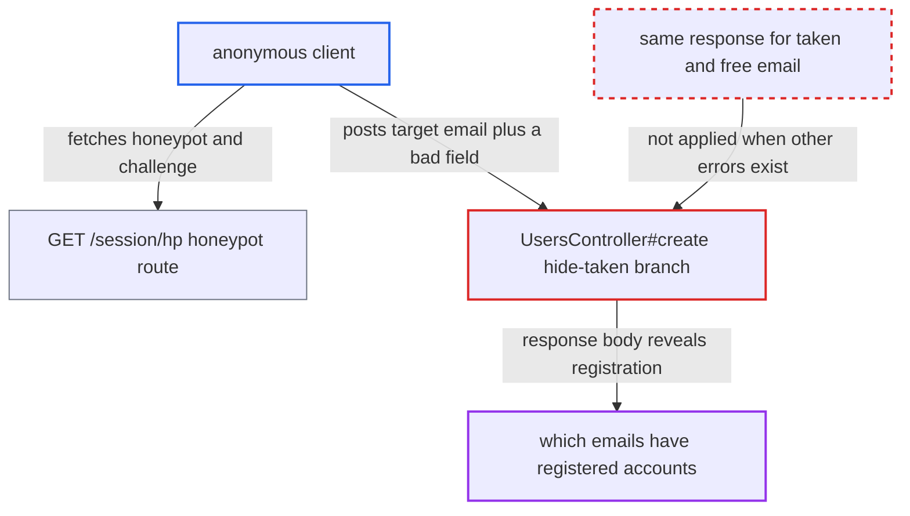

# Signup success response leaks registered emails when other validation errors are present

| Field | Value |
|---|---|
| ID | `find_01SGkHnBKSuD46ohLEDdzmnv` |
| Severity | **Medium** |
| Status | open |
| CWE | CWE-204 — Information exposure |
| Created | 2026-10-27T22:33:14.517476Z |
| Claude Security | https://claude.ai/security/findings/find_01SGkHnBKSuD46ohLEDdzmnv |

## Description

An anonymous internet client can learn whether a chosen email address belongs to a registered, non-staged forum account. The probe creates no account and can be repeated, limited only by the global per-IP request-tracker rate. It works because `UsersController#create` takes the pretend-success branch whenever the email `taken` error is present, even if other validation errors also exist. A free email with the same bad input gets a failure body instead. This defeats `hide_email_address_taken`, which is on by default.

1. **attacker** calls `GET /session/hp` to get the honeypot and challenge values. This public route stores the values in the server session and returns them, so any client with a cookie jar can pass the only gate that runs before `create`. ([`app/controllers/session_controller.rb:832-841`](https://github.com/cx-benchmark/discourse/blob/e08ed05b4b1ef773b2de7948a8f88a7c182a3520/app/controllers/session_controller.rb#L832-L841))
2. **attacker** posts to `POST /u.json` with the target email and one deliberately invalid field. The invalid field can be any existing public username, a password shorter than `min_password_length` (default 10), or a request from an IP at the per-IP TL0 cap (default 3), which needs no bad input. ([`app/controllers/users_controller.rb:2179-2198`](https://github.com/cx-benchmark/discourse/blob/e08ed05b4b1ef773b2de7948a8f88a7c182a3520/app/controllers/users_controller.rb#L2179-L2198))
3. **`User#save`** runs all validators and collects every error. `validates_associated :primary_email` copies the email `taken` error into `user.errors[:primary_email]` alongside the username, password and IP errors, and validation does not stop at the first failure. ([`app/models/user.rb:169-172`](https://github.com/cx-benchmark/discourse/blob/e08ed05b4b1ef773b2de7948a8f88a7c182a3520/app/models/user.rb#L169-L172))
4. **the handler `UsersController#create`** renders `{success: true, active: false, message: ...}` if the email `taken` error is present. The branch checks only for the `taken` message on `user.errors[:primary_email]` and ignores the other errors collected on the same save. It also queues an `account_exists` mail to the real owner. ([`app/controllers/users_controller.rb:844-857`](https://github.com/cx-benchmark/discourse/blob/e08ed05b4b1ef773b2de7948a8f88a7c182a3520/app/controllers/users_controller.rb#L844-L857))
5. **the handler `UsersController#create`** renders `{success: false, errors: {...}}` if the email is free. The same unrelated error still makes `save` fail, so the `else` branch returns a failure body that differs from the registered-email body. ([`app/controllers/users_controller.rb:858-873`](https://github.com/cx-benchmark/discourse/blob/e08ed05b4b1ef773b2de7948a8f88a7c182a3520/app/controllers/users_controller.rb#L858-L873))
6. **attacker** compares the two response bodies. The difference is deterministic, so the attacker learns whether the email belongs to a registered account without creating one.

## Assessment

The attacker is an anonymous internet client with no login. They first call the public `GET /session/hp` route with a cookie jar to get the honeypot and challenge, then send `POST /u.json` with the target email and a field that fails validation. Three ways to cause the other error are given. One is any existing non-reserved username (error `user.username.unique`). Another is a password shorter than `min_password_length`. The third is an IP that already holds the TL0 cap of `max_new_accounts_per_registration_ip`, which makes every signup from it fail with an `ip_address` error. Reserved usernames such as `system` or `admin` do not work, because the controller rejects them before `save` and gives the same answer for every email. The setting `hide_email_address_taken` must be on, which is the default.

Impact: The attacker can tell, for any email address, whether it belongs to a registered, non-staged account. Emails held only by staged users read as free, because the controller reuses the staged record. No data is changed and no account is created. Each registered answer queues an `account_exists` mail to the real owner as a side effect.

## Recommendation

The hide-taken branch in `UsersController#create` is chosen only because the email `taken` error is present. It ignores all other validation errors, so a taken email gets a different response than a free email would for the same other inputs.

Fix criteria: With `hide_email_address_taken` on, the JSON body for a registered email is byte-identical to the body for an unregistered email given the same username, password, IP state and other fields. If other validation errors exist, both cases return exactly those errors with the email error removed. The pretend-success body is returned only when the email error is the sole failure. Submit a taken and a free email with a duplicate username, with a short password, and from an IP at the TL0 cap, and confirm the responses are identical in each pair.

## Evidence

**https://github.com/cx-benchmark/discourse**

- [`app/controllers/users_controller.rb:844-857`](https://github.com/cx-benchmark/discourse/blob/e08ed05b4b1ef773b2de7948a8f88a7c182a3520/app/controllers/users_controller.rb#L844-L857)
- [`app/controllers/users_controller.rb:858-873`](https://github.com/cx-benchmark/discourse/blob/e08ed05b4b1ef773b2de7948a8f88a7c182a3520/app/controllers/users_controller.rb#L858-L873)
- [`app/models/user.rb:169-172`](https://github.com/cx-benchmark/discourse/blob/e08ed05b4b1ef773b2de7948a8f88a7c182a3520/app/models/user.rb#L169-L172)
- [`app/models/user_email.rb:86-102`](https://github.com/cx-benchmark/discourse/blob/e08ed05b4b1ef773b2de7948a8f88a7c182a3520/app/models/user_email.rb#L86-L102)
- [`app/models/user.rb:2173-2199`](https://github.com/cx-benchmark/discourse/blob/e08ed05b4b1ef773b2de7948a8f88a7c182a3520/app/models/user.rb#L2173-L2199)
- [`lib/validators/user_password_validator.rb:4-14`](https://github.com/cx-benchmark/discourse/blob/e08ed05b4b1ef773b2de7948a8f88a7c182a3520/lib/validators/user_password_validator.rb#L4-L14)
- [`lib/validators/allowed_ip_address_validator.rb:4-12`](https://github.com/cx-benchmark/discourse/blob/e08ed05b4b1ef773b2de7948a8f88a7c182a3520/lib/validators/allowed_ip_address_validator.rb#L4-L12)
- [`lib/spam_handler.rb:4-24`](https://github.com/cx-benchmark/discourse/blob/e08ed05b4b1ef773b2de7948a8f88a7c182a3520/lib/spam_handler.rb#L4-L24)
- [`app/controllers/users_controller.rb:2179-2198`](https://github.com/cx-benchmark/discourse/blob/e08ed05b4b1ef773b2de7948a8f88a7c182a3520/app/controllers/users_controller.rb#L2179-L2198)
- [`app/controllers/session_controller.rb:832-841`](https://github.com/cx-benchmark/discourse/blob/e08ed05b4b1ef773b2de7948a8f88a7c182a3520/app/controllers/session_controller.rb#L832-L841)

