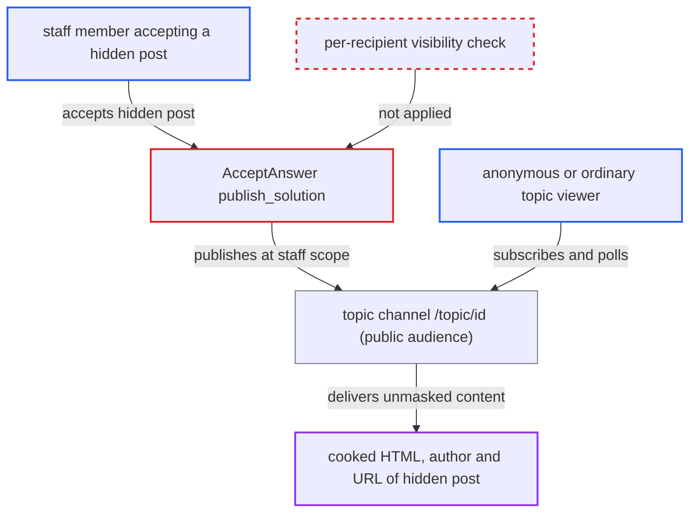

# Solved accept/unaccept broadcasts hidden accepted answers serialized with the actor's guardian

| Field | Value |
|---|---|
| ID | `find_01457Cp26VSVnnhjCuaeNA1n` |
| Severity | **Medium** |
| Status | open |
| CWE | CWE-200 — Information exposure |
| Created | 2026-10-27T22:06:54.154613Z |
| Claude Security | https://claude.ai/security/findings/find_01457Cp26VSVnnhjCuaeNA1n |

## Description

Any viewer of a solved-enabled topic, including an anonymous one, can read the full HTML, author and URL of a post that moderators hid with flags. This happens when a staff member marks that hidden post as the solution. The cause is that `AcceptAnswer#publish_solution` and `UnacceptAnswer#publish_unaccepted` serialize the broadcast with the acting user's guardian, so staff visibility is applied to every recipient. Only hidden posts that are accepted answers in topics the viewer can already see are exposed.

1. **a topic viewer** subscribes to the `/topic/<id>` channel. For a public category the audience is not restricted, so anonymous clients can poll `/message-bus` live or read the 100-message backlog. ([`app/models/topic.rb:2266-2278`](https://github.com/cx-benchmark/discourse/blob/e08ed05b4b1ef773b2de7948a8f88a7c182a3520/app/models/topic.rb#L2266-L2278))
2. **a staff member** accepts a post that flags have hidden as the solution. `can_accept_answer?` allows this, and it is a moderation action the attacker does not control. ([`plugins/discourse-solved/app/services/discourse_solved/accept_answer.rb:188-198`](https://github.com/cx-benchmark/discourse/blob/e08ed05b4b1ef773b2de7948a8f88a7c182a3520/plugins/discourse-solved/app/services/discourse_solved/accept_answer.rb#L188-L198))
3. **the method `publish_solution`** serializes the accepted answers with the staff member's `guardian`. The helper filters with `guardian.can_see_post?` and serializes with `scope: guardian`, so the hidden post passes the filter. ([`plugins/discourse-solved/lib/discourse_solved/accepted_answers_helper.rb:5-30`](https://github.com/cx-benchmark/discourse/blob/e08ed05b4b1ef773b2de7948a8f88a7c182a3520/plugins/discourse-solved/lib/discourse_solved/accepted_answers_helper.rb#L5-L30))
4. **the serializer `BasicPostSerializer`** returns the real `cooked` HTML of the hidden post. `cooked_hidden` is `object.hidden && !scope.is_staff?`, which is false for a staff scope, so nothing is masked. ([`app/serializers/basic_post_serializer.rb:21-40`](https://github.com/cx-benchmark/discourse/blob/e08ed05b4b1ef773b2de7948a8f88a7c182a3520/app/serializers/basic_post_serializer.rb#L21-L40))
5. **the method `publish_solution`** publishes the payload once on `/topic/<id>` to `topic.secure_audience_publish_messages`. The same payload goes to every subscriber, and it stays in the channel backlog for later polls. ([`plugins/discourse-solved/app/services/discourse_solved/accept_answer.rb:188-198`](https://github.com/cx-benchmark/discourse/blob/e08ed05b4b1ef773b2de7948a8f88a7c182a3520/plugins/discourse-solved/app/services/discourse_solved/accept_answer.rb#L188-L198))
6. **the topic viewer** reads the hidden post's `cooked`, author and URL from the message. The page client copies `message.accepted_answers` onto the topic and renders each `cooked`, and the raw MessageBus JSON already contains it. ([`plugins/discourse-solved/assets/javascripts/discourse/initializers/extend-for-solved-button.gjs:146-156`](https://github.com/cx-benchmark/discourse/blob/e08ed05b4b1ef773b2de7948a8f88a7c182a3520/plugins/discourse-solved/assets/javascripts/discourse/initializers/extend-for-solved-button.gjs#L146-L156))

## Assessment

The attacker is any viewer of a solved-enabled topic, with no login needed when the category is public. A post in the topic must be hidden by flags, and a staff member must mark it as the solution. In the default single-solution setup this alone exposes the post. With the non-default `solved_allow_multiple_solutions` setting, the exposure grows. Any later staff accept or unaccept re-sends all remaining accepted answers at admin scope, hidden ones included. Calls to `UnacceptAnswer` by the system user do the same: the `post_destroyed` hook, the post mover and category changes. The normal page load path (`TopicViewSerializerExtension#accepted_answers`) uses the viewer's own scope and drops the hidden post, so only the broadcast leaks.

Impact: Recipients get the full `cooked` HTML, author and URL of accepted-answer posts that moderation hid from them. They cannot get this content through any normal request. The exposure is limited to hidden posts that are accepted answers in topics the recipient can already view. Nothing is modified and service is unaffected.

## Recommendation

The `/topic/<id>` payloads in `AcceptAnswer#publish_solution` and `UnacceptAnswer#publish_unaccepted` are serialized once with the acting user's or system user's guardian. Visibility rules (`can_see_post?`, `cooked_hidden`) are therefore decided for the actor instead of for each recipient.

Fix criteria: No `accepted_solution` or `unaccepted_solution` message delivered to a non-privileged topic subscriber contains a post, or its `cooked`, that the subscriber's own guardian could not see. The payload is serialized for a viewer-neutral audience, or it carries only identifiers for clients to refetch. Check this by having staff accept a hidden post while an anonymous or TL1 client polls `/topic/<id>`: the message must not include that post's `cooked`. Also test the system-user unaccept path with multiple solutions enabled.

## Evidence

**https://github.com/cx-benchmark/discourse**

- [`plugins/discourse-solved/app/services/discourse_solved/accept_answer.rb:188-198`](https://github.com/cx-benchmark/discourse/blob/e08ed05b4b1ef773b2de7948a8f88a7c182a3520/plugins/discourse-solved/app/services/discourse_solved/accept_answer.rb#L188-L198)
- [`plugins/discourse-solved/lib/discourse_solved/accepted_answers_helper.rb:5-30`](https://github.com/cx-benchmark/discourse/blob/e08ed05b4b1ef773b2de7948a8f88a7c182a3520/plugins/discourse-solved/lib/discourse_solved/accepted_answers_helper.rb#L5-L30)
- [`app/serializers/basic_post_serializer.rb:21-40`](https://github.com/cx-benchmark/discourse/blob/e08ed05b4b1ef773b2de7948a8f88a7c182a3520/app/serializers/basic_post_serializer.rb#L21-L40)
- [`lib/guardian/post_guardian.rb:314-325`](https://github.com/cx-benchmark/discourse/blob/e08ed05b4b1ef773b2de7948a8f88a7c182a3520/lib/guardian/post_guardian.rb#L314-L325)
- [`plugins/discourse-solved/lib/discourse_solved/topic_view_serializer_extension.rb:12-14`](https://github.com/cx-benchmark/discourse/blob/e08ed05b4b1ef773b2de7948a8f88a7c182a3520/plugins/discourse-solved/lib/discourse_solved/topic_view_serializer_extension.rb#L12-L14)
- [`app/models/topic.rb:2266-2278`](https://github.com/cx-benchmark/discourse/blob/e08ed05b4b1ef773b2de7948a8f88a7c182a3520/app/models/topic.rb#L2266-L2278)
- [`plugins/discourse-solved/app/services/discourse_solved/unaccept_answer.rb:89-99`](https://github.com/cx-benchmark/discourse/blob/e08ed05b4b1ef773b2de7948a8f88a7c182a3520/plugins/discourse-solved/app/services/discourse_solved/unaccept_answer.rb#L89-L99)
- [`plugins/discourse-solved/plugin.rb:364-371`](https://github.com/cx-benchmark/discourse/blob/e08ed05b4b1ef773b2de7948a8f88a7c182a3520/plugins/discourse-solved/plugin.rb#L364-L371)
- [`plugins/discourse-solved/assets/javascripts/discourse/initializers/extend-for-solved-button.gjs:146-156`](https://github.com/cx-benchmark/discourse/blob/e08ed05b4b1ef773b2de7948a8f88a7c182a3520/plugins/discourse-solved/assets/javascripts/discourse/initializers/extend-for-solved-button.gjs#L146-L156)

