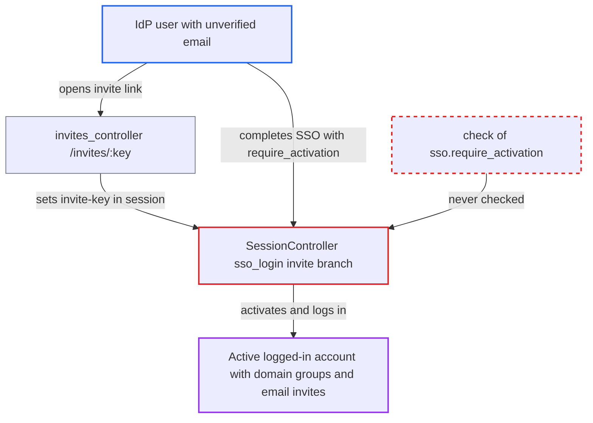

# SSO invite branch activates accounts flagged require_activation, confirming unverified emails

| Field | Value |
|---|---|
| ID | `find_01HPsKeYHYVKgFMGp5f2Grhd` |
| Severity | **Medium** |
| Status | open |
| CWE | CWE-287 — Improper Authentication |
| Created | 2026-10-27T21:20:11.186417Z |
| Claude Security | https://claude.ai/security/findings/find_01HPsKeYHYVKgFMGp5f2Grhd |

## Description

A user with an identity provider account can get an active, logged-in Discourse account tied to an email address they do not own. That account gets the domain-based groups and pending email invites for the address. The attack needs DiscourseConnect enabled, `must_approve_users` off, and any redeemable invite link. The flaw is in `SessionController#sso_login`, whose invite branch activates the user without checking `sso.require_activation`.

1. **attacker** opens a redeemable invite link. Opening `/invites/:key` stores the key in `server_session["invite-key"]`, which arms the invite branch in `sso_login`. ([`app/controllers/invites_controller.rb:648`](https://github.com/cx-benchmark/discourse/blob/e08ed05b4b1ef773b2de7948a8f88a7c182a3520/app/controllers/invites_controller.rb#L648))
2. **attacker** signs in through the identity provider with an unverified email such as `x@corp.example`. The provider marks the payload with `require_activation=true`, meaning the email is not verified.
3. **`DiscourseConnect#match_email_or_create_user`** skips the email lookup and creates an inactive user. This is meant to keep the account inactive until an activation email proves the address. ([`app/models/discourse_connect.rb:245-265`](https://github.com/cx-benchmark/discourse/blob/e08ed05b4b1ef773b2de7948a8f88a7c182a3520/app/models/discourse_connect.rb#L245-L265))
4. **the handler `sso_login`** takes the invite branch before the `elsif !user.active?` branch. The invite branch redeems the invite, calls `user.activate` and `login_sso_user`, and never reads `sso.require_activation`. ([`app/controllers/session_controller.rb:261-277`](https://github.com/cx-benchmark/discourse/blob/e08ed05b4b1ef773b2de7948a8f88a7c182a3520/app/controllers/session_controller.rb#L261-L277))
5. **`User#activate`** creates and confirms a signup `EmailToken` for the unverified email. The address is treated as confirmed without any email being sent. ([`app/models/user.rb:1550-1554`](https://github.com/cx-benchmark/discourse/blob/e08ed05b4b1ef773b2de7948a8f88a7c182a3520/app/models/user.rb#L1550-L1554))
6. **`EmailToken.confirm`** marks the user active and applies email-based access. It runs `set_automatic_groups` for matching `automatic_membership_email_domains` and `Invite.redeem_for_existing_user` for pending email invites on that address. ([`app/models/email_token.rb:51-67`](https://github.com/cx-benchmark/discourse/blob/e08ed05b4b1ef773b2de7948a8f88a7c182a3520/app/models/email_token.rb#L51-L67))

## Assessment

The attacker needs an account at the identity provider and the ability to set an unverified email there, which the provider flags with `require_activation=true`. They also need any redeemable invite link. It can be a shared link, or one they create themselves as a TL2 user, since `invite_allowed_groups` includes TL2 by default. For invite links the `email` is NULL, so `validate_invitation!` makes no email check. Any invite `domain` is checked against the same unverified email. Preconditions are DiscourseConnect enabled and `must_approve_users` off.

Impact: The attacker gets an active, logged-in account bound to an email they do not own. It has the domain-based group access and any pending email invite for that address, including its groups, private-message topics and moderator grant. They can post as that identity. Existing accounts are not taken over, because a duplicate primary email makes `user.save!` fail.

## Recommendation

The invite branch of `sso_login` calls `user.activate` and logs in a user created from a payload flagged `require_activation`. That confirms the unverified email, which triggers domain automatic groups and email-invite redemption.

Fix criteria: When `sso.require_activation` is true and the user is inactive, no path in `sso_login` activates, confirms the email of, or logs in the user before the emailed activation token is confirmed. A test with an invite key in the session and a signed payload with `require_activation=true` leaves the user `active: false`. The test also shows no automatic or invite groups granted, no session logged in, and an activation email sent.

## Evidence

**https://github.com/cx-benchmark/discourse**

- [`app/controllers/session_controller.rb:261-277`](https://github.com/cx-benchmark/discourse/blob/e08ed05b4b1ef773b2de7948a8f88a7c182a3520/app/controllers/session_controller.rb#L261-L277)
- [`app/models/discourse_connect.rb:245-265`](https://github.com/cx-benchmark/discourse/blob/e08ed05b4b1ef773b2de7948a8f88a7c182a3520/app/models/discourse_connect.rb#L245-L265)
- [`app/models/discourse_connect.rb:137-142`](https://github.com/cx-benchmark/discourse/blob/e08ed05b4b1ef773b2de7948a8f88a7c182a3520/app/models/discourse_connect.rb#L137-L142)
- [`app/models/user.rb:1550-1554`](https://github.com/cx-benchmark/discourse/blob/e08ed05b4b1ef773b2de7948a8f88a7c182a3520/app/models/user.rb#L1550-L1554)
- [`app/models/email_token.rb:51-67`](https://github.com/cx-benchmark/discourse/blob/e08ed05b4b1ef773b2de7948a8f88a7c182a3520/app/models/email_token.rb#L51-L67)
- [`app/models/user.rb:1832-1845`](https://github.com/cx-benchmark/discourse/blob/e08ed05b4b1ef773b2de7948a8f88a7c182a3520/app/models/user.rb#L1832-L1845)
- [`app/models/invite.rb:266-272`](https://github.com/cx-benchmark/discourse/blob/e08ed05b4b1ef773b2de7948a8f88a7c182a3520/app/models/invite.rb#L266-L272)
- [`app/controllers/session_controller.rb:1539-1574`](https://github.com/cx-benchmark/discourse/blob/e08ed05b4b1ef773b2de7948a8f88a7c182a3520/app/controllers/session_controller.rb#L1539-L1574)
- [`app/controllers/invites_controller.rb:648`](https://github.com/cx-benchmark/discourse/blob/e08ed05b4b1ef773b2de7948a8f88a7c182a3520/app/controllers/invites_controller.rb#L648)

