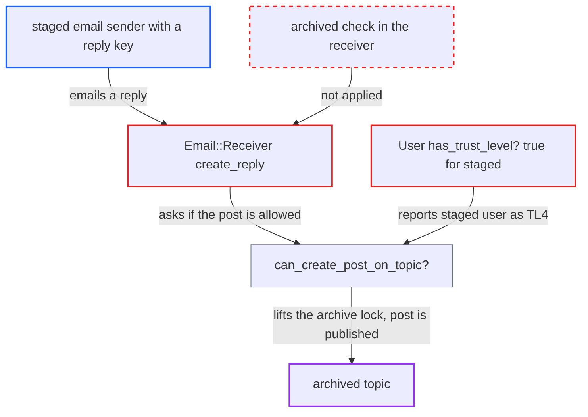

# Staged email senders count as TL4 and can reply by email to archived topics

| Field | Value |
|---|---|
| ID | `find_0162GHsFXu71dfx2MgX8BQ5T` |
| Severity | **Medium** |
| Status | open |
| CWE | CWE-863 — Incorrect Authorization |
| Created | 2026-10-27T22:08:01.035019Z |
| Claude Security | https://claude.ai/security/findings/find_0162GHsFXu71dfx2MgX8BQ5T |

## Description

An anonymous email sender can publish replies in topics that staff have archived to freeze them. Registered members below TL4 are refused. The attack needs a staged account that holds a reply key, plus `reply_by_email_enabled` and email-in set up, which are not defaults. The cause is `User#has_trust_level?`, which returns true for every staged account, so the archive lock in `can_create_post_on_topic?` is skipped, and the email receiver has no archive check of its own.

1. **the mailer in `user_notifications.rb`** sends a notification email with a reply key to a staged user. Staged recipients get emails that allow reply by email, and `Email::Sender#get_reply_key` creates a per-user `PostReplyKey` for them. ([`app/mailers/user_notifications.rb:917-918`](https://github.com/cx-benchmark/discourse/blob/e08ed05b4b1ef773b2de7948a8f88a7c182a3520/app/mailers/user_notifications.rb#L917-L918))
2. **staff** archive the topic to freeze it. The archive lock is meant to stop new replies from everyone except staff, group moderators and real TL4 members.
3. **the staged sender** replies by email to the old notification. The reply key is still valid, which by default lasts up to 90 days after the last notification. ([`lib/email/receiver.rb:923-943`](https://github.com/cx-benchmark/discourse/blob/e08ed05b4b1ef773b2de7948a8f88a7c182a3520/lib/email/receiver.rb#L923-L943))
4. **the receiver `process_destination`** accepts the reply after a pre-check that ignores archiving. The pre-check `can_create_post?` resolves to `can_create_post_in_topic?`, which tests only PM visibility, auto-silence and category create permission. ([`lib/guardian/post_guardian.rb:461-472`](https://github.com/cx-benchmark/discourse/blob/e08ed05b4b1ef773b2de7948a8f88a7c182a3520/lib/guardian/post_guardian.rb#L461-L472))
5. **the receiver method `create_reply`** rejects closed topics but lets archived topics through. It raises only for `closed?` at line 1355, so the reply goes on to the post creation code. ([`lib/email/receiver.rb:1335-1361`](https://github.com/cx-benchmark/discourse/blob/e08ed05b4b1ef773b2de7948a8f88a7c182a3520/lib/email/receiver.rb#L1335-L1361))
6. **`PostCreator#valid?`** asks Guardian whether the post is allowed and gets yes. `can_create_post_on_topic?` treats the staged user as TL4 because `has_trust_level?` returns true for any `staged?` account, so the archive lock is lifted. ([`lib/guardian/topic_guardian.rb:85-96`](https://github.com/cx-benchmark/discourse/blob/e08ed05b4b1ef773b2de7948a8f88a7c182a3520/lib/guardian/topic_guardian.rb#L85-L96))
7. **`PostCreator#valid?`** returns early and the post is saved. The receiver sets `skip_validations: user.staged?`, so line 180 returns true. ([`lib/post_creator.rb:172-180`](https://github.com/cx-benchmark/discourse/blob/e08ed05b4b1ef773b2de7948a8f88a7c182a3520/lib/post_creator.rb#L172-L180))

## Assessment

The attacker is an anonymous email sender who became a staged user, either by mailing a category with `email_in_allow_strangers` or by joining a public topic by email. They hold a reply key from a notification email. The site needs `reply_by_email_enabled` and email-in configured, which are not defaults. After staff archive the topic, the attacker replies to the old notification within the key lifetime, which is 90 days by default (`disallow_reply_by_email_after_days`) until `Jobs::CleanUpPostReplyKeys` deletes the key. No victim action is needed.

Impact: The attacker can add posts to topics that staff archived, which every non-TL4, non-staff member must respect, and topic watchers are notified. They are limited to topics in categories they may post in and for which they hold an unexpired reply key. Staff can delete the posts. Nothing is disclosed and the service is not degraded.

## Recommendation

(1) `User#has_trust_level?` counts staged (unauthenticated email) accounts as having every trust level. Every trust-level gate therefore treats an email stranger as a Leader.

Fix criteria: A staged user does not pass any trust-level gate above their real `trust_level`, or at least not the TL4 exemption in `can_create_post_on_topic?`. `Guardian.new(staged_user).can_create?(Post, archived_topic)` returns false. A reply-key email from a staged sender to an archived topic creates no post.

(2) The inbound-email reply path enforces the closed lock itself, but for the archived lock it relies on trust-level-gated Guardian logic.

Fix criteria: Email replies to an archived topic from a sender who is not staff, not a category group moderator and not a genuine TL4 member are rejected with a clear error, as replies to closed topics already are. Receiver specs cover staged and TL0 senders replying to archived topics and pass.

## Evidence

**https://github.com/cx-benchmark/discourse**

- [`app/models/user.rb:1516-1520`](https://github.com/cx-benchmark/discourse/blob/e08ed05b4b1ef773b2de7948a8f88a7c182a3520/app/models/user.rb#L1516-L1520)
- [`lib/guardian/topic_guardian.rb:85-96`](https://github.com/cx-benchmark/discourse/blob/e08ed05b4b1ef773b2de7948a8f88a7c182a3520/lib/guardian/topic_guardian.rb#L85-L96)
- [`lib/email/receiver.rb:923-943`](https://github.com/cx-benchmark/discourse/blob/e08ed05b4b1ef773b2de7948a8f88a7c182a3520/lib/email/receiver.rb#L923-L943)
- [`lib/email/receiver.rb:1335-1361`](https://github.com/cx-benchmark/discourse/blob/e08ed05b4b1ef773b2de7948a8f88a7c182a3520/lib/email/receiver.rb#L1335-L1361)
- [`lib/guardian/post_guardian.rb:461-472`](https://github.com/cx-benchmark/discourse/blob/e08ed05b4b1ef773b2de7948a8f88a7c182a3520/lib/guardian/post_guardian.rb#L461-L472)
- [`lib/post_creator.rb:172-180`](https://github.com/cx-benchmark/discourse/blob/e08ed05b4b1ef773b2de7948a8f88a7c182a3520/lib/post_creator.rb#L172-L180)
- [`app/mailers/user_notifications.rb:917-918`](https://github.com/cx-benchmark/discourse/blob/e08ed05b4b1ef773b2de7948a8f88a7c182a3520/app/mailers/user_notifications.rb#L917-L918)

