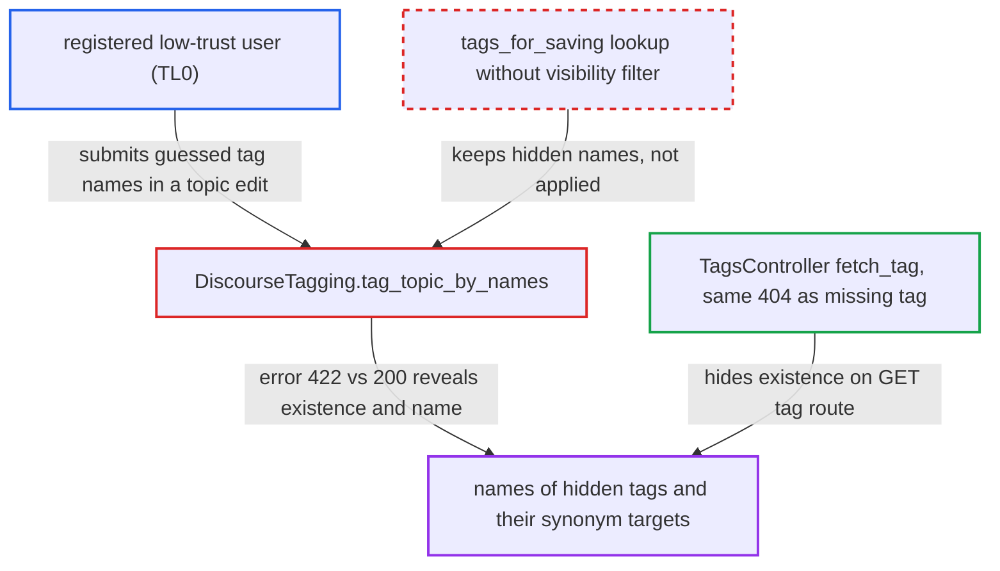

# Tag-save error reveals existence of hidden tag names to low-trust users

| Field | Value |
|---|---|
| ID | `find_01XdMNs61Mi5nYiPHM5Sf3c1` |
| Severity | **Medium** |
| Status | open |
| CWE | CWE-203 — Observable Discrepancy |
| Created | 2026-10-27T21:19:26.911720Z |
| Claude Security | https://claude.ai/security/findings/find_01XdMNs61Mi5nYiPHM5Sf3c1 |

## Description

A low-trust registered user can find out whether tags hidden from them exist, and read their stored names. Hidden synonyms also reveal the hidden target tag's name. The attacker needs only a topic they can edit, with the default setting that lets TL0 tag topics. `DiscourseTagging.tag_topic_by_names` fails with a named error for a hidden tag but silently drops a name that does not exist.

1. **attacker** sends a topic edit with a guessed tag name. The attacker is a registered user who can edit their own topic and sends `PUT /t/<slug>/<id>` with `tags[]=<guess>`. ([`app/controllers/topics_controller.rb:421-515`](https://github.com/cx-benchmark/discourse/blob/e08ed05b4b1ef773b2de7948a8f88a7c182a3520/app/controllers/topics_controller.rb#L421-L515))
2. **`PostRevisor#apply_tag_changes`** passes the submitted names to `DiscourseTagging.tag_topic_by_names`. It runs for any user with `can_tag_topics?`, which by default includes TL0 because `tag_topic_allowed_groups` defaults to 1|2|10. ([`lib/post_revisor.rb:44-55`](https://github.com/cx-benchmark/discourse/blob/e08ed05b4b1ef773b2de7948a8f88a7c182a3520/lib/post_revisor.rb#L44-L55))
3. **`tags_for_saving`** looks up each name without checking whether the caller can see the tag. `Tag.where_name` is case-insensitive and has no visibility filter, so an existing hidden tag is kept. An unknown name is kept only if `can_create_tag?` allows it, so for default low-trust users it is silently dropped. ([`lib/discourse_tagging.rb:926-939`](https://github.com/cx-benchmark/discourse/blob/e08ed05b4b1ef773b2de7948a8f88a7c182a3520/lib/discourse_tagging.rb#L926-L939))
4. **`DiscourseTagging.tag_topic_by_names`** fails the save with `tags.restricted_tag_disallowed` when the name is in `hidden_tag_names(guardian)`. The error reads 'You cannot apply the tag "\<name>".' and uses the stored name. A synonym is first swapped for its target, so the error then shows the hidden target's name. ([`lib/discourse_tagging.rb:41-84`](https://github.com/cx-benchmark/discourse/blob/e08ed05b4b1ef773b2de7948a8f88a7c182a3520/lib/discourse_tagging.rb#L41-L84))
5. **`TopicsController`** returns 422 with the error for a hidden tag, or 200 for a name that does not exist. The attacker compares status and body. Repeating this over a wordlist enumerates the hidden tag names. ([`app/controllers/topics_controller.rb:421-515`](https://github.com/cx-benchmark/discourse/blob/e08ed05b4b1ef773b2de7948a8f88a7c182a3520/app/controllers/topics_controller.rb#L421-L515))

## Assessment

The attacker is a registered user in the default `tag_topic_allowed_groups` (TL0) who can edit a topic they own. No victim action is needed. The 200 result for an unknown name applies to callers outside `create_tag_allowed_groups`, which by default is everyone below TL3. Visible read-only tags give the same error, but they are listed in `/tags.json`, so the attacker can tell them apart.

Impact: The attacker learns whether guessed names exist among tags hidden from them, such as staff-only tags, and gets each tag's stored name. Only existence and names are disclosed. A tag's topics and description are not, and nothing is modified.

## Recommendation

`tag_topic_by_names` answers a hidden tag name with an explicit error naming it, resolving synonyms to the hidden target, but silently drops a non-existent name. This is because `tags_for_saving` resolves names without the caller's tag visibility.

Fix criteria: For a caller who cannot see a tag, including a hidden synonym, submitting its name gives a response indistinguishable from submitting a name that does not exist: same status, same message and same resulting tag set. Hidden target names are never echoed. From a TL0 account, `PUT /t/<slug>/<id>` with a hidden tag's name, a hidden synonym's name and a random name all give identical responses.

## Evidence

**https://github.com/cx-benchmark/discourse**

- [`lib/discourse_tagging.rb:41-84`](https://github.com/cx-benchmark/discourse/blob/e08ed05b4b1ef773b2de7948a8f88a7c182a3520/lib/discourse_tagging.rb#L41-L84)
- [`lib/discourse_tagging.rb:926-939`](https://github.com/cx-benchmark/discourse/blob/e08ed05b4b1ef773b2de7948a8f88a7c182a3520/lib/discourse_tagging.rb#L926-L939)
- [`lib/post_revisor.rb:44-55`](https://github.com/cx-benchmark/discourse/blob/e08ed05b4b1ef773b2de7948a8f88a7c182a3520/lib/post_revisor.rb#L44-L55)
- [`app/controllers/topics_controller.rb:421-515`](https://github.com/cx-benchmark/discourse/blob/e08ed05b4b1ef773b2de7948a8f88a7c182a3520/app/controllers/topics_controller.rb#L421-L515)
- [`lib/guardian/tag_guardian.rb:4-9`](https://github.com/cx-benchmark/discourse/blob/e08ed05b4b1ef773b2de7948a8f88a7c182a3520/lib/guardian/tag_guardian.rb#L4-L9)
- [`app/controllers/tags_controller.rb:534`](https://github.com/cx-benchmark/discourse/blob/e08ed05b4b1ef773b2de7948a8f88a7c182a3520/app/controllers/tags_controller.rb#L534)
- [`app/services/tags/search.rb:199-204`](https://github.com/cx-benchmark/discourse/blob/e08ed05b4b1ef773b2de7948a8f88a7c182a3520/app/services/tags/search.rb#L199-L204)

