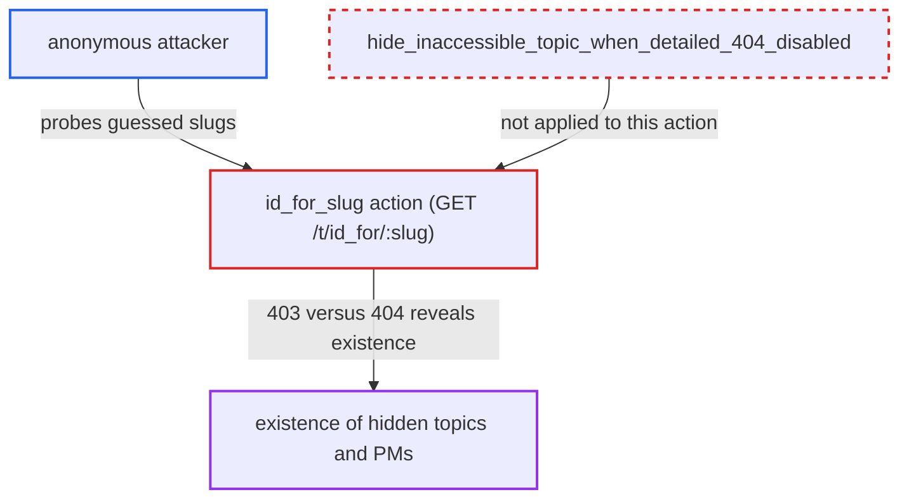

# Topic id_for_slug endpoint reveals existence of hidden topics and PMs via 403/404

| Field | Value |
|---|---|
| ID | `find_01CU9ZpvSutipo1oPo4AodXH` |
| Severity | **Medium** |
| Status | open |
| CWE | CWE-204 — Observable response discrepancy |
| Created | 2026-10-27T21:18:44.505497Z |
| Claude Security | https://claude.ai/security/findings/find_01CU9ZpvSutipo1oPo4AodXH |

## Description

Anyone on the internet, without an account, can tell whether a hidden topic or personal message exists, by guessing the slug of its title. Only existence leaks: no title, content, id or participants. The endpoint `GET /t/id_for/:slug` answers 403 for a hidden topic and 404 for an unknown slug. This happens because `id_for_slug` never applies the `detailed_404` policy, which is off by default.

1. **anonymous attacker** requests `GET /t/id_for/<candidate-slug>.json` for a guessed slug. The route is not in the `requires_login` list, and the `.json` suffix satisfies `check_xhr`, so no account is needed. ([`config/routes.rb:1629`](https://github.com/cx-benchmark/discourse/blob/e08ed05b4b1ef773b2de7948a8f88a7c182a3520/config/routes.rb#L1629))
2. **the action `id_for_slug`** looks the slug up among all topics, live ones first and then deleted ones. The lookup uses `Topic.find_by_slug` and then `Topic.with_deleted.find_by_slug`, with no archetype or category restriction, so private categories and personal messages are included. ([`app/controllers/topics_controller.rb:59-68`](https://github.com/cx-benchmark/discourse/blob/e08ed05b4b1ef773b2de7948a8f88a7c182a3520/app/controllers/topics_controller.rb#L59-L68))
3. **the action `id_for_slug`** raises `Discourse::NotFound` when no topic matches. This produces a 404 response. ([`app/controllers/topics_controller.rb:59-68`](https://github.com/cx-benchmark/discourse/blob/e08ed05b4b1ef773b2de7948a8f88a7c182a3520/app/controllers/topics_controller.rb#L59-L68))
4. **the action `id_for_slug`** calls `guardian.ensure_can_see!` when a topic matches, which raises `Discourse::InvalidAccess` if the caller may not see it. `SiteSetting.detailed_404` is never checked, and `id_for_slug` is not in the `around_action` list that runs `hide_inaccessible_topic_when_detailed_404_disabled`, so the error is not turned into a 404. ([`app/controllers/topics_controller.rb:1367-1376`](https://github.com/cx-benchmark/discourse/blob/e08ed05b4b1ef773b2de7948a8f88a7c182a3520/app/controllers/topics_controller.rb#L1367-L1376))
5. **`ApplicationController`** renders `Discourse::InvalidAccess` as a 403 with type `invalid_access`. This differs from the 404 `not_found` response for an unknown slug. ([`app/controllers/application_controller.rb:249-260`](https://github.com/cx-benchmark/discourse/blob/e08ed05b4b1ef773b2de7948a8f88a7c182a3520/app/controllers/application_controller.rb#L249-L260))
6. **anonymous attacker** compares the status codes to learn which guessed slugs belong to hidden topics. A 403 means a hidden topic or personal message exists whose title turns into that slug through `Slug.for`, and a 404 means none does.

## Assessment

The attacker is anyone who can reach the site over the network. No account, special setting or victim action is needed. The attack works while `detailed_404` is off, which is the shipped default. In that state the documented policy is that users must not learn whether a URL points to a valid topic. The attacker guesses slugs from likely titles, such as an incident name, a person's name or a project codename, and requests `/t/id_for/<slug>.json` for each. Another way in is `show_by_external_id`, which has the same 404 versus 403 split for `external_id` values. Those values are less guessable.

Impact: The attacker can confirm, one guess at a time, that a hidden topic or personal message exists with a title that turns into a given slug. This includes topics in read-restricted categories and deleted topics in such categories. The report limits the leak to this yes-or-no answer. The 403 body has no title, content, id or participants, and the JSON body with `topic_id` and `url` is only sent to callers who can see the topic.

## Recommendation

`id_for_slug` and `show_by_external_id` return a 403 for topics the caller cannot see and a 404 for unknown values. This bypasses the `detailed_404` policy that the `show` action applies to hide whether a topic exists.

Fix criteria: With `SiteSetting.detailed_404` disabled, a slug or external id that matches only topics the caller cannot see gets exactly the same response (status, headers, body) as one that matches nothing. To check, request `/t/id_for/<slug>.json` as an anonymous user for a private-category topic and for a PM, and compare with a nonexistent slug. All three should return 404 with identical bodies.

## Evidence

**https://github.com/cx-benchmark/discourse**

- [`app/controllers/topics_controller.rb:59-68`](https://github.com/cx-benchmark/discourse/blob/e08ed05b4b1ef773b2de7948a8f88a7c182a3520/app/controllers/topics_controller.rb#L59-L68)
- [`config/routes.rb:1629`](https://github.com/cx-benchmark/discourse/blob/e08ed05b4b1ef773b2de7948a8f88a7c182a3520/config/routes.rb#L1629)
- [`app/controllers/topics_controller.rb:1367-1376`](https://github.com/cx-benchmark/discourse/blob/e08ed05b4b1ef773b2de7948a8f88a7c182a3520/app/controllers/topics_controller.rb#L1367-L1376)
- [`app/controllers/topics_controller.rb:1466-1471`](https://github.com/cx-benchmark/discourse/blob/e08ed05b4b1ef773b2de7948a8f88a7c182a3520/app/controllers/topics_controller.rb#L1466-L1471)
- [`app/controllers/topics_controller.rb:70-75`](https://github.com/cx-benchmark/discourse/blob/e08ed05b4b1ef773b2de7948a8f88a7c182a3520/app/controllers/topics_controller.rb#L70-L75)
- [`app/controllers/application_controller.rb:249-260`](https://github.com/cx-benchmark/discourse/blob/e08ed05b4b1ef773b2de7948a8f88a7c182a3520/app/controllers/application_controller.rb#L249-L260)
- [`config/locales/server.en.yml:2263`](https://github.com/cx-benchmark/discourse/blob/e08ed05b4b1ef773b2de7948a8f88a7c182a3520/config/locales/server.en.yml#L2263)

