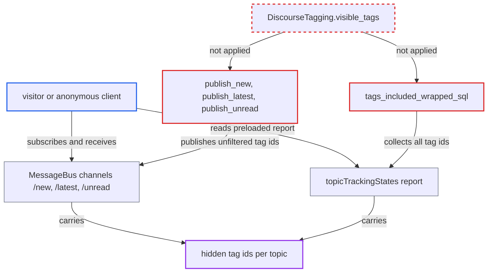

# Topic tracking state leaks hidden tag ids to users who cannot see them

| Field | Value |
|---|---|
| ID | `find_01E7dYBrJhX72Hnaut8oMYq1` |
| Severity | **Medium** |
| Status | open |
| CWE | CWE-212 — Information exposure |
| Created | 2026-10-27T22:12:06.313804Z |
| Claude Security | https://claude.ai/security/findings/find_01E7dYBrJhX72Hnaut8oMYq1 |

## Description

Any visitor, including an anonymous one, can learn which readable topics carry hidden tags from restricted tag groups. They can also see how many hidden tags each topic has and which topics share one. Tag names and restricted topic content are not exposed. The tracking-state code (`TopicTrackingState`) sends tag ids to everyone who may see the category and never applies the tag-group visibility rule.

1. **attacker** subscribes to the `/latest` or `/new` MessageBus channel. For a public category `secure_category_group_ids` returns `nil`, so the message goes to every MessageBus client, anonymous ones included. ([`app/models/topic_tracking_state.rb:645-657`](https://github.com/cx-benchmark/discourse/blob/e08ed05b4b1ef773b2de7948a8f88a7c182a3520/app/models/topic_tracking_state.rb#L645-L657))
2. **registered user** optionally replies to a topic to force a broadcast. Every non-whisper post makes the job call `publish_latest`, so anyone who can reply can make the topic's tag ids be sent. ([`app/jobs/regular/post_update_topic_tracking_state.rb:15-21`](https://github.com/cx-benchmark/discourse/blob/e08ed05b4b1ef773b2de7948a8f88a7c182a3520/app/jobs/regular/post_update_topic_tracking_state.rb#L15-L21))
3. **the method `publish_latest`** puts every tag id of the topic into the payload. It uses `topic.tags.pluck(:id)` and never filters by what the receiving user may see; `publish_new` and `publish_unread` do the same. ([`app/models/topic_tracking_state.rb:64-79`](https://github.com/cx-benchmark/discourse/blob/e08ed05b4b1ef773b2de7948a8f88a7c182a3520/app/models/topic_tracking_state.rb#L64-L79))
4. **`tags_included_wrapped_sql`** adds every `topic_tags` id to the per-user report. The report is preloaded as `topicTrackingStates` on every logged-in page, so a logged-in attacker gets the same ids without MessageBus. ([`app/models/topic_tracking_state.rb:352-364`](https://github.com/cx-benchmark/discourse/blob/e08ed05b4b1ef773b2de7948a8f88a7c182a3520/app/models/topic_tracking_state.rb#L352-L364))
5. **attacker** compares the received ids with the public `/tags.json` list. Any id that is not in that list belongs to a hidden tag, which shows which topics carry restricted labels and which share the same one.

## Assessment

The attacker can be any visitor, with no login and no victim action. Tagging must be enabled, which is the shipped default (`tagging_enabled: default: true`). For a public category, an anonymous MessageBus client that listens on `/latest` or `/new` receives the tag ids whenever a topic is created, replied to or bumped, which is routine activity. A registered user can also force a broadcast by replying to the topic, and gets the same ids in the preloaded `topicTrackingStates`. Recipients are chosen only by category security.

Impact: The attacker sees which readable topics staff marked with restricted tags, how many each has, and which topics share the same hidden tag. Only ids leak: names are not disclosed because `fetch_tag` returns 404 for hidden ids, and no restricted topic content is exposed. Nothing is modified and service is unaffected.

## Recommendation

(1) `publish_new`, `publish_latest` and `publish_unread` put the full `topic_tags` id set into messages whose audience is chosen only by category permission. This bypasses the tag-group visibility rule that `DiscourseTagging.visible_tags` enforces elsewhere.

Fix criteria: No tracking-state MessageBus message received by a user contains the id of a tag that user's guardian cannot see. Test it with an admins-only tag group: reply to a public topic that carries such a tag. The `/latest`, `/new` and `/unread` messages received by a non-admin client, or an anonymous one, must not contain that id.

(2) `tags_included_wrapped_sql` collects every `topic_tags` id into the per-user report without limiting it to the tags the reporting user can see.

Fix criteria: The `tags` in `TopicTrackingState.report(user)`, and so in `topicTrackingStates` and `/u/:username/topic-tracking-state.json`, include only tags that user may see. Test it: a regular user's preloaded state for a new topic with a hidden tag omits that tag's id, while an admin's still includes it.

## Evidence

**https://github.com/cx-benchmark/discourse**

- [`app/models/topic_tracking_state.rb:64-79`](https://github.com/cx-benchmark/discourse/blob/e08ed05b4b1ef773b2de7948a8f88a7c182a3520/app/models/topic_tracking_state.rb#L64-L79)
- [`app/models/topic_tracking_state.rb:43-61`](https://github.com/cx-benchmark/discourse/blob/e08ed05b4b1ef773b2de7948a8f88a7c182a3520/app/models/topic_tracking_state.rb#L43-L61)
- [`app/models/topic_tracking_state.rb:158-168`](https://github.com/cx-benchmark/discourse/blob/e08ed05b4b1ef773b2de7948a8f88a7c182a3520/app/models/topic_tracking_state.rb#L158-L168)
- [`app/models/topic_tracking_state.rb:352-364`](https://github.com/cx-benchmark/discourse/blob/e08ed05b4b1ef773b2de7948a8f88a7c182a3520/app/models/topic_tracking_state.rb#L352-L364)
- [`app/models/topic_tracking_state.rb:645-657`](https://github.com/cx-benchmark/discourse/blob/e08ed05b4b1ef773b2de7948a8f88a7c182a3520/app/models/topic_tracking_state.rb#L645-L657)
- [`lib/application_layout_preloader.rb:90-94`](https://github.com/cx-benchmark/discourse/blob/e08ed05b4b1ef773b2de7948a8f88a7c182a3520/lib/application_layout_preloader.rb#L90-L94)
- [`app/jobs/regular/post_update_topic_tracking_state.rb:15-21`](https://github.com/cx-benchmark/discourse/blob/e08ed05b4b1ef773b2de7948a8f88a7c182a3520/app/jobs/regular/post_update_topic_tracking_state.rb#L15-L21)
- [`app/models/topic.rb:2311-2316`](https://github.com/cx-benchmark/discourse/blob/e08ed05b4b1ef773b2de7948a8f88a7c182a3520/app/models/topic.rb#L2311-L2316)
- [`lib/discourse_tagging.rb:738-753`](https://github.com/cx-benchmark/discourse/blob/e08ed05b4b1ef773b2de7948a8f88a7c182a3520/lib/discourse_tagging.rb#L738-L753)
- [`app/controllers/tags_controller.rb:519-536`](https://github.com/cx-benchmark/discourse/blob/e08ed05b4b1ef773b2de7948a8f88a7c182a3520/app/controllers/tags_controller.rb#L519-L536)

