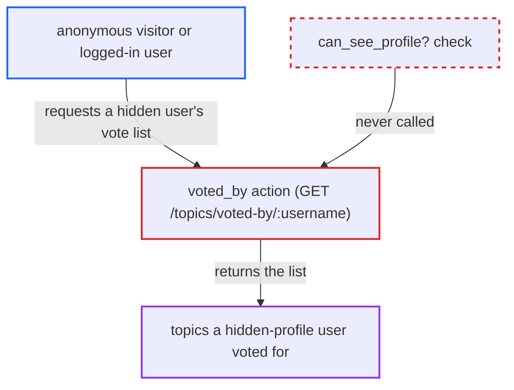

# Topic voting voted-by list ignores hidden-profile and public-profile restrictions

| Field | Value |
|---|---|
| ID | `find_01TwdfPCvdQV72o5yUiqLfDn` |
| Severity | **Medium** |
| Status | open |
| CWE | CWE-862 — Missing Authorization |
| Created | 2026-10-27T21:41:25.523255Z |
| Claude Security | https://claude.ai/security/findings/find_01TwdfPCvdQV72o5yUiqLfDn |

## Description

Anonymous visitors and any logged-in user can see which topics a privacy-protected user voted for. This covers users who set `hide_profile`, TL0 users with no posts, and all users when `hide_user_profiles_from_public` is on. The action `voted_by` never calls `guardian.can_see_profile?`, so those profile-hiding settings are ignored. Only topics the viewer can already see are listed.

1. **attacker** requests `GET /topics/voted-by/<username>.json` for a user whose profile is hidden from them. The target is hidden through `hide_profile`, through `hide_new_user_profiles` (a TL0 user with no posts), or through `hide_user_profiles_from_public` for an anonymous viewer. No login is needed. ([`plugins/discourse-topic-voting/plugin.rb:245-249`](https://github.com/cx-benchmark/discourse/blob/e08ed05b4b1ef773b2de7948a8f88a7c182a3520/plugins/discourse-topic-voting/plugin.rb#L245-L249))
2. **the action `voted_by`** accepts the request without requiring a login. Line 9 of the extension skips `ensure_logged_in` for this action, so anonymous callers reach it. ([`plugins/discourse-topic-voting/lib/discourse_topic_voting/list_controller_extension.rb:12-19`](https://github.com/cx-benchmark/discourse/blob/e08ed05b4b1ef773b2de7948a8f88a7c182a3520/plugins/discourse-topic-voting/lib/discourse_topic_voting/list_controller_extension.rb#L12-L19))
3. **the action `voted_by`** looks up the target user with `fetch_user_from_params`. The only visibility check there is `guardian.ensure_can_see!(user)`, and `can_see_user?` always returns true. The action never calls `ensure_can_see_profile!` or `guardian.can_see_profile?` for the target. ([`plugins/discourse-topic-voting/lib/discourse_topic_voting/list_controller_extension.rb:12-19`](https://github.com/cx-benchmark/discourse/blob/e08ed05b4b1ef773b2de7948a8f88a7c182a3520/plugins/discourse-topic-voting/lib/discourse_topic_voting/list_controller_extension.rb#L12-L19))
4. **the action `voted_by`** builds and returns the user's voted-topic list with `generate_list_for("voted_by", ...)`. The list uses the normal topic-list serializer, so the attacker sees the topics the hidden user has active votes on. ([`plugins/discourse-topic-voting/lib/discourse_topic_voting/list_controller_extension.rb:12-19`](https://github.com/cx-benchmark/discourse/blob/e08ed05b4b1ef773b2de7948a8f88a7c182a3520/plugins/discourse-topic-voting/lib/discourse_topic_voting/list_controller_extension.rb#L12-L19))
5. **core `can_see_profile?`** is never consulted on this path. This is the gate that enforces `hide_profile`, `hide_user_profiles_from_public` and `hide_new_user_profiles`, and other per-user listings in core already use it. ([`lib/guardian/user_guardian.rb:205-227`](https://github.com/cx-benchmark/discourse/blob/e08ed05b4b1ef773b2de7948a8f88a7c182a3520/lib/guardian/user_guardian.rb#L205-L227))

## Assessment

The attacker is an anonymous internet visitor or any logged-in user, with no victim interaction needed. The target must already be in a hidden-profile state that the attacker does not control. That means the user enabled `hide_profile` (allowed by default via `allow_users_to_hide_profile: true`), or the site sets `hide_user_profiles_from_public` (anonymous viewers), or the user is a TL0 user with no posts under the default-on `hide_new_user_profiles`. The only other gate is the global setting `topic_voting_show_votes_on_profile`, which defaults to true. The endpoint is not reachable if that setting is off.

Impact: The attacker learns which topics a privacy-protected user supports, which defeats that user's hidden-profile choice and the site-wide profile-hiding settings. Only topics the viewer can already see are listed, because `TopicQuery#default_results` still applies topic security. Logged-in users can already see voters per topic through `/voting/who`, so for them the gain is aggregation. For anonymous visitors the per-user vote list is otherwise unavailable. The report names no integrity or availability effect.

## Recommendation

`voted_by` returns a user's voted-topic list without applying the profile-visibility check `Guardian#can_see_profile?`, which core applies to equivalent per-user listings such as `topics_by`.

Fix criteria: The endpoint returns 404, as `topics_by` does, whenever `guardian.can_see_profile?(target_user)` is false. This covers `hide_profile`, `hide_user_profiles_from_public` for anonymous viewers, and `hide_new_user_profiles`. Test: with a target user who set `hide_profile`, an anonymous request and a non-staff request to `/topics/voted-by/<username>.json` are refused. The user themselves and staff still get the list.

## Evidence

**https://github.com/cx-benchmark/discourse**

- [`plugins/discourse-topic-voting/lib/discourse_topic_voting/list_controller_extension.rb:12-19`](https://github.com/cx-benchmark/discourse/blob/e08ed05b4b1ef773b2de7948a8f88a7c182a3520/plugins/discourse-topic-voting/lib/discourse_topic_voting/list_controller_extension.rb#L12-L19)
- [`plugins/discourse-topic-voting/plugin.rb:245-249`](https://github.com/cx-benchmark/discourse/blob/e08ed05b4b1ef773b2de7948a8f88a7c182a3520/plugins/discourse-topic-voting/plugin.rb#L245-L249)
- [`lib/guardian/user_guardian.rb:205-227`](https://github.com/cx-benchmark/discourse/blob/e08ed05b4b1ef773b2de7948a8f88a7c182a3520/lib/guardian/user_guardian.rb#L205-L227)

