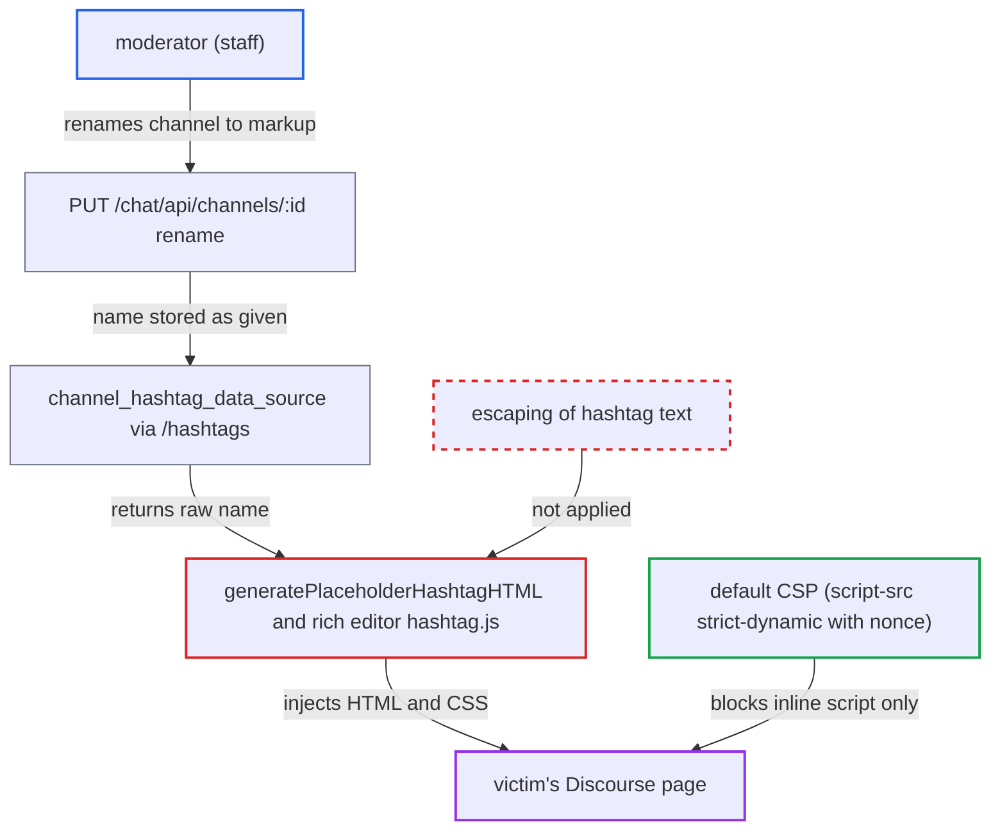

# Unescaped category/chat-channel names rendered via innerHTML in composer hashtag preview

| Field | Value |
|---|---|
| ID | `find_01NLPQ1Qu2XSUvb71fgt9cm5` |
| Severity | **Medium** |
| Status | open |
| CWE | CWE-79 — Cross-site scripting |
| Created | 2026-10-27T21:47:00.708661Z |
| Claude Security | https://claude.ai/security/findings/find_01NLPQ1Qu2XSUvb71fgt9cm5 |

## Description

A moderator can inject HTML and CSS into another user's Discourse page, including an admin's, by renaming a chat channel. Script is blocked by the default Content Security Policy (CSP), so the effect is fake forms, overlays and CSS-based leaks. The victim must type or open `#<slug>` in the composer. `generatePlaceholderHashtagHTML` and the rich editor write the name through `innerHTML` unescaped.

1. **moderator** renames a public category channel to an HTML/CSS payload. `can_edit_chat_channel?` lets any staff member rename a category channel, using `PUT /chat/api/channels/:id`. ([`plugins/chat/lib/chat/guardian_extensions.rb:85-91`](https://github.com/cx-benchmark/discourse/blob/e08ed05b4b1ef773b2de7948a8f88a7c182a3520/plugins/chat/lib/chat/guardian_extensions.rb#L85-L91))
2. **channel model** accepts the markup as the channel name. The name is checked only for presence and length (up to `max_topic_title_length`, default 255), so angle brackets pass. ([`plugins/chat/app/models/chat/channel.rb:36-41`](https://github.com/cx-benchmark/discourse/blob/e08ed05b4b1ef773b2de7948a8f88a7c182a3520/plugins/chat/app/models/chat/channel.rb#L36-L41))
3. **victim** opens the composer with text containing `#<slug>`. The victim can type it, or quote or edit a post that contains it, and `previewUpdated` runs `_renderHashtags` on the live preview after every cook. ([`frontend/discourse/app/components/composer-editor.gjs:477-488`](https://github.com/cx-benchmark/discourse/blob/e08ed05b4b1ef773b2de7948a8f88a7c182a3520/frontend/discourse/app/components/composer-editor.gjs#L477-L488))
4. **hashtag data source** returns the raw channel name in the `/hashtags` response. `item.text = channel.title` copies the name verbatim, and the server escapes nothing. ([`plugins/chat/lib/chat/channel_hashtag_data_source.rb:21-33`](https://github.com/cx-benchmark/discourse/blob/e08ed05b4b1ef773b2de7948a8f88a7c182a3520/plugins/chat/lib/chat/channel_hashtag_data_source.rb#L21-L33))
5. **the function `generatePlaceholderHashtagHTML`** assigns the name to `link.innerHTML`. `emojiUnescape` only substitutes emoji, so the markup and CSS become real elements in the victim's page. ([`frontend/discourse/app/lib/hashtag-decorator.js:74-96`](https://github.com/cx-benchmark/discourse/blob/e08ed05b4b1ef773b2de7948a8f88a7c182a3520/frontend/discourse/app/lib/hashtag-decorator.js#L74-L96))
6. **the rich editor hashtag plugin** does the same in the rich composer. It sets `domNode.innerHTML` from the raw `/hashtags` item text, so the second editor is affected as well. ([`frontend/discourse/app/static/prosemirror/extensions/hashtag.js:189-202`](https://github.com/cx-benchmark/discourse/blob/e08ed05b4b1ef773b2de7948a8f88a7c182a3520/frontend/discourse/app/static/prosemirror/extensions/hashtag.js#L189-L202))

## Assessment

The attacker must be a moderator (staff, not admin). They rename a public category channel through `PUT /chat/api/channels/:id`. Chat and public channels are on by default. Any user, including an admin, is a victim once they put `#<slug>` into the composer, by typing it or by quoting or editing a post that has it. Category names are a second way in, but only where the non-default setting `moderators_manage_categories` lets moderators edit them (1 to 50 characters). The default-off experimental `live` plugin also feeds `room.name` into the same sink; the report did not trace that path. DM channels are excluded from the lookup, and tag names have `<>` stripped.

Impact: The attacker puts arbitrary HTML and CSS into the victim's page. That allows overlays, fake login or confirmation forms posting to an external host, restyling, and CSS rules that fetch attacker URLs to leak page content. With the default CSP, no script runs and nothing is done in the victim's session. The effect is deception and partial disclosure.

## Recommendation

(1) `generatePlaceholderHashtagHTML` and the rich-editor hashtag decoration treat the server-provided `text` of a hashtag item as HTML and assign it through `innerHTML` without escaping.

Fix criteria: Hashtag display text is inserted as text in both code paths, using `textContent`, a text node, or `escapeExpression` before `emojiUnescape`, as `lib/hashtag-autocomplete.js` does. Test: rename a channel or category to `` and type `#<slug>` in both the markdown and rich composers of another account. The preview shows the literal text and no script executes.

(2) The server returns unescaped resource names in `HashtagItem#text` and relies on every client consumer to escape them, which is fragile.

Fix criteria: As defense in depth, either `HashtagAutocompleteService::HashtagItem#to_h` HTML-escapes `text` and `description` and the client stops double-escaping, or category and chat channel names containing `<` or `>` are rejected. `/hashtags` and `/hashtags/search` never return raw angle brackets in `text`.

## Evidence

**https://github.com/cx-benchmark/discourse**

- [`frontend/discourse/app/lib/hashtag-decorator.js:74-96`](https://github.com/cx-benchmark/discourse/blob/e08ed05b4b1ef773b2de7948a8f88a7c182a3520/frontend/discourse/app/lib/hashtag-decorator.js#L74-L96)
- [`frontend/discourse/app/static/prosemirror/extensions/hashtag.js:189-202`](https://github.com/cx-benchmark/discourse/blob/e08ed05b4b1ef773b2de7948a8f88a7c182a3520/frontend/discourse/app/static/prosemirror/extensions/hashtag.js#L189-L202)
- [`frontend/discourse/app/components/composer-editor.gjs:477-488`](https://github.com/cx-benchmark/discourse/blob/e08ed05b4b1ef773b2de7948a8f88a7c182a3520/frontend/discourse/app/components/composer-editor.gjs#L477-L488)
- [`plugins/chat/lib/chat/channel_hashtag_data_source.rb:21-33`](https://github.com/cx-benchmark/discourse/blob/e08ed05b4b1ef773b2de7948a8f88a7c182a3520/plugins/chat/lib/chat/channel_hashtag_data_source.rb#L21-L33)
- [`plugins/chat/lib/chat/guardian_extensions.rb:85-91`](https://github.com/cx-benchmark/discourse/blob/e08ed05b4b1ef773b2de7948a8f88a7c182a3520/plugins/chat/lib/chat/guardian_extensions.rb#L85-L91)
- [`plugins/chat/app/models/chat/channel.rb:36-41`](https://github.com/cx-benchmark/discourse/blob/e08ed05b4b1ef773b2de7948a8f88a7c182a3520/plugins/chat/app/models/chat/channel.rb#L36-L41)
- [`app/services/category_hashtag_data_source.rb:23-32`](https://github.com/cx-benchmark/discourse/blob/e08ed05b4b1ef773b2de7948a8f88a7c182a3520/app/services/category_hashtag_data_source.rb#L23-L32)
- [`frontend/discourse/app/lib/hashtag-autocomplete.js:129`](https://github.com/cx-benchmark/discourse/blob/e08ed05b4b1ef773b2de7948a8f88a7c182a3520/frontend/discourse/app/lib/hashtag-autocomplete.js#L129)
- [`lib/content_security_policy/default.rb:9-31`](https://github.com/cx-benchmark/discourse/blob/e08ed05b4b1ef773b2de7948a8f88a7c182a3520/lib/content_security_policy/default.rb#L9-L31)

