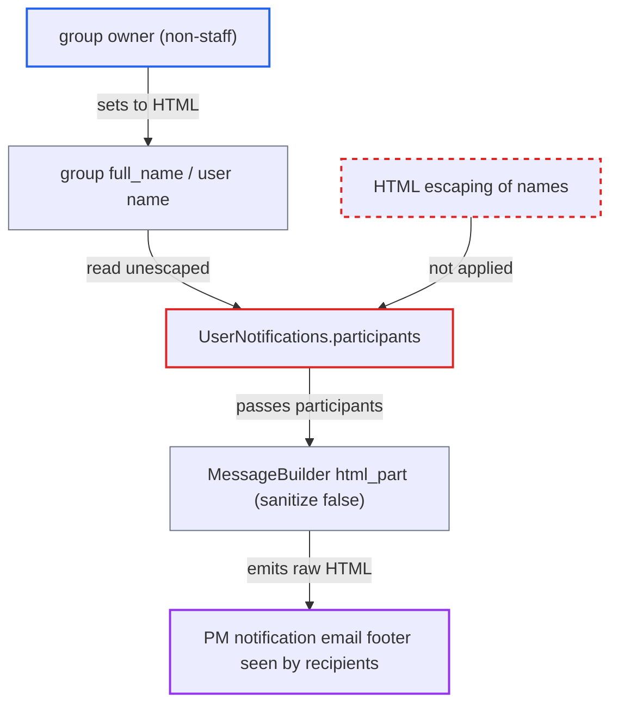

# Unescaped group full names and user names injected as raw HTML into PM notification emails

| Field | Value |
|---|---|
| ID | `find_014LgS9A9MmkUKakUuLD7LrM` |
| Severity | **Medium** |
| Status | open |
| CWE | CWE-79 — HTML injection |
| Created | 2026-10-27T21:23:47.852325Z |
| Claude Security | https://claude.ai/security/findings/find_014LgS9A9MmkUKakUuLD7LrM |

## Description

A user who owns a group can put their own HTML into private-message notification emails that the forum sends to other participants and group members. With default settings, any non-staff owner of a non-automatic group can do this through the group's `full_name`. Users' `name` works as well when `prioritize_username_in_ux` is off. The cause is `UserNotifications.participants`, which builds the participant list without escaping, and `MessageBuilder#html_part` then cooks that list with the sanitizer disabled.

1. **attacker (group owner)** sets the group `full_name` to HTML. `full_name` is only length-checked (100 characters), and non-staff owners of non-automatic groups may set it, for example through `PUT /groups/:id`. ([`lib/group_updater.rb:50-57`](https://github.com/cx-benchmark/discourse/blob/e08ed05b4b1ef773b2de7948a8f88a7c182a3520/lib/group_updater.rb#L50-L57))
2. **attacker** lets the group be added to a private message. The attacker can set `messageable_level` so that anyone may message the group. The group then appears among the PM participants.
3. **the method `participants`** puts the raw `name_full_preferred` and `display_name` into Markdown link text. Nothing escapes the names, so the HTML stays intact in the participant list. ([`app/mailers/user_notifications.rb:949-1001`](https://github.com/cx-benchmark/discourse/blob/e08ed05b4b1ef773b2de7948a8f88a7c182a3520/app/mailers/user_notifications.rb#L949-L1001))
4. **the builder `Email::MessageBuilder`** inserts the participant list into `respond_instructions` and cooks it with `sanitize: false`. The `*_pm` strings contain `%{participants}`. Cooking with `sanitize: false` turns off the allow-list sanitizer, and markdown-it runs with `html: true`. ([`lib/email/message_builder.rb:182-185`](https://github.com/cx-benchmark/discourse/blob/e08ed05b4b1ef773b2de7948a8f88a7c182a3520/lib/email/message_builder.rb#L182-L185))
5. **`PrettyText.cleanup`** removes only `<script>` nodes. Tags such as `img`, `a`, `style` and form markup are left in place. ([`lib/pretty_text.rb:692-706`](https://github.com/cx-benchmark/discourse/blob/e08ed05b4b1ef773b2de7948a8f88a7c182a3520/lib/pretty_text.rb#L692-L706))
6. **the email template `notification.html.erb`** renders the markup in the footer of every notification for that PM. The markup sits next to the `Visit Message` button. Recipients only have to open the email. ([`app/views/email/notification.html.erb:19-42`](https://github.com/cx-benchmark/discourse/blob/e08ed05b4b1ef773b2de7948a8f88a7c182a3520/app/views/email/notification.html.erb#L19-L42))

## Assessment

The main attacker is a non-staff owner of any non-automatic group, which works with default settings. The owner sets the group `full_name` to HTML such as an `img` tag plus a link labelled `Visit Message`, and can set `messageable_level` so anyone may message the group. Once the group is in a PM, the markup goes into every notification sent to the other participants and group members. This includes notifications for posts written by other users. A second route is the user `name`, open to any user who can send a PM. It works only when `prioritize_username_in_ux` is turned off, because it ships as `true` and `display_name` then returns the restricted username. The victim only has to open the email.

Impact: The attacker controls unsanitized HTML in genuine emails sent by the forum. This allows phishing links and fake content in the footer, and remote images that reveal each recipient's open time and IP address. Email clients do not run script and `full_name` is limited to 100 characters, so there is no session compromise. The report rates this as limited integrity and limited disclosure.

## Recommendation

`UserNotifications.participants` puts group `full_name` and user `display_name` unescaped into Markdown that `MessageBuilder#html_part` cooks with the HTML sanitizer disabled. User-controlled names therefore become raw HTML in forum emails.

Fix criteria: Every user- or group-controlled value that reaches `respond_instructions`, or any string cooked with `sanitize: false`, reaches the HTML part as inert text. A group `full_name` or user `name` of `<a href=https://e>x</a>` appears escaped, or not at all, in the HTML part of a PM notification. This holds for both the group vector and the user vector.

## Evidence

**https://github.com/cx-benchmark/discourse**

- [`app/mailers/user_notifications.rb:949-1001`](https://github.com/cx-benchmark/discourse/blob/e08ed05b4b1ef773b2de7948a8f88a7c182a3520/app/mailers/user_notifications.rb#L949-L1001)
- [`lib/email/message_builder.rb:182-185`](https://github.com/cx-benchmark/discourse/blob/e08ed05b4b1ef773b2de7948a8f88a7c182a3520/lib/email/message_builder.rb#L182-L185)
- [`lib/email/message_builder.rb:61-91`](https://github.com/cx-benchmark/discourse/blob/e08ed05b4b1ef773b2de7948a8f88a7c182a3520/lib/email/message_builder.rb#L61-L91)
- [`config/locales/server.en.yml:4840-4847`](https://github.com/cx-benchmark/discourse/blob/e08ed05b4b1ef773b2de7948a8f88a7c182a3520/config/locales/server.en.yml#L4840-L4847)
- [`lib/pretty_text.rb:213`](https://github.com/cx-benchmark/discourse/blob/e08ed05b4b1ef773b2de7948a8f88a7c182a3520/lib/pretty_text.rb#L213)
- [`frontend/discourse-markdown-it/src/index.js:61-63`](https://github.com/cx-benchmark/discourse/blob/e08ed05b4b1ef773b2de7948a8f88a7c182a3520/frontend/discourse-markdown-it/src/index.js#L61-L63)
- [`frontend/discourse-markdown-it/src/setup.js:177-184`](https://github.com/cx-benchmark/discourse/blob/e08ed05b4b1ef773b2de7948a8f88a7c182a3520/frontend/discourse-markdown-it/src/setup.js#L177-L184)
- [`lib/pretty_text.rb:692-706`](https://github.com/cx-benchmark/discourse/blob/e08ed05b4b1ef773b2de7948a8f88a7c182a3520/lib/pretty_text.rb#L692-L706)
- [`app/views/email/notification.html.erb:19-42`](https://github.com/cx-benchmark/discourse/blob/e08ed05b4b1ef773b2de7948a8f88a7c182a3520/app/views/email/notification.html.erb#L19-L42)
- [`lib/group_updater.rb:50-57`](https://github.com/cx-benchmark/discourse/blob/e08ed05b4b1ef773b2de7948a8f88a7c182a3520/lib/group_updater.rb#L50-L57)
- [`app/models/user.rb:2026-2032`](https://github.com/cx-benchmark/discourse/blob/e08ed05b4b1ef773b2de7948a8f88a7c182a3520/app/models/user.rb#L2026-L2032)
- [`app/mailers/user_notifications.rb:795`](https://github.com/cx-benchmark/discourse/blob/e08ed05b4b1ef773b2de7948a8f88a7c182a3520/app/mailers/user_notifications.rb#L795)

