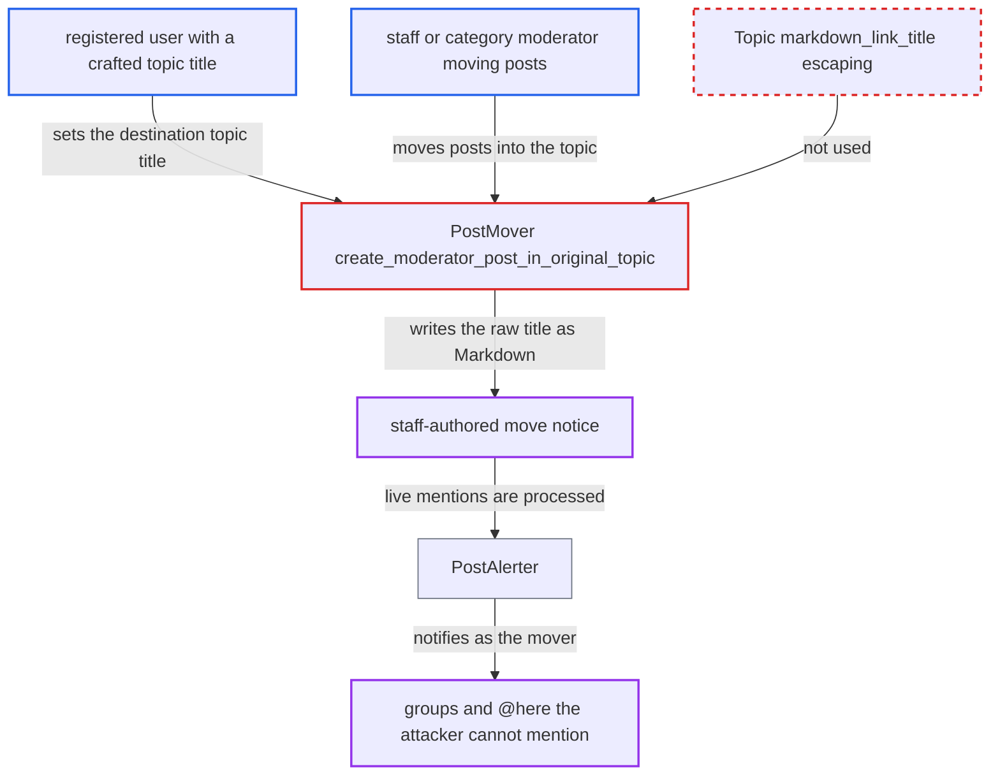

# Unescaped topic title lets users inject Markdown and mentions into staff-authored post-move notice

| Field | Value |
|---|---|
| ID | `find_01LzFyitXaqLU6wHimPS1APk` |
| Severity | **Medium** |
| Status | open |
| CWE | CWE-74 — Markdown Injection |
| Created | 2026-10-27T21:44:06.999910Z |
| Claude Security | https://claude.ai/security/findings/find_01LzFyitXaqLU6wHimPS1APk |

## Description

A registered user can make a staff-authored post-move notice carry their own links, images and live mentions. They set a topic title that closes the link label early, then wait for a staff member, TL4 user or category moderator to move posts into that topic. `PostMover#create_moderator_post_in_original_topic` puts the raw `destination_topic.title` into a Markdown link without escaping it.

1. **attacker** creates a topic with a crafted title. A title such as `x](https://evil.example) @moderators @here [y` passes the title validators, because `TextCleaner.clean_title` and the validators leave `[`, `]`, `(` and `)` intact. ([`lib/text_cleaner.rb:24-70`](https://github.com/cx-benchmark/discourse/blob/e08ed05b4b1ef773b2de7948a8f88a7c182a3520/lib/text_cleaner.rb#L24-L70))
2. **staff member, TL4 user or category moderator** moves or merges posts into the attacker's topic. This is a routine moderation step that the victim must choose to take.
3. **`PostMover#create_moderator_post_in_original_topic`** builds the notice link from the raw topic title. The title is put inside the link label without escaping, so the `]` in the title ends the label early and the rest becomes free Markdown. ([`app/models/post_mover.rb:685-690`](https://github.com/cx-benchmark/discourse/blob/e08ed05b4b1ef773b2de7948a8f88a7c182a3520/app/models/post_mover.rb#L685-L690))
4. **`Topic#add_moderator_post`** creates a `small_action` post as the moving user. It runs with `skip_validations: true`, cooks the text as Markdown and queues the `post_alert` job. ([`app/models/topic.rb:1250-1282`](https://github.com/cx-benchmark/discourse/blob/e08ed05b4b1ef773b2de7948a8f88a7c182a3520/app/models/topic.rb#L1250-L1282))
5. **the Markdown cooker** turns the mentions into live mentions. Mentions inside a link label are skipped, but the breakout puts them outside the label, so they are cooked as mentions. ([`frontend/pretty-text/addon/text-replace.js:15-60`](https://github.com/cx-benchmark/discourse/blob/e08ed05b4b1ef773b2de7948a8f88a7c182a3520/frontend/pretty-text/addon/text-replace.js#L15-L60))
6. **`PostAlerter`** notifies the mentioned users and groups with the mover's rights. It expands group mentions and `@here` using `Group.mentionable(post.user)` and `can_mention_here?` for the staff mover, not the title's author. ([`app/services/post_alerter.rb:770-814`](https://github.com/cx-benchmark/discourse/blob/e08ed05b4b1ef773b2de7948a8f88a7c182a3520/app/services/post_alerter.rb#L770-L814))

## Assessment

The attacker needs a registered account that can create a topic. A staff member, TL4 user or category moderator must then move or merge posts into that topic. The report does not say whether the attacker can cause that move. A second route is `Jobs::CreateLinkedTopic` in `app/jobs/regular/create_linked_topic.rb`, which has the same unescaped title-in-link pattern. There the notice is a system-user small action, reached when a topic is auto-closed at `auto_close_topics_post_count`.

Impact: The attacker gets up to about 255 characters of their own Markdown into a post attributed to a staff member. This allows arbitrary link targets, images and mention notifications sent as that staff member to groups and `@here`, which the attacker cannot mention. Each group is capped at `max_users_notified_per_group_mention`. Sanitization still prevents script execution, so this is content and notification spoofing, not XSS. Nothing is disclosed or made unavailable.

## Recommendation

`PostMover` and `Jobs::CreateLinkedTopic` put a user-controlled topic title into Markdown link syntax without escaping it. The title can end the link label early and add links, Markdown and mentions to a post authored by staff or the system. The existing `Topic#markdown_link_title` is not used here.

Fix criteria: Every topic title put into generated Markdown in these notices is escaped, so it cannot end the link label or create new link, mention or Markdown structure. Test: merge posts into a topic titled `a](https://evil.example) @moderators [b`. The notice must contain exactly one link, pointing at the destination topic or post. It must show the title as literal text and create no mention notifications.

## Evidence

**https://github.com/cx-benchmark/discourse**

- [`app/models/post_mover.rb:685-690`](https://github.com/cx-benchmark/discourse/blob/e08ed05b4b1ef773b2de7948a8f88a7c182a3520/app/models/post_mover.rb#L685-L690)
- [`app/models/post_mover.rb:709-723`](https://github.com/cx-benchmark/discourse/blob/e08ed05b4b1ef773b2de7948a8f88a7c182a3520/app/models/post_mover.rb#L709-L723)
- [`app/models/topic.rb:1250-1282`](https://github.com/cx-benchmark/discourse/blob/e08ed05b4b1ef773b2de7948a8f88a7c182a3520/app/models/topic.rb#L1250-L1282)
- [`frontend/pretty-text/addon/text-replace.js:15-60`](https://github.com/cx-benchmark/discourse/blob/e08ed05b4b1ef773b2de7948a8f88a7c182a3520/frontend/pretty-text/addon/text-replace.js#L15-L60)
- [`app/services/post_alerter.rb:160-209`](https://github.com/cx-benchmark/discourse/blob/e08ed05b4b1ef773b2de7948a8f88a7c182a3520/app/services/post_alerter.rb#L160-L209)
- [`app/services/post_alerter.rb:770-814`](https://github.com/cx-benchmark/discourse/blob/e08ed05b4b1ef773b2de7948a8f88a7c182a3520/app/services/post_alerter.rb#L770-L814)
- [`app/models/topic.rb:655-659`](https://github.com/cx-benchmark/discourse/blob/e08ed05b4b1ef773b2de7948a8f88a7c182a3520/app/models/topic.rb#L655-L659)
- [`lib/text_cleaner.rb:24-70`](https://github.com/cx-benchmark/discourse/blob/e08ed05b4b1ef773b2de7948a8f88a7c182a3520/lib/text_cleaner.rb#L24-L70)
- [`frontend/discourse/app/components/post/small-action.gjs:229-239`](https://github.com/cx-benchmark/discourse/blob/e08ed05b4b1ef773b2de7948a8f88a7c182a3520/frontend/discourse/app/components/post/small-action.gjs#L229-L239)
- [`app/jobs/regular/create_linked_topic.rb:117-118`](https://github.com/cx-benchmark/discourse/blob/e08ed05b4b1ef773b2de7948a8f88a7c182a3520/app/jobs/regular/create_linked_topic.rb#L117-L118)

