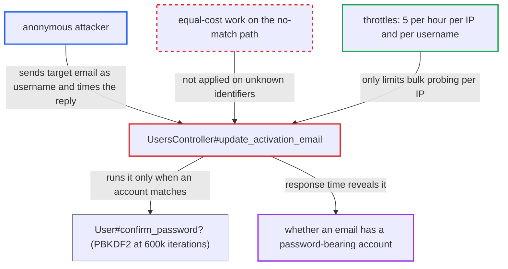

# update_activation_email timing reveals whether a login identifier has a password-bearing account

| Field | Value |
|---|---|
| ID | `find_01UrtLVbpmhFhqSSHGuMiznj` |
| Severity | **Medium** |
| Status | open |
| CWE | CWE-208 — Observable timing discrepancy |
| Created | 2026-10-27T22:18:08.984922Z |
| Claude Security | https://claude.ai/security/findings/find_01UrtLVbpmhFhqSSHGuMiznj |

## Description

An anonymous attacker can learn whether an email address belongs to a forum account with a local password. The response time gives it away, even though the 403 error is identical. Only one request per address is needed. The cause is `UsersController#update_activation_email`, which runs the slow password check only when the supplied identifier matches an account, so it defeats `hide_email_address_taken`.

1. **attacker** sends `PUT /u/update-activation-email` with the target email as `username`. No login is needed. Any `password` and any `email` values will do, because the request is rejected either way. ([`app/controllers/users_controller.rb:1235-1250`](https://github.com/cx-benchmark/discourse/blob/e08ed05b4b1ef773b2de7948a8f88a7c182a3520/app/controllers/users_controller.rb#L1235-L1250))
2. **the handler `update_activation_email`** looks up the `username` value with `User.find_by_username_or_email`. This lookup matches usernames and all stored email addresses. If nothing matches, the handler raises `Discourse::InvalidAccess` at once. ([`app/controllers/users_controller.rb:1235-1250`](https://github.com/cx-benchmark/discourse/blob/e08ed05b4b1ef773b2de7948a8f88a7c182a3520/app/controllers/users_controller.rb#L1235-L1250))
3. **the handler `update_activation_email`** calls `@user.confirm_password?` when an account matched. For an account with a local password, this recomputes a PBKDF2 hash at 600000 iterations, which takes hundreds of milliseconds, before the same `Discourse::InvalidAccess` is raised. ([`app/models/user_password.rb:32-39`](https://github.com/cx-benchmark/discourse/blob/e08ed05b4b1ef773b2de7948a8f88a7c182a3520/app/models/user_password.rb#L32-L39))
4. **`User#confirm_password?`** returns false without hashing when the account has no `user_password`. Passwordless accounts and unknown identifiers therefore both take the fast path. ([`app/models/user.rb:1070-1073`](https://github.com/cx-benchmark/discourse/blob/e08ed05b4b1ef773b2de7948a8f88a7c182a3520/app/models/user.rb#L1070-L1073))
5. **attacker** times the 403 response and reads the delay. The status and body are the same in every case. A delay of hundreds of milliseconds means an account with a local password exists for that email. An immediate reply means it does not. ([`app/controllers/users_controller.rb:1235-1250`](https://github.com/cx-benchmark/discourse/blob/e08ed05b4b1ef773b2de7948a8f88a7c182a3520/app/controllers/users_controller.rb#L1235-L1250))

## Assessment

The attacker is an anonymous internet user who needs no session or account. They send one request per target email address to `PUT /u/update-activation-email`. The endpoint is throttled to 5 requests per hour per `request.remote_ip` (`activate-edit-email-hr-<ip>`) and 5 per hour per submitted `username` string (`activate-edit-email-hr-username-<username>`). Both limits still allow the single probe each address needs. The per-IP limit only slows bulk probing from one address, and an attacker with many IP addresses is not held back, since the report notes there is no IPv6 prefix bucketing. The `hide_email_address_taken` setting is on by default, and this endpoint undoes it for any email the attacker names.

Impact: The attacker learns, for each email address, whether an account with a local password exists. That is one bit per address, at a low rate per source IP. Nothing is modified and no service is degraded.

## Recommendation

`update_activation_email` does the expensive password derivation only when `find_by_username_or_email` matches a password-bearing account. For any other identifier it returns early, so the response time for the identical `Discourse::InvalidAccess` error reveals whether the account exists.

Fix criteria: The rejection time is indistinguishable between an identifier that matches a password-bearing account, one that matches a passwordless account, and one that matches nothing. This can be done with an equivalent-cost derivation on the non-matching paths, or by restricting the lookup to the pending-activation account id held in the session instead of an attacker-supplied identifier. Check it by timing both cases from a client and confirming that the timing distributions overlap.

## Evidence

**https://github.com/cx-benchmark/discourse**

- [`app/controllers/users_controller.rb:1235-1250`](https://github.com/cx-benchmark/discourse/blob/e08ed05b4b1ef773b2de7948a8f88a7c182a3520/app/controllers/users_controller.rb#L1235-L1250)
- [`app/models/user_password.rb:32-39`](https://github.com/cx-benchmark/discourse/blob/e08ed05b4b1ef773b2de7948a8f88a7c182a3520/app/models/user_password.rb#L32-L39)
- [`app/models/user.rb:1070-1073`](https://github.com/cx-benchmark/discourse/blob/e08ed05b4b1ef773b2de7948a8f88a7c182a3520/app/models/user.rb#L1070-L1073)
- [`app/controllers/users_controller.rb:1236-1244`](https://github.com/cx-benchmark/discourse/blob/e08ed05b4b1ef773b2de7948a8f88a7c182a3520/app/controllers/users_controller.rb#L1236-L1244)
- [`config/site_settings.yml:995-998`](https://github.com/cx-benchmark/discourse/blob/e08ed05b4b1ef773b2de7948a8f88a7c182a3520/config/site_settings.yml#L995-L998)

