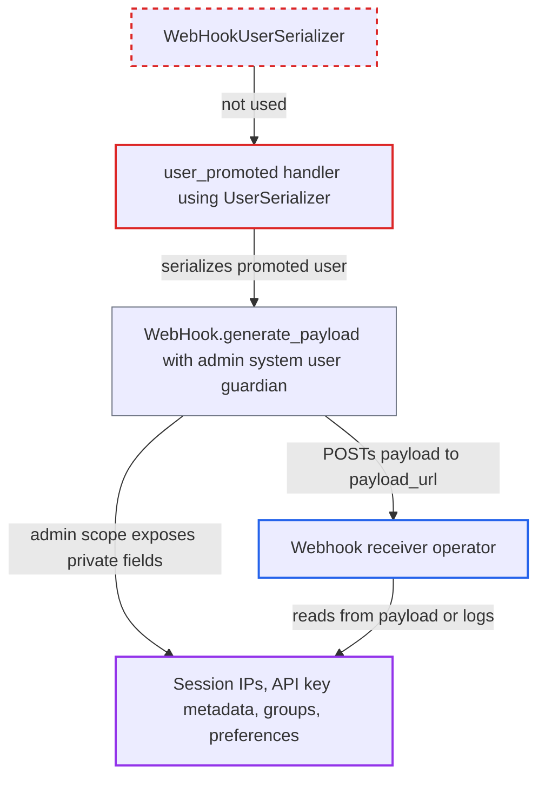

# user_promoted webhook bypasses WebHookUserSerializer, sending session IPs and private settings

| Field | Value |
|---|---|
| ID | `find_011r97iYGR6ouWKW5Jt6Q1EZ` |
| Severity | **Medium** |
| Status | open |
| CWE | CWE-212 — Sensitive information in transfer |
| Created | 2026-10-27T21:41:07.244067Z |
| Claude Security | https://claude.ai/security/findings/find_011r97iYGR6ouWKW5Jt6Q1EZ |

## Description

A webhook receiver gets private data about every promoted user. This includes session IP addresses and locations, API-key metadata, hidden group memberships and private preferences. It only happens when an admin has subscribed a webhook to `user_promoted` (or a wildcard webhook). The `user_promoted` handler uses `UserSerializer` instead of `WebHookUserSerializer`, and it serializes under an admin guardian. Token values, API-key secrets and email are not sent.

1. **admin** subscribes a webhook to `user_promoted` or to all events. The webhook has a `payload_url` that points to a receiver the project does not control.
2. **forum** promotes a user's trust level. Automatic promotions such as TL0 to TL1 and admin promotions both trigger `:user_promoted`. ([`lib/promotion.rb:92-97`](https://github.com/cx-benchmark/discourse/blob/e08ed05b4b1ef773b2de7948a8f88a7c182a3520/lib/promotion.rb#L92-L97))
3. **the `user_promoted` handler** enqueues the webhook with the plain `UserSerializer`. The other user events use the reduced `WebHookUserSerializer`, and this one does not. ([`config/initializers/012-web_hook_events.rb:130-138`](https://github.com/cx-benchmark/discourse/blob/e08ed05b4b1ef773b2de7948a8f88a7c182a3520/config/initializers/012-web_hook_events.rb#L130-L138))
4. **`WebHook.generate_payload`** serializes the user under `Guardian.new(Discourse.system_user)`. This is an admin guardian, so every `can_edit`, `is_staff?`, `is_admin?` and `can_see_ip?` gate passes and the private attributes are emitted. ([`app/models/web_hook.rb:136-147`](https://github.com/cx-benchmark/discourse/blob/e08ed05b4b1ef773b2de7948a8f88a7c182a3520/app/models/web_hook.rb#L136-L147))
5. **`UserSerializer`** emits private and staff-only attributes. The output includes `user_auth_tokens`, `user_api_keys`, `user_option`, `group_users` and `second_factor_enabled`. ([`app/serializers/user_serializer.rb:29-120`](https://github.com/cx-benchmark/discourse/blob/e08ed05b4b1ef773b2de7948a8f88a7c182a3520/app/serializers/user_serializer.rb#L29-L120))
6. **`Jobs::EmitWebHookEvent`** POSTs the payload to `payload_url`. The body is sent without further filtering, so whoever runs or compromises the receiver, or reads its logs, gets the data. ([`app/jobs/regular/emit_web_hook_event.rb:151-162`](https://github.com/cx-benchmark/discourse/blob/e08ed05b4b1ef773b2de7948a8f88a7c182a3520/app/jobs/regular/emit_web_hook_event.rb#L151-L162))

## Assessment

An admin must have configured a webhook subscribed to `user_promoted`, or a wildcard webhook. Every trust-level promotion then sends the payload, including routine automatic ones from `lib/promotion.rb`. The attacker is whoever operates or compromises the receiving endpoint, or reads its logs. They need no forum account and no victim action, and they collect the data passively.

Impact: The receiver learns, for each promoted user, all session IPs, geo-locations, browser, device and OS details, API-key application names and scopes, and 2FA and password status. It also learns hidden group memberships and private preferences. Token values and API-key secrets are not sent, so there is no account takeover. The impact is limited disclosure of personal data.

## Recommendation

The `user_promoted` webhook builds its payload with `UserSerializer` under an admin guardian instead of `WebHookUserSerializer`. Private data that the webhook serializer deliberately removes is sent to the external receiver.

Fix criteria: The `user_promoted` payload exposes no more user data than the other user webhook events. It carries no `user_auth_tokens`, `user_api_keys`, `user_passkeys`, `group_users`, `user_option` or other private or staff attributes. To verify, promote a user while a `user_promoted` webhook is subscribed and assert that the delivered JSON contains none of these keys.

## Evidence

**https://github.com/cx-benchmark/discourse**

- [`config/initializers/012-web_hook_events.rb:130-138`](https://github.com/cx-benchmark/discourse/blob/e08ed05b4b1ef773b2de7948a8f88a7c182a3520/config/initializers/012-web_hook_events.rb#L130-L138)
- [`app/models/web_hook.rb:136-147`](https://github.com/cx-benchmark/discourse/blob/e08ed05b4b1ef773b2de7948a8f88a7c182a3520/app/models/web_hook.rb#L136-L147)
- [`app/serializers/user_serializer.rb:29-120`](https://github.com/cx-benchmark/discourse/blob/e08ed05b4b1ef773b2de7948a8f88a7c182a3520/app/serializers/user_serializer.rb#L29-L120)
- [`app/serializers/concerns/user_auth_tokens_mixin.rb:6-57`](https://github.com/cx-benchmark/discourse/blob/e08ed05b4b1ef773b2de7948a8f88a7c182a3520/app/serializers/concerns/user_auth_tokens_mixin.rb#L6-L57)
- [`app/serializers/web_hook_user_serializer.rb:6-50`](https://github.com/cx-benchmark/discourse/blob/e08ed05b4b1ef773b2de7948a8f88a7c182a3520/app/serializers/web_hook_user_serializer.rb#L6-L50)
- [`app/jobs/regular/emit_web_hook_event.rb:151-162`](https://github.com/cx-benchmark/discourse/blob/e08ed05b4b1ef773b2de7948a8f88a7c182a3520/app/jobs/regular/emit_web_hook_event.rb#L151-L162)
- [`lib/promotion.rb:92-97`](https://github.com/cx-benchmark/discourse/blob/e08ed05b4b1ef773b2de7948a8f88a7c182a3520/lib/promotion.rb#L92-L97)

