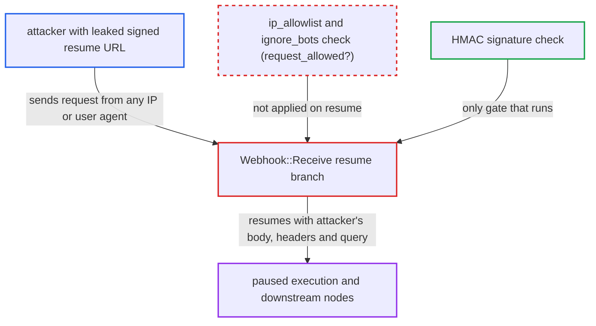

# Wait-node webhook resume does not enforce configured IP allowlist and bot filter

| Field | Value |
|---|---|
| ID | `find_0135Xj3PHqZ7JkWqAbQxqTvk` |
| Severity | **Medium** |
| Status | open |
| CWE | CWE-862 — Missing authorization |
| Created | 2026-10-27T21:16:49.113583Z |
| Claude Security | https://claude.ai/security/findings/find_0135Xj3PHqZ7JkWqAbQxqTvk |

## Description

Anyone holding a signed resume URL for a paused workflow can resume it from any IP address or user agent, even when an admin set an IP allowlist or bot filter on the Wait node. The attacker must have the leaked URL, and the admin must have configured a filter. The resume branch in `Webhook::Receive` never applies the `ip_allowlist` and `ignore_bots` checks, and it does not enforce `authentication` either.

1. **admin** sets `ip_allowlist` or `ignore_bots` on a `flow:wait` node in `resume: webhook` mode. The Wait node copies all of `Schemas::Webhook::CONFIGURATION_FIELDS` into its properties and labels both options in the UI, so the admin expects them to filter requests to the resume URL. ([`plugins/discourse-workflows/lib/discourse_workflows/nodes/wait/v1.rb:45-88`](https://github.com/cx-benchmark/discourse/blob/e08ed05b4b1ef773b2de7948a8f88a7c182a3520/plugins/discourse-workflows/lib/discourse_workflows/nodes/wait/v1.rb#L45-L88))
2. **attacker** sends the configured HTTP method to the signed resume URL under `/workflows/waiting/:execution_id/webhook`. The attacker got the URL from a leak such as a third party's logs, a forwarded message or a referrer. The public, CSRF-exempt controller passes the caller's body, headers, query, remote IP and user agent on as the resume request. ([`plugins/discourse-workflows/app/controllers/discourse_workflows/webhooks_controller.rb:95-111`](https://github.com/cx-benchmark/discourse/blob/e08ed05b4b1ef773b2de7948a8f88a7c182a3520/plugins/discourse-workflows/app/controllers/discourse_workflows/webhooks_controller.rb#L95-L111))
3. **service `Webhook::Receive`** takes the `resuming_execution` branch and checks only the signature, the suffix and the HTTP method. This branch never calls `filter_request_allowed_nodes` or `request_allowed?` for the waiting node, so the allowlist and bot filter are skipped. ([`plugins/discourse-workflows/app/services/discourse_workflows/webhook/receive.rb:73-87`](https://github.com/cx-benchmark/discourse/blob/e08ed05b4b1ef773b2de7948a8f88a7c182a3520/plugins/discourse-workflows/app/services/discourse_workflows/webhook/receive.rb#L73-L87))
4. **service `Webhook::Receive`** leaves the request filters unused on resume. The new-trigger branch applies authentication and the IP and bot filtering, and `request_allowed?` holds the checks. Only the trigger and test branches call it. ([`plugins/discourse-workflows/app/services/discourse_workflows/webhook/receive.rb:89-96`](https://github.com/cx-benchmark/discourse/blob/e08ed05b4b1ef773b2de7948a8f88a7c182a3520/plugins/discourse-workflows/app/services/discourse_workflows/webhook/receive.rb#L89-L96))
5. **job `Jobs::DiscourseWorkflows::ResumeWebhookWaiting`** resumes the execution with the attacker's request data. The job applies no request filtering. `WaitingExecution.resume_claimed` and `Executor.resume_from` do not filter either. ([`plugins/discourse-workflows/app/jobs/regular/discourse_workflows/resume_webhook_waiting.rb:6-22`](https://github.com/cx-benchmark/discourse/blob/e08ed05b4b1ef773b2de7948a8f88a7c182a3520/plugins/discourse-workflows/app/jobs/regular/discourse_workflows/resume_webhook_waiting.rb#L6-L22))

## Assessment

The attacker is an anonymous internet user who has a signed resume URL for a paused execution, for example from a third party's logs, a forwarded message or a referrer. The admin must have set `ip_allowlist` or `ignore_bots` on the Wait node. The attacker sends the configured HTTP method to the URL. The HMAC signature, keyed from `secret_key_base`, must still be obtained, so this is not unauthenticated resumption. The `authentication` option is also not enforced. The Wait node declares no `credentials` slot, unlike `nodes/webhook/v1.rb:32-43`, so choosing a non-`none` mode gives no protection.

Impact: The attacker resumes the paused execution once, because the claim is single-use, despite the admin's allowlist or bot filter. The request body, headers and query become the Wait node's output (`webhook_context.request.item_json`) and feed every downstream node, for example an approval status written into a topic or data table. The effect depends on the workflow and is bounded. Nothing is disclosed beyond the node's configured response. No spec covers filtering on the resume path.

## Recommendation

(1) The resume branch of `Webhook::Receive` never evaluates the waiting node's `ip_allowlist` and `ignore_bots` parameters, nor `authentication`, although the Wait node offers them. The configured restriction is not enforced.

Fix criteria: A correctly signed resume request from an IP not in the Wait node's `ip_allowlist` is rejected with 403, as for triggers. With `ignore_bots` set, a request from a bot user agent is rejected the same way. A request from a listed IP is accepted. Rejected requests do not claim or resume the execution. A spec covers both the rejected and the accepted case on the resume path.

(2) The Wait node offers an `authentication` mode but has no credential slot, and the resume path never authenticates. The option gives no protection.

Fix criteria: Either the Wait node supports binding a credential and the resume path enforces the chosen mode, or the `authentication` option is removed from the Wait node so that admins cannot rely on it.

## Evidence

**https://github.com/cx-benchmark/discourse**

- [`plugins/discourse-workflows/app/services/discourse_workflows/webhook/receive.rb:73-87`](https://github.com/cx-benchmark/discourse/blob/e08ed05b4b1ef773b2de7948a8f88a7c182a3520/plugins/discourse-workflows/app/services/discourse_workflows/webhook/receive.rb#L73-L87)
- [`plugins/discourse-workflows/app/services/discourse_workflows/webhook/receive.rb:89-96`](https://github.com/cx-benchmark/discourse/blob/e08ed05b4b1ef773b2de7948a8f88a7c182a3520/plugins/discourse-workflows/app/services/discourse_workflows/webhook/receive.rb#L89-L96)
- [`plugins/discourse-workflows/app/services/discourse_workflows/webhook/receive.rb:412-423`](https://github.com/cx-benchmark/discourse/blob/e08ed05b4b1ef773b2de7948a8f88a7c182a3520/plugins/discourse-workflows/app/services/discourse_workflows/webhook/receive.rb#L412-L423)
- [`plugins/discourse-workflows/lib/discourse_workflows/nodes/wait/v1.rb:45-88`](https://github.com/cx-benchmark/discourse/blob/e08ed05b4b1ef773b2de7948a8f88a7c182a3520/plugins/discourse-workflows/lib/discourse_workflows/nodes/wait/v1.rb#L45-L88)
- [`plugins/discourse-workflows/config/locales/client.en.yml:1194-1195`](https://github.com/cx-benchmark/discourse/blob/e08ed05b4b1ef773b2de7948a8f88a7c182a3520/plugins/discourse-workflows/config/locales/client.en.yml#L1194-L1195)
- [`plugins/discourse-workflows/app/controllers/discourse_workflows/webhooks_controller.rb:95-111`](https://github.com/cx-benchmark/discourse/blob/e08ed05b4b1ef773b2de7948a8f88a7c182a3520/plugins/discourse-workflows/app/controllers/discourse_workflows/webhooks_controller.rb#L95-L111)
- [`plugins/discourse-workflows/app/jobs/regular/discourse_workflows/resume_webhook_waiting.rb:6-22`](https://github.com/cx-benchmark/discourse/blob/e08ed05b4b1ef773b2de7948a8f88a7c182a3520/plugins/discourse-workflows/app/jobs/regular/discourse_workflows/resume_webhook_waiting.rb#L6-L22)

