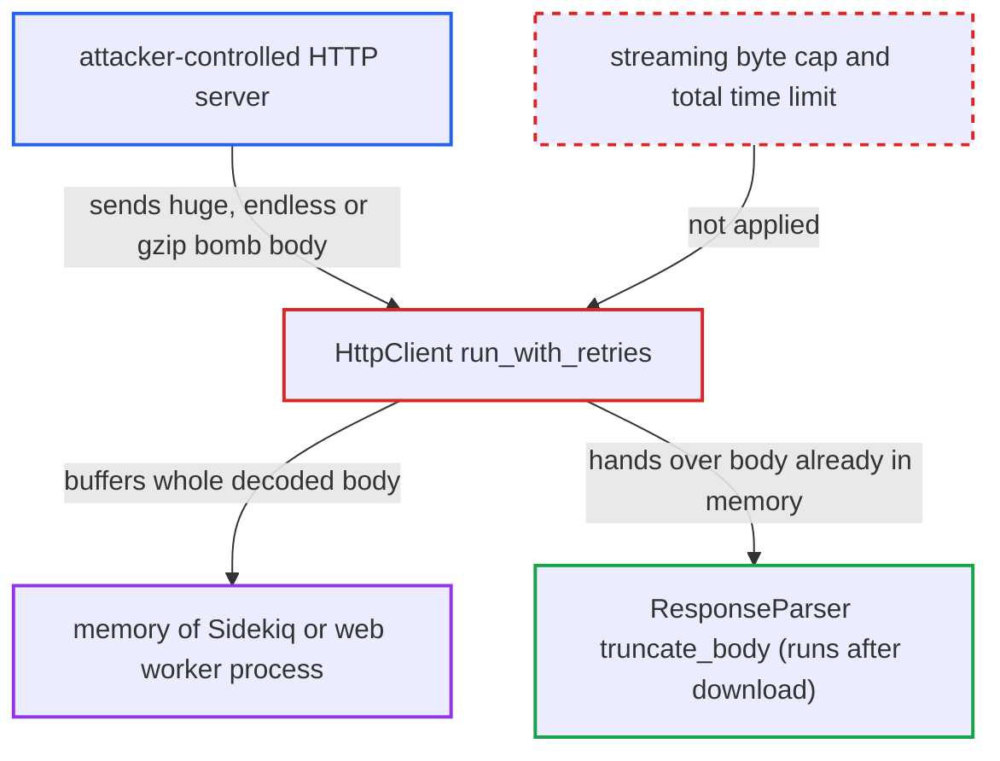

# Workflows HTTP Request node buffers whole response before applying max_response_size_kb

| Field | Value |
|---|---|
| ID | `find_01WS4ENdttrxexyU8n23zp76` |
| Severity | **Medium** |
| Status | open |
| CWE | CWE-770 — Uncontrolled resource consumption |
| Created | 2026-10-27T21:16:49.036141Z |
| Claude Security | https://claude.ai/security/findings/find_01WS4ENdttrxexyU8n23zp76 |

## Description

A server that a published workflow's HTTP Request node contacts can crash the Sidekiq or web worker process that runs the node. It does this by sending a huge, endless or gzip-compressed body. The attacker needs control of that server, and the plugin must be enabled (off by default) with an admin-built workflow that fetches it. The cause is that `HttpClient#run_with_retries` reads the whole response into memory before `max_response_size_kb` is applied.

1. **the HTTP Request node** fetches the URL through `Executor::HttpClient`. The `url` parameter can be an expression, so the address can come from trigger data such as a webhook body, a form field or a post. ([`plugins/discourse-workflows/lib/discourse_workflows/nodes/http_request/v1.rb:196-200`](https://github.com/cx-benchmark/discourse/blob/e08ed05b4b1ef773b2de7948a8f88a7c182a3520/plugins/discourse-workflows/lib/discourse_workflows/nodes/http_request/v1.rb#L196-L200))
2. **the attacker's server** answers 200 with an oversized body. The body can be many gigabytes, an endless slow trickle, or a small gzip bomb that expands to gigabytes when decoded.
3. **the method `HttpClient#run_with_retries`** reads and inflates the whole body into one Ruby String. The connection passes no streaming callback and sets only 30 s timeouts per socket operation. Net::HTTP also sends `accept-encoding: gzip` and inflates the body when the node sets no such header. ([`plugins/discourse-workflows/lib/discourse_workflows/executor/http_client.rb:74-96`](https://github.com/cx-benchmark/discourse/blob/e08ed05b4b1ef773b2de7948a8f88a7c182a3520/plugins/discourse-workflows/lib/discourse_workflows/executor/http_client.rb#L74-L96))
4. **the adapter `FinalDestination::FaradayAdapter`** adds no size or total-time limit. It is a `Faraday::Adapter::NetHttp` subclass that only adds SSRF IP filtering, so a server that keeps sending data is never cut off. ([`lib/final_destination/faraday_adapter.rb:3-21`](https://github.com/cx-benchmark/discourse/blob/e08ed05b4b1ef773b2de7948a8f88a7c182a3520/lib/final_destination/faraday_adapter.rb#L3-L21))
5. **the method `ResponseParser.truncate_body`** applies `max_response_size_kb` after the download. It only calls `byteslice` on a string that is already in memory, so it cannot prevent the allocation. ([`plugins/discourse-workflows/lib/discourse_workflows/nodes/http_request/response_parser.rb:10-47`](https://github.com/cx-benchmark/discourse/blob/e08ed05b4b1ef773b2de7948a8f88a7c182a3520/plugins/discourse-workflows/lib/discourse_workflows/nodes/http_request/response_parser.rb#L10-L47))
6. **the run deadline check `check_deadline!`** fails to interrupt the download. It runs only between steps, so a single HTTP step that keeps receiving data is not stopped. ([`plugins/discourse-workflows/lib/discourse_workflows/executor.rb:608-610`](https://github.com/cx-benchmark/discourse/blob/e08ed05b4b1ef773b2de7948a8f88a7c182a3520/plugins/discourse-workflows/lib/discourse_workflows/executor.rb#L608-L610))
7. **the worker process** runs out of memory and is killed or restarted. Async triggers run in a Sidekiq worker. Webhook triggers in `last_node` or `response_node` mode run inline in a web worker, where the 30 s Pitchfork timeout limits time but not memory. ([`plugins/discourse-workflows/app/services/discourse_workflows/webhook/receive.rb:320-344`](https://github.com/cx-benchmark/discourse/blob/e08ed05b4b1ef773b2de7948a8f88a7c182a3520/plugins/discourse-workflows/app/services/discourse_workflows/webhook/receive.rb#L320-L344))

## Assessment

The attacker controls an HTTP server that a published workflow's HTTP Request node contacts. That is either a third-party endpoint an admin chose (malicious, compromised or lapsed), or a URL the attacker supplies through trigger data (webhook body, form field, post) when the admin's `url` expression uses it. Two conditions are outside the attacker's control: `enable_discourse_workflows` must be on (default off, beta), and an admin must have built such a workflow. Repeated triggers are limited only by the per-workflow execution rate limit.

Impact: Memory in the worker process grows without bound until it is killed or restarted, which aborts in-flight jobs. The Sidekiq process is shared with email, notification and indexing jobs, so repeated triggers keep background processing disrupted. No data is disclosed or modified. The forum front end keeps serving, and an admin can recover by unpublishing the workflow.

## Recommendation

`Executor::HttpClient` reads the entire remote response, inflated if compressed, into memory before `max_response_size_kb` is applied. With only per-read timeouts, a hostile server decides how much memory and time one HTTP step uses.

Fix criteria: The body is read incrementally, and the request is aborted with a node error as soon as the received (decoded) byte count exceeds the configured `max_response_size_kb`, never more than the 10 MB ceiling. A total wall-clock limit also ends slow, endless streams. Tested against a server that streams more than 10 MB without end, streams slowly, or sends a gzip bomb, the step fails quickly with bounded process memory. This holds in both Sidekiq and synchronous-webhook execution.

## Evidence

**https://github.com/cx-benchmark/discourse**

- [`plugins/discourse-workflows/lib/discourse_workflows/executor/http_client.rb:74-96`](https://github.com/cx-benchmark/discourse/blob/e08ed05b4b1ef773b2de7948a8f88a7c182a3520/plugins/discourse-workflows/lib/discourse_workflows/executor/http_client.rb#L74-L96)
- [`plugins/discourse-workflows/lib/discourse_workflows/nodes/http_request/response_parser.rb:10-47`](https://github.com/cx-benchmark/discourse/blob/e08ed05b4b1ef773b2de7948a8f88a7c182a3520/plugins/discourse-workflows/lib/discourse_workflows/nodes/http_request/response_parser.rb#L10-L47)
- [`lib/final_destination/faraday_adapter.rb:3-21`](https://github.com/cx-benchmark/discourse/blob/e08ed05b4b1ef773b2de7948a8f88a7c182a3520/lib/final_destination/faraday_adapter.rb#L3-L21)
- [`plugins/discourse-workflows/lib/discourse_workflows/nodes/http_request/v1.rb:196-200`](https://github.com/cx-benchmark/discourse/blob/e08ed05b4b1ef773b2de7948a8f88a7c182a3520/plugins/discourse-workflows/lib/discourse_workflows/nodes/http_request/v1.rb#L196-L200)
- [`plugins/discourse-workflows/app/services/discourse_workflows/webhook/receive.rb:320-344`](https://github.com/cx-benchmark/discourse/blob/e08ed05b4b1ef773b2de7948a8f88a7c182a3520/plugins/discourse-workflows/app/services/discourse_workflows/webhook/receive.rb#L320-L344)
- [`plugins/discourse-workflows/lib/discourse_workflows/executor.rb:608-610`](https://github.com/cx-benchmark/discourse/blob/e08ed05b4b1ef773b2de7948a8f88a7c182a3520/plugins/discourse-workflows/lib/discourse_workflows/executor.rb#L608-L610)

