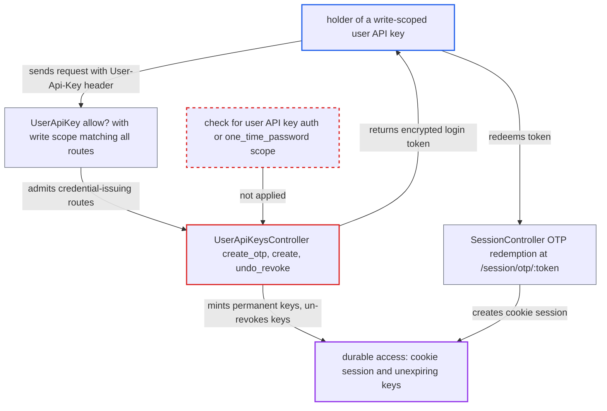

# Write-scoped user API keys can mint login tokens and permanent keys, bypassing expiry and revocation

| Field | Value |
|---|---|
| ID | `find_014wNZFMPoiFZPo9NUbY95zf` |
| Severity | **Medium** |
| Status | open |
| CWE | CWE-863 — Incorrect Authorization |
| Created | 2026-10-27T21:23:31.257866Z |
| Claude Security | https://claude.ai/security/findings/find_014wNZFMPoiFZPo9NUbY95zf |

## Description

Someone holding a write-scoped user API key for a victim can turn it into access that outlives the key's expiry and revocation. They gain no privilege beyond the victim's own. The key's `write` scope matches every route, and the credential-issuing actions of `UserApiKeysController` check only that a user is logged in, so the key can mint login tokens and permanent keys.

1. **attacker** sends `POST /user-api-key/otp.json` with the `User-Api-Key` header. The body carries the attacker's own `public_key`, an `application_name` and `auth_redirect=discourse://auth_redirect`, and `DefaultCurrentUserProvider` accepts the key and sets `current_user` to the key's owner. ([`lib/auth/default_current_user_provider.rb:194-217`](https://github.com/cx-benchmark/discourse/blob/e08ed05b4b1ef773b2de7948a8f88a7c182a3520/lib/auth/default_current_user_provider.rb#L194-L217))
2. **the `write` scope matcher** lets the request through to every route. `write` has no `actions` restriction, so `UserApiKey#allow?` passes the credential-issuing routes, and CSRF failures are ignored for user API requests. ([`app/models/user_api_key_scope.rb:5-9`](https://github.com/cx-benchmark/discourse/blob/e08ed05b4b1ef773b2de7948a8f88a7c182a3520/app/models/user_api_key_scope.rb#L5-L9))
3. **the handler `create_otp`** issues a one-time token for the key's user. It checks only login and `meets_tl?`, not whether a user API key made the request or whether the key has the `one_time_password` scope, and it returns the token encrypted to the attacker's key in the JSON `redirect_url`. ([`app/controllers/user_api_keys_controller.rb:419-436`](https://github.com/cx-benchmark/discourse/blob/e08ed05b4b1ef773b2de7948a8f88a7c182a3520/app/controllers/user_api_keys_controller.rb#L419-L436))
4. **attacker** decrypts the token and redeems it at `POST /session/otp/:token`. The action calls `log_on_user` with no second-factor step, which creates a cookie session that does not depend on the API key. ([`app/controllers/session_controller.rb:556-575`](https://github.com/cx-benchmark/discourse/blob/e08ed05b4b1ef773b2de7948a8f88a7c182a3520/app/controllers/session_controller.rb#L556-L575))
5. **attacker** calls `create` without `expires_in_seconds` to mint another key. The new key can have any site-allowed scope and a nil `expires_at`, and reusing the original `client_id` replaces that client's key, so the Apps list looks unchanged. ([`app/controllers/user_api_keys_controller.rb:73-98`](https://github.com/cx-benchmark/discourse/blob/e08ed05b4b1ef773b2de7948a8f88a7c182a3520/app/controllers/user_api_keys_controller.rb#L73-L98))
6. **attacker** calls `undo_revoke` to clear `revoked_at` on the user's other keys. The action works on any key owned by the same user, so it undoes revocations for keys whose secret the attacker holds. ([`app/controllers/user_api_keys_controller.rb:451-454`](https://github.com/cx-benchmark/discourse/blob/e08ed05b4b1ef773b2de7948a8f88a7c182a3520/app/controllers/user_api_keys_controller.rb#L451-L454))

## Assessment

The attacker holds a write-scoped user API key for the victim. That could be an app the victim authorized, for example through the device flow or with a short expiry, or someone who obtained the key. The key needs only `read,write` consent. The device flow forbids `one_time_password` through `DISALLOWED_DEVICE_SCOPES`, and the attack gets around that. No action by the victim is needed. The attacker can redeem the login token for a cookie session, mint a permanent key with `create`, or un-revoke other keys with `undo_revoke`. Any of the three works on its own.

Impact: The attacker keeps acting as the victim, and keeps reading the victim's private data, after the original key has expired or been revoked. The cookie session lasts up to `maximum_session_age` (1440 h by default, rotating). The attacker also gets the login-token capability that the consent screen lists as a separate grant and the device flow withholds. The new credentials carry only the victim's own privileges.

## Recommendation

`UserApiKeysController#create`, `#create_otp`, `#undo_revoke` and `#authorize_device_request` accept requests authenticated only by a user API key, and the `write` scope matches every route. A delegated key can therefore issue new credentials beyond its consented scopes, expiry and revocation.

Fix criteria: A request authenticated by a user API key cannot create one-time login tokens, create user API keys, un-revoke keys or approve device grants, unless a scope explicitly grants that capability. Device-issued keys never obtain an OTP. To verify, use a write-only key, a device-issued key and a short-lived key. `POST /user-api-key/otp.json`, `/user-api-key.json`, `/user-api-key/undo-revoke` and `/user-api-key/device/authorize` must all be rejected for each of them. Users with a browser session can still authorize apps and create OTPs.

## Evidence

**https://github.com/cx-benchmark/discourse**

- [`app/controllers/user_api_keys_controller.rb:419-436`](https://github.com/cx-benchmark/discourse/blob/e08ed05b4b1ef773b2de7948a8f88a7c182a3520/app/controllers/user_api_keys_controller.rb#L419-L436)
- [`app/controllers/user_api_keys_controller.rb:73-98`](https://github.com/cx-benchmark/discourse/blob/e08ed05b4b1ef773b2de7948a8f88a7c182a3520/app/controllers/user_api_keys_controller.rb#L73-L98)
- [`app/models/user_api_key_scope.rb:5-9`](https://github.com/cx-benchmark/discourse/blob/e08ed05b4b1ef773b2de7948a8f88a7c182a3520/app/models/user_api_key_scope.rb#L5-L9)
- [`app/models/user_api_key.rb:86-88`](https://github.com/cx-benchmark/discourse/blob/e08ed05b4b1ef773b2de7948a8f88a7c182a3520/app/models/user_api_key.rb#L86-L88)
- [`lib/auth/default_current_user_provider.rb:194-217`](https://github.com/cx-benchmark/discourse/blob/e08ed05b4b1ef773b2de7948a8f88a7c182a3520/lib/auth/default_current_user_provider.rb#L194-L217)
- [`app/controllers/application_controller.rb:28-35`](https://github.com/cx-benchmark/discourse/blob/e08ed05b4b1ef773b2de7948a8f88a7c182a3520/app/controllers/application_controller.rb#L28-L35)
- [`app/controllers/user_api_keys_controller.rb:696-711`](https://github.com/cx-benchmark/discourse/blob/e08ed05b4b1ef773b2de7948a8f88a7c182a3520/app/controllers/user_api_keys_controller.rb#L696-L711)
- [`app/controllers/session_controller.rb:556-575`](https://github.com/cx-benchmark/discourse/blob/e08ed05b4b1ef773b2de7948a8f88a7c182a3520/app/controllers/session_controller.rb#L556-L575)
- [`app/services/user_api_key/device_auth.rb:32`](https://github.com/cx-benchmark/discourse/blob/e08ed05b4b1ef773b2de7948a8f88a7c182a3520/app/services/user_api_key/device_auth.rb#L32)
- [`app/controllers/user_api_keys_controller.rb:451-454`](https://github.com/cx-benchmark/discourse/blob/e08ed05b4b1ef773b2de7948a8f88a7c182a3520/app/controllers/user_api_keys_controller.rb#L451-L454)

