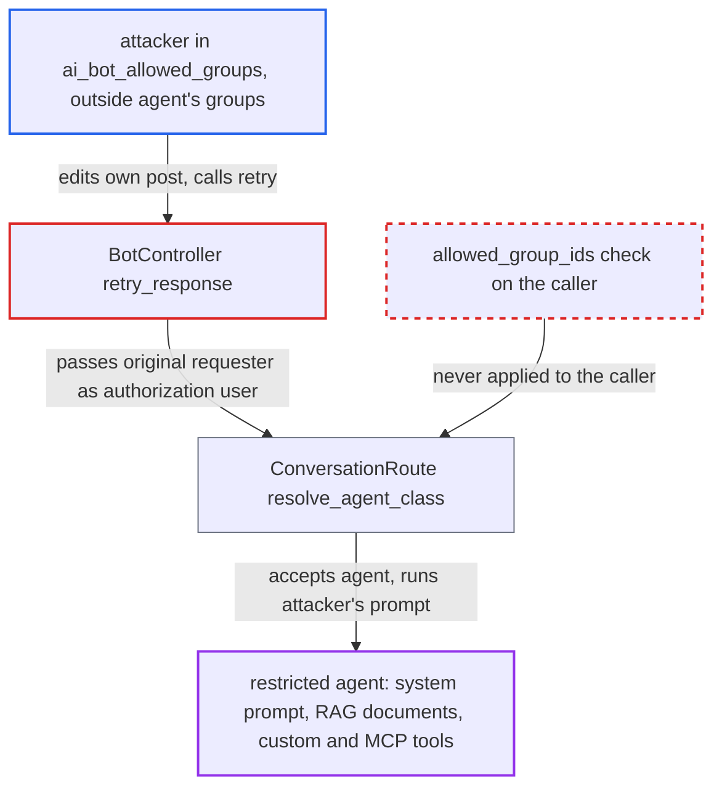

# AI bot retry authorizes a group-restricted agent as the original requester, not the caller

| Field | Value |
|---|---|
| ID | `find_01LRLYPCt8qxyn3GSq28hQQq` |
| Severity | **Low** |
| Status | open |
| CWE | CWE-863 — Incorrect authorization |
| Created | 2026-10-27T21:11:23.780527Z |
| Claude Security | https://claude.ai/security/findings/find_01LRLYPCt8qxyn3GSq28hQQq |

## Description

A user who may talk to AI bots but is not in a restricted agent's allowed groups can still make that agent answer prompts they choose. The agent's system prompt, uploaded documents and custom or MCP tools are reachable this way, and the result overwrites an existing bot reply. The attacker must be in `ai_bot_allowed_groups` (by default TL4 or staff). The cause is that `retry_response` and `CreateAiReply` check the agent's `allowed_group_ids` against the original requester, not the caller.

1. **authorized user** mentions the group-restricted agent in a public topic the attacker can post in. Outside personal messages `stream_reply` is false, so the bot reply post is created only after the LLM finishes, which leaves a window for other users' posts. ([`plugins/discourse-ai/lib/ai_bot/playground.rb:809-952`](https://github.com/cx-benchmark/discourse/blob/e08ed05b4b1ef773b2de7948a8f88a7c182a3520/plugins/discourse-ai/lib/ai_bot/playground.rb#L809-L952))
2. **attacker** posts in the topic during that window, so the post sits right before the bot reply. `find_prompt_post` returns the last non-bot post before the bot reply, whoever wrote it, so the attacker now owns the prompt that is re-run. ([`plugins/discourse-ai/app/controllers/discourse_ai/ai_bot/bot_controller.rb:115-126`](https://github.com/cx-benchmark/discourse/blob/e08ed05b4b1ef773b2de7948a8f88a7c182a3520/plugins/discourse-ai/app/controllers/discourse_ai/ai_bot/bot_controller.rb#L115-L126))
3. **attacker** edits that post to any prompt and calls `POST /discourse-ai/ai-bot/post/<reply_id>/retry`. `retry_response` only checks `ai_bot_allowed_groups` and `can_see?`. It sets `authorization_user_id` from the bot post's `ai_agent_authorization_user_id` field, or from `topic.user_id`, and passes the caller only as `visibility_user_id`. ([`plugins/discourse-ai/app/controllers/discourse_ai/ai_bot/bot_controller.rb:64-103`](https://github.com/cx-benchmark/discourse/blob/e08ed05b4b1ef773b2de7948a8f88a7c182a3520/plugins/discourse-ai/app/controllers/discourse_ai/ai_bot/bot_controller.rb#L64-L103))
4. **the job `Jobs::CreateAiReply`** resolves the agent as the original requester. It loads `authorization_user` from `args[:authorization_user_id]`, picks modality `:retry` and calls `ConversationRoute.resolve` as that user. ([`plugins/discourse-ai/app/jobs/regular/create_ai_reply.rb:16-69`](https://github.com/cx-benchmark/discourse/blob/e08ed05b4b1ef773b2de7948a8f88a7c182a3520/plugins/discourse-ai/app/jobs/regular/create_ai_reply.rb#L16-L69))
5. **`resolve_agent_class`** accepts the agent because the original requester is allowed to use it. `Agent.find_by(user: @authorization_user, id:)` is the only check of `allowed_group_ids` on this path, and `validate_modality!` returns true for `:retry`, so the caller's own membership is never tested. ([`plugins/discourse-ai/lib/ai_bot/conversation_route.rb:126-140`](https://github.com/cx-benchmark/discourse/blob/e08ed05b4b1ef773b2de7948a8f88a7c182a3520/plugins/discourse-ai/lib/ai_bot/conversation_route.rb#L126-L140))
6. **restricted agent** answers the attacker's prompt using its system prompt, documents and tools. `search_uploaded_documents` searches `RagDocumentFragment` by agent id with no user check, and the regenerated text overwrites the existing bot post. ([`plugins/discourse-ai/lib/agents/tools/search_uploaded_documents.rb:63-80`](https://github.com/cx-benchmark/discourse/blob/e08ed05b4b1ef773b2de7948a8f88a7c182a3520/plugins/discourse-ai/lib/agents/tools/search_uploaded_documents.rb#L63-L80))

## Assessment

The attacker is a registered user in `ai_bot_allowed_groups` (by default TL4 or staff) who is outside the restricted agent's `allowed_group_ids`. An authorized user must first mention the restricted agent in a public topic where the attacker can post. The attacker then posts during the LLM latency window so their post comes right before the bot reply. Another route needs no race: the caller edits their own earlier posts that sit in the topic context window and retries. That re-runs the restricted agent over injected content without the authorized user doing anything. The retry can be repeated without limit.

Impact: The attacker can use an agent that admins restricted to other groups: its system prompt, its uploaded RAG documents and its custom or MCP tools answer prompts the attacker chooses. The regenerated text overwrites an existing bot post. Tool calls run as the prompt post's author, here the attacker, and history is filtered with the caller's guardian, so core content visibility is kept. Only the per-agent group restriction is bypassed, so the loss is limited to agent-scoped data and behaviour.

## Recommendation

`retry_response` and `CreateAiReply` authorize the retry with the recorded original requester, so the agent's `allowed_group_ids` are never checked against the user who triggers the retry. The re-run prompt is taken from whatever post precedes the reply.

Fix criteria: A retry succeeds only if the caller may use the resolved agent, or only if the re-run prompt is provably the one the recorded authorization user wrote (for example, the prompt post's author equals the authorization user). Test: a user outside the agent's `allowed_group_ids` who owns the post before a restricted agent's reply gets 403 on retry, or no regenerated reply, and no restricted-agent LLM call runs.

## Evidence

**https://github.com/cx-benchmark/discourse**

- [`plugins/discourse-ai/app/controllers/discourse_ai/ai_bot/bot_controller.rb:64-103`](https://github.com/cx-benchmark/discourse/blob/e08ed05b4b1ef773b2de7948a8f88a7c182a3520/plugins/discourse-ai/app/controllers/discourse_ai/ai_bot/bot_controller.rb#L64-L103)
- [`plugins/discourse-ai/app/controllers/discourse_ai/ai_bot/bot_controller.rb:115-126`](https://github.com/cx-benchmark/discourse/blob/e08ed05b4b1ef773b2de7948a8f88a7c182a3520/plugins/discourse-ai/app/controllers/discourse_ai/ai_bot/bot_controller.rb#L115-L126)
- [`plugins/discourse-ai/app/jobs/regular/create_ai_reply.rb:16-69`](https://github.com/cx-benchmark/discourse/blob/e08ed05b4b1ef773b2de7948a8f88a7c182a3520/plugins/discourse-ai/app/jobs/regular/create_ai_reply.rb#L16-L69)
- [`plugins/discourse-ai/lib/ai_bot/conversation_route.rb:126-140`](https://github.com/cx-benchmark/discourse/blob/e08ed05b4b1ef773b2de7948a8f88a7c182a3520/plugins/discourse-ai/lib/ai_bot/conversation_route.rb#L126-L140)
- [`plugins/discourse-ai/lib/agents/agent.rb:84-101`](https://github.com/cx-benchmark/discourse/blob/e08ed05b4b1ef773b2de7948a8f88a7c182a3520/plugins/discourse-ai/lib/agents/agent.rb#L84-L101)
- [`plugins/discourse-ai/lib/ai_bot/playground.rb:809-952`](https://github.com/cx-benchmark/discourse/blob/e08ed05b4b1ef773b2de7948a8f88a7c182a3520/plugins/discourse-ai/lib/ai_bot/playground.rb#L809-L952)
- [`plugins/discourse-ai/lib/agents/tools/search_uploaded_documents.rb:63-80`](https://github.com/cx-benchmark/discourse/blob/e08ed05b4b1ef773b2de7948a8f88a7c182a3520/plugins/discourse-ai/lib/agents/tools/search_uploaded_documents.rb#L63-L80)

