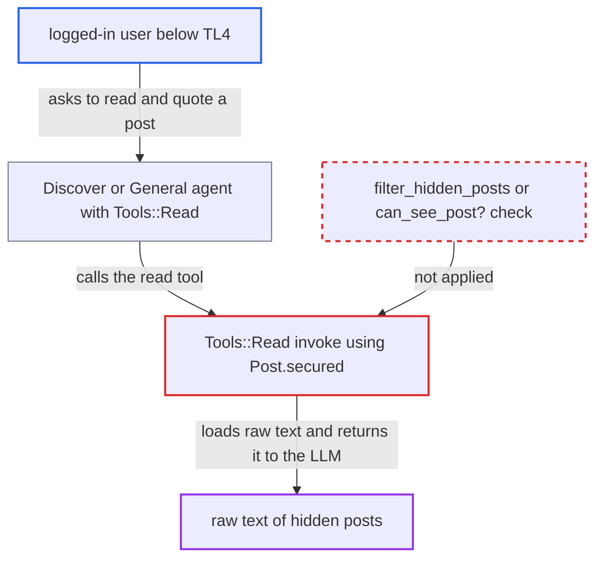

# AI read tool returns raw content of flag-hidden posts to any bot user

| Field | Value |
|---|---|
| ID | `find_011UXQXbdVYUzGHz6Mrjoz9Q` |
| Severity | **Low** |
| Status | open |
| CWE | CWE-862 — Missing authorization |
| Created | 2026-10-27T21:15:24.913066Z |
| Claude Security | https://claude.ai/security/findings/find_011UXQXbdVYUzGHz6Mrjoz9Q |

## Description

A logged-in user below trust level 4 can make the AI bot reveal the raw text of posts that moderation or community flags hid, in topics the user can already see. This works only when the AI feature is opened to lower trust levels, which is not the default. The `read` tool loads posts with `Post.secured(guardian)`, which never excludes `hidden` posts.

1. **attacker** asks an AI agent to read a topic and quote a post. The attacker names the topic and the `post_numbers` of a hidden post, through AI Discover (`/discoveries/reply`) or a PM to the bot where `ai_bot_allowed_groups` was widened. ([`plugins/discourse-ai/app/controllers/discourse_ai/discover/discoveries_controller.rb:170-186`](https://github.com/cx-benchmark/discourse/blob/e08ed05b4b1ef773b2de7948a8f88a7c182a3520/plugins/discourse-ai/app/controllers/discourse_ai/discover/discoveries_controller.rb#L170-L186))
2. **the tool `Tools::Read`** checks only that the topic is visible. The guardian is anonymous, or the user's guardian with `read_private`, and it gates only `can_see?(topic)`, not individual posts. ([`plugins/discourse-ai/lib/agents/tools/read.rb:49-57`](https://github.com/cx-benchmark/discourse/blob/e08ed05b4b1ef773b2de7948a8f88a7c182a3520/plugins/discourse-ai/lib/agents/tools/read.rb#L49-L57))
3. **the tool `Tools::Read`** loads up to 100 posts with `Post.secured(guardian)`. `Post.secured` filters only on `post_type`, so posts with `hidden = true` are included and `filter_hidden_posts` or `can_see_post?` is never called. ([`plugins/discourse-ai/lib/agents/tools/read.rb:61-62`](https://github.com/cx-benchmark/discourse/blob/e08ed05b4b1ef773b2de7948a8f88a7c182a3520/plugins/discourse-ai/lib/agents/tools/read.rb#L61-L62))
4. **the tool `Tools::Read`** appends each post's `post.raw` to the tool result for the LLM. The hidden post's raw text is placed in the model's context without any further check. ([`plugins/discourse-ai/lib/agents/tools/read.rb:86-94`](https://github.com/cx-benchmark/discourse/blob/e08ed05b4b1ef773b2de7948a8f88a7c182a3520/plugins/discourse-ai/lib/agents/tools/read.rb#L86-L94))
5. **the LLM** relays the hidden post's raw text to the attacker. The Discover agent's prompt tells the model to quote passages verbatim, so the text comes back in the reply. ([`plugins/discourse-ai/lib/agents/discover.rb:10-12`](https://github.com/cx-benchmark/discourse/blob/e08ed05b4b1ef773b2de7948a8f88a7c182a3520/plugins/discourse-ai/lib/agents/discover.rb#L10-L12))

## Assessment

The attacker is a logged-in user who is not in `hidden_post_visible_groups` (default `14`, TL4) and who can use an agent that has `Tools::Read`. `Tools::Read` is part of the default `General` and `Discover` agents. The AI feature must be enabled with an LLM configured and opened to lower trust levels, which is not the default. One route is AI Discover (`ai_discover_enabled`), where the Discover agent is seeded for TL0 and `/discoveries/reply` is called without a `request_id`. Another is a widened `ai_bot_allowed_groups`. A third is chat DM or mention modalities, which check only the agent's own groups. With shipped defaults the PM bot is limited to `ai_bot_allowed_groups` `3|14` (staff, TL4), and those users can already see hidden posts.

Impact: The attacker can read the raw text of posts hidden by flags or moderators, such as spam, abuse or doxxing pending review. This is limited to hidden posts in topics the attacker can already see. Deleted posts and whispers stay filtered, and nothing can be modified.

## Recommendation

`Tools::Read#invoke` selects posts with `Post.secured(guardian)`, which filters only post types. Posts with `hidden = true` are returned and their raw text is disclosed, although core authorization (`can_see_post?`) denies them to users who are not staff and not the author.

Fix criteria: The `read` tool returns only posts the acting guardian may see under core rules. Hidden posts are excluded unless the guardian is staff, a category moderator or the post author, for example by applying `guardian.filter_hidden_posts` or filtering with `can_see_post?`. Verify by asking the bot to read a topic containing a hidden post as a non-staff user. The hidden post's raw text must be absent and visible posts must still be returned.

## Evidence

**https://github.com/cx-benchmark/discourse**

- [`plugins/discourse-ai/lib/agents/tools/read.rb:61-62`](https://github.com/cx-benchmark/discourse/blob/e08ed05b4b1ef773b2de7948a8f88a7c182a3520/plugins/discourse-ai/lib/agents/tools/read.rb#L61-L62)
- [`plugins/discourse-ai/lib/agents/tools/read.rb:86-94`](https://github.com/cx-benchmark/discourse/blob/e08ed05b4b1ef773b2de7948a8f88a7c182a3520/plugins/discourse-ai/lib/agents/tools/read.rb#L86-L94)
- [`plugins/discourse-ai/lib/agents/tools/read.rb:49-57`](https://github.com/cx-benchmark/discourse/blob/e08ed05b4b1ef773b2de7948a8f88a7c182a3520/plugins/discourse-ai/lib/agents/tools/read.rb#L49-L57)
- [`app/models/post.rb:120-121`](https://github.com/cx-benchmark/discourse/blob/e08ed05b4b1ef773b2de7948a8f88a7c182a3520/app/models/post.rb#L120-L121)
- [`lib/guardian/post_guardian.rb:314-325`](https://github.com/cx-benchmark/discourse/blob/e08ed05b4b1ef773b2de7948a8f88a7c182a3520/lib/guardian/post_guardian.rb#L314-L325)
- [`lib/guardian/post_guardian.rb:351-381`](https://github.com/cx-benchmark/discourse/blob/e08ed05b4b1ef773b2de7948a8f88a7c182a3520/lib/guardian/post_guardian.rb#L351-L381)
- [`app/controllers/posts_controller.rb:780-786`](https://github.com/cx-benchmark/discourse/blob/e08ed05b4b1ef773b2de7948a8f88a7c182a3520/app/controllers/posts_controller.rb#L780-L786)
- [`plugins/discourse-ai/lib/agents/tools/read_post.rb:75`](https://github.com/cx-benchmark/discourse/blob/e08ed05b4b1ef773b2de7948a8f88a7c182a3520/plugins/discourse-ai/lib/agents/tools/read_post.rb#L75)
- [`plugins/discourse-ai/lib/agents/discover.rb:10-12`](https://github.com/cx-benchmark/discourse/blob/e08ed05b4b1ef773b2de7948a8f88a7c182a3520/plugins/discourse-ai/lib/agents/discover.rb#L10-L12)
- [`plugins/discourse-ai/app/controllers/discourse_ai/discover/discoveries_controller.rb:170-186`](https://github.com/cx-benchmark/discourse/blob/e08ed05b4b1ef773b2de7948a8f88a7c182a3520/plugins/discourse-ai/app/controllers/discourse_ai/discover/discoveries_controller.rb#L170-L186)
- [`plugins/discourse-ai/app/jobs/regular/stream_discover_reply.rb:303-342`](https://github.com/cx-benchmark/discourse/blob/e08ed05b4b1ef773b2de7948a8f88a7c182a3520/plugins/discourse-ai/app/jobs/regular/stream_discover_reply.rb#L303-L342)
- [`plugins/discourse-ai/db/fixtures/agents/603_ai_agents.rb:61-62`](https://github.com/cx-benchmark/discourse/blob/e08ed05b4b1ef773b2de7948a8f88a7c182a3520/plugins/discourse-ai/db/fixtures/agents/603_ai_agents.rb#L61-L62)
- [`plugins/discourse-ai/lib/ai_bot/playground.rb:1169-1172`](https://github.com/cx-benchmark/discourse/blob/e08ed05b4b1ef773b2de7948a8f88a7c182a3520/plugins/discourse-ai/lib/ai_bot/playground.rb#L1169-L1172)
- [`plugins/discourse-ai/lib/agents/general.rb:10-16`](https://github.com/cx-benchmark/discourse/blob/e08ed05b4b1ef773b2de7948a8f88a7c182a3520/plugins/discourse-ai/lib/agents/general.rb#L10-L16)

