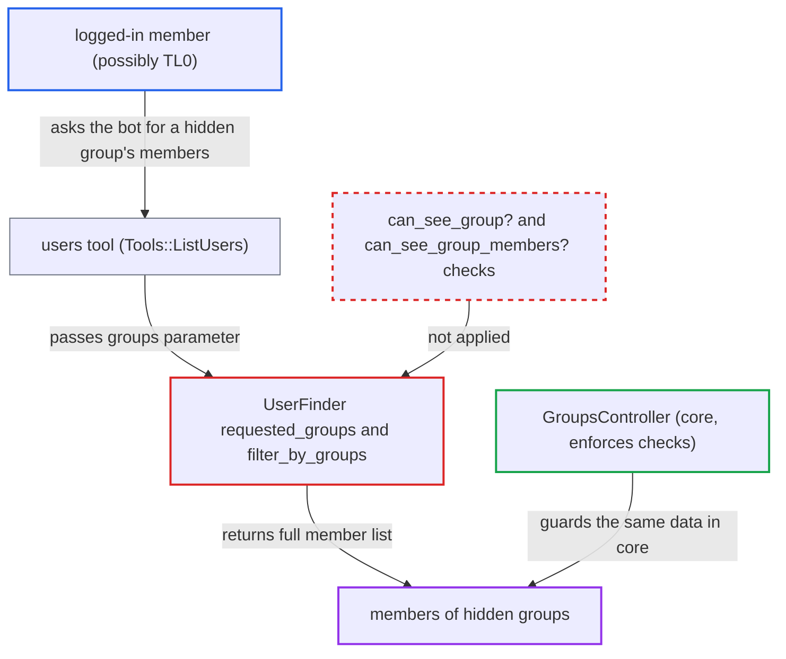

# AI users tool lists members of hidden groups without guardian visibility checks

| Field | Value |
|---|---|
| ID | `find_01Hiw9dic8C9ZdGjLFvqyyuM` |
| Severity | **Low** |
| Status | open |
| CWE | CWE-862 — Missing authorization |
| Created | 2026-10-27T21:12:49.942750Z |
| Claude Security | https://claude.ai/security/findings/find_01Hiw9dic8C9ZdGjLFvqyyuM |

## Description

A logged-in member can use an AI agent to list the members of groups that core Discourse hides from them, and to check whether a hidden group name exists. The agent must have the built-in `users` tool and the member must be allowed to use it. `DiscourseAi::Agents::UserFinder` resolves groups and lists their members without applying the caller's guardian visibility checks.

1. **logged-in member** messages an AI agent that has the `users` tool. The member must be in the agent's `allowed_group_ids`, and the message asks for the members of a named hidden group. ([`plugins/discourse-ai/lib/agents/bot_context.rb:117-123`](https://github.com/cx-benchmark/discourse/blob/e08ed05b4b1ef773b2de7948a8f88a7c182a3520/plugins/discourse-ai/lib/agents/bot_context.rb#L117-L123))
2. **the LLM** emits a `users` tool call with a `groups` parameter. `Tools::ListUsers#invoke` passes the LLM-supplied `groups` and status parameters straight to `UserFinder` together with the triggering user's guardian. ([`plugins/discourse-ai/lib/agents/tools/list_users.rb:73-79`](https://github.com/cx-benchmark/discourse/blob/e08ed05b4b1ef773b2de7948a8f88a7c182a3520/plugins/discourse-ai/lib/agents/tools/list_users.rb#L73-L79))
3. **the finder `UserFinder#requested_groups`** resolves the group by id, name or auto-group symbol. It never calls `can_see_group?`, so a hidden group can be addressed, and the `Group not found` error tells whether a name exists. ([`plugins/discourse-ai/lib/agents/user_finder.rb:48-69`](https://github.com/cx-benchmark/discourse/blob/e08ed05b4b1ef773b2de7948a8f88a7c182a3520/plugins/discourse-ai/lib/agents/user_finder.rb#L48-L69))
4. **the finder `UserFinder#filter_by_groups`** joins `group_users` for the resolved groups. There is no `can_see_group_members?` check against the guardian, so every member is returned. ([`plugins/discourse-ai/lib/agents/user_finder.rb:148-152`](https://github.com/cx-benchmark/discourse/blob/e08ed05b4b1ef773b2de7948a8f88a7c182a3520/plugins/discourse-ai/lib/agents/user_finder.rb#L148-L152))
5. **the bot** writes the member list into its reply. The requester sees usernames, names and ids of members of groups that core would hide from them.

## Assessment

The attacker is a logged-in member, who may be low trust level. The member must be in the `allowed_group_ids` of an agent that an admin has given the built-in `users` tool. No system agent ships with the tool, so an admin must have added it to an agent that non-staff can use. The attacker sends the agent a message such as "list members of group" followed by a hidden group's name. In a bot PM reply the guardian belongs to the post author. Secondarily, the status filters in `filter_by_status` and the output in `serialize_user` let any caller list staged, inactive and anonymous shadow accounts.

Impact: The attacker can read usernames, names and ids of members of groups whose members or existence core hides from them, up to 100 per call and repeatable. They can also confirm whether a hidden group name exists. Secondarily they can list staged, inactive and anonymous shadow accounts. Nothing is modified and availability is not affected.

## Recommendation

(1) `UserFinder#requested_groups` and `#filter_by_groups` resolve groups and list their members without applying the caller's guardian, so core group and member visibility rules are bypassed.

Fix criteria: A group the guardian cannot see (`can_see_group?`), or whose members it cannot see (`can_see_group_members?`), is treated exactly like a group that does not exist, and its members are never returned. A non-staff user who asks the bot for members of a group with `members_visibility_level` owners/staff, or `visibility_level` staff/members, gets `Group not found` and no rows. Admins and permitted members still get results.

(2) The `staged`/`active`/`real` filters and output flags let non-staff callers enumerate staged, inactive and anonymous shadow accounts that core search hides from them.

Fix criteria: For non-staff guardians, only the accounts core user search would return to that user are returned. No staged or anonymous shadow records appear unless `can_search_staged_users?` allows it. With a TL0 guardian, `staged: true` or `real: false` returns no rows.

## Evidence

**https://github.com/cx-benchmark/discourse**

- [`plugins/discourse-ai/lib/agents/user_finder.rb:148-152`](https://github.com/cx-benchmark/discourse/blob/e08ed05b4b1ef773b2de7948a8f88a7c182a3520/plugins/discourse-ai/lib/agents/user_finder.rb#L148-L152)
- [`plugins/discourse-ai/lib/agents/user_finder.rb:48-69`](https://github.com/cx-benchmark/discourse/blob/e08ed05b4b1ef773b2de7948a8f88a7c182a3520/plugins/discourse-ai/lib/agents/user_finder.rb#L48-L69)
- [`plugins/discourse-ai/lib/agents/tools/list_users.rb:73-79`](https://github.com/cx-benchmark/discourse/blob/e08ed05b4b1ef773b2de7948a8f88a7c182a3520/plugins/discourse-ai/lib/agents/tools/list_users.rb#L73-L79)
- [`plugins/discourse-ai/lib/agents/tools/tool.rb:364-366`](https://github.com/cx-benchmark/discourse/blob/e08ed05b4b1ef773b2de7948a8f88a7c182a3520/plugins/discourse-ai/lib/agents/tools/tool.rb#L364-L366)
- [`plugins/discourse-ai/lib/agents/bot_context.rb:117-123`](https://github.com/cx-benchmark/discourse/blob/e08ed05b4b1ef773b2de7948a8f88a7c182a3520/plugins/discourse-ai/lib/agents/bot_context.rb#L117-L123)
- [`app/controllers/groups_controller.rb:200-203`](https://github.com/cx-benchmark/discourse/blob/e08ed05b4b1ef773b2de7948a8f88a7c182a3520/app/controllers/groups_controller.rb#L200-L203)
- [`lib/guardian.rb:304-345`](https://github.com/cx-benchmark/discourse/blob/e08ed05b4b1ef773b2de7948a8f88a7c182a3520/lib/guardian.rb#L304-L345)
- [`plugins/discourse-ai/lib/agents/user_finder.rb:110-146`](https://github.com/cx-benchmark/discourse/blob/e08ed05b4b1ef773b2de7948a8f88a7c182a3520/plugins/discourse-ai/lib/agents/user_finder.rb#L110-L146)

