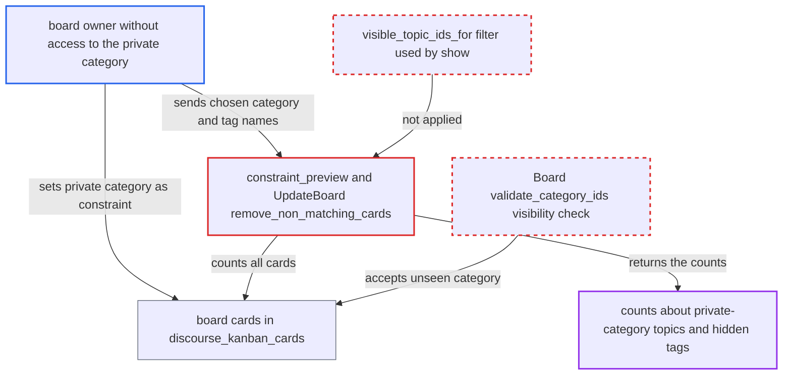

# Board constraint-preview and update counts include cards for topics the manager cannot read

| Field | Value |
|---|---|
| ID | `find_01Xs381JXz9GyGi3Kex8ZpfA` |
| Severity | **Low** |
| Status | open |
| CWE | CWE-200 — Information exposure |
| Created | 2026-10-27T21:44:45.301938Z |
| Claude Security | https://claude.ai/security/findings/find_01Xs381JXz9GyGi3Kex8ZpfA |

## Description

A non-staff user who has been made owner of a board can learn counts about topics in private categories they cannot read. This includes how many topics carry given tags, how cards split between categories, and whether hidden tags exist. No titles or content leak. Two manager endpoints, `constraint_preview` and the board update that returns `cards_removed_count`, count all board cards without the per-viewer visibility filter.

1. **an admin or existing board owner** names a non-staff user as board owner. Board ownership is enough to pass `can_manage_board?`, and it does not imply read access to any private category. ([`app/services/access_control_list/apply.rb:122-127`](https://github.com/cx-benchmark/discourse/blob/e08ed05b4b1ef773b2de7948a8f88a7c182a3520/app/services/access_control_list/apply.rb#L122-L127))
2. **the board owner** sets a read-restricted category as the board's `category_ids` and adds tagged columns. `Board#validate_category_ids` only checks that the category exists, so a category the owner cannot see is accepted. ([`plugins/boards/app/models/boards/board.rb:226-238`](https://github.com/cx-benchmark/discourse/blob/e08ed05b4b1ef773b2de7948a8f88a7c182a3520/plugins/boards/app/models/boards/board.rb#L226-L238))
3. **the board owner** opens the board with `GET /boards/api/boards/:id`. The backfill selects topics through `build_column_topic_map` with no guardian, so cards are created for private-category topics, up to 200 per column. ([`plugins/boards/app/services/boards/topic_sync.rb:431-461`](https://github.com/cx-benchmark/discourse/blob/e08ed05b4b1ef773b2de7948a8f88a7c182a3520/plugins/boards/app/services/boards/topic_sync.rb#L431-L461))
4. **the handler `constraint_preview`** counts the board's cards that fail the caller's `category_ids` and `tag_names`. The count joins `topics` without `secured(guardian)`, and `tag_names` is resolved with `Tag.where(name:)` without a tag-visibility check, so the owner can probe hidden tags and categories. ([`plugins/boards/app/controllers/boards/api/boards_controller.rb:196-236`](https://github.com/cx-benchmark/discourse/blob/e08ed05b4b1ef773b2de7948a8f88a7c182a3520/plugins/boards/app/controllers/boards/api/boards_controller.rb#L196-L236))
5. **the service `UpdateBoard`** returns `cards_removed_count` from `PUT /boards/api/boards/:id`. `remove_non_matching_cards` counts non-matching cards over every card, visible or not. This is a second way to read the same kind of count. ([`plugins/boards/app/services/boards/update_board.rb:113-140`](https://github.com/cx-benchmark/discourse/blob/e08ed05b4b1ef773b2de7948a8f88a7c182a3520/plugins/boards/app/services/boards/update_board.rb#L113-L140))

## Assessment

The attacker is a logged-in user who has been made owner of a board, on a site where the opt-in Boards plugin is enabled. A member of `boards_manage_board_allowed_groups` (admins and moderators by default) who holds `manage` also passes the manager check. The attacker either sets the board's `category_ids` to a private category and adds tagged columns, or uses a board that already holds private cards. They then call `POST /boards/api/boards/:id/constraint-preview` with chosen `category_ids` and `tag_names`, or read `cards_removed_count` from the update. No victim action is needed.

Impact: The attacker learns aggregate metadata about read-restricted content: how many topics in a private category carry chosen tags, how they split between categories, whether hidden tags exist and how often they are used. `board_updated` MessageBus pushes also reveal when private topics are created or retagged. Counts are capped at 200 cards per column. No titles, posts or users are disclosed and nothing is modified. Moderators can already get per-category topic counts from the staff `topics` report, so the extra gain is mainly for non-staff board owners.

## Recommendation

(1) `constraint_preview` and `UpdateBoard#remove_non_matching_cards` count all board cards, including cards for topics the acting user cannot see. `constraint_preview` also resolves `tag_names` without checking tag visibility. This breaks the per-viewer visibility that `show` enforces.

Fix criteria: Every count returned to the caller (`cards_to_remove`, `cards_removed_count`) covers only topics the acting guardian can see. Tag names resolve only to tags visible to the guardian. To verify: with private-category cards on a board, a manager without access gets counts equal to what they can see on the board, and an unseen hidden tag name changes nothing.

(2) `Board#validate_category_ids` and the create and update services accept any existing category id as a constraint. A manager can therefore target a read-restricted category they cannot see.

Fix criteria: Creating or updating a board rejects `category_ids` the acting guardian cannot see, as is already done for tags. The rejection does not reveal which unseen ids exist. To verify: a non-member owner who submits a private category id gets the same error as for a nonexistent id.

## Evidence

**https://github.com/cx-benchmark/discourse**

- [`plugins/boards/app/controllers/boards/api/boards_controller.rb:196-236`](https://github.com/cx-benchmark/discourse/blob/e08ed05b4b1ef773b2de7948a8f88a7c182a3520/plugins/boards/app/controllers/boards/api/boards_controller.rb#L196-L236)
- [`plugins/boards/app/services/boards/update_board.rb:113-140`](https://github.com/cx-benchmark/discourse/blob/e08ed05b4b1ef773b2de7948a8f88a7c182a3520/plugins/boards/app/services/boards/update_board.rb#L113-L140)
- [`plugins/boards/app/controllers/boards/api/boards_controller.rb:414-424`](https://github.com/cx-benchmark/discourse/blob/e08ed05b4b1ef773b2de7948a8f88a7c182a3520/plugins/boards/app/controllers/boards/api/boards_controller.rb#L414-L424)
- [`plugins/boards/app/services/boards/topic_sync.rb:431-461`](https://github.com/cx-benchmark/discourse/blob/e08ed05b4b1ef773b2de7948a8f88a7c182a3520/plugins/boards/app/services/boards/topic_sync.rb#L431-L461)
- [`plugins/boards/app/models/boards/board.rb:226-238`](https://github.com/cx-benchmark/discourse/blob/e08ed05b4b1ef773b2de7948a8f88a7c182a3520/plugins/boards/app/models/boards/board.rb#L226-L238)
- [`plugins/boards/lib/boards/guardian_extensions.rb:18-21`](https://github.com/cx-benchmark/discourse/blob/e08ed05b4b1ef773b2de7948a8f88a7c182a3520/plugins/boards/lib/boards/guardian_extensions.rb#L18-L21)
- [`app/services/access_control_list/apply.rb:122-127`](https://github.com/cx-benchmark/discourse/blob/e08ed05b4b1ef773b2de7948a8f88a7c182a3520/app/services/access_control_list/apply.rb#L122-L127)

