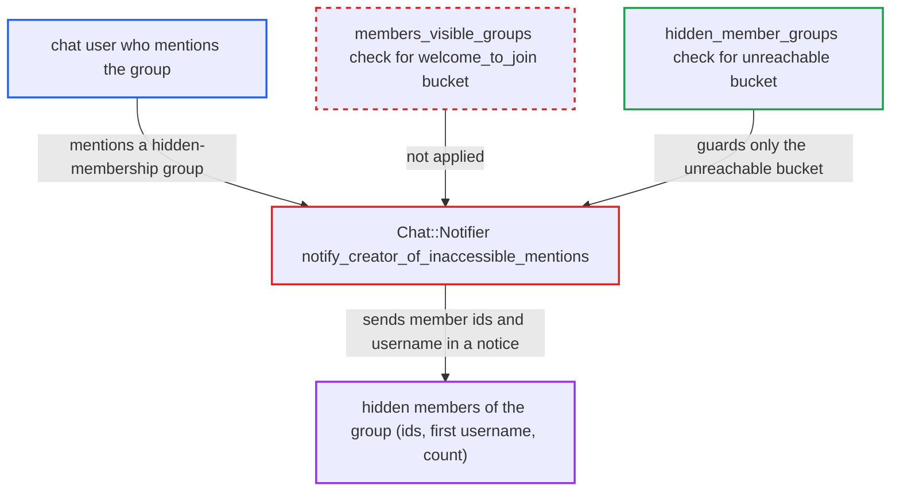

# Chat mention-without-membership notice leaks members of groups with hidden membership

| Field | Value |
|---|---|
| ID | `find_01C6L3xUJd2wxJaMkvawco9E` |
| Severity | **Low** |
| Status | open |
| CWE | CWE-201 — Information exposure |
| Created | 2026-10-27T21:17:25.502871Z |
| Claude Security | https://claude.ai/security/findings/find_01C6L3xUJd2wxJaMkvawco9E |

## Description

A logged-in chat user can learn which members, with chat enabled, belong to a group whose member list is hidden from them. The notice they get lists user ids, one username and a count. It needs a group that is visible and mentionable to the author, and the leak is limited to members who can join the channel but have not. The cause is `notify_creator_of_inaccessible_mentions`, which never checks the group's member visibility for the `welcome_to_join` list.

1. **Attacker (chat user)** posts a message mentioning a hidden-membership group. The group must be visible and mentionable to the author and have at most `max_users_notified_per_group_mention` (100) users, and the channel must be a category channel the author can post in.
2. **`ParsedMentions`** selects the mentioned groups without looking at member visibility. `groups_to_mention` is filtered only by `Group.visible_groups(author)` and `Group.mentionable(author, include_public: false)`, so `members_visibility_level` plays no part. ([`plugins/chat/lib/chat/parsed_mentions.rb:41-60`](https://github.com/cx-benchmark/discourse/blob/e08ed05b4b1ef773b2de7948a8f88a7c182a3520/plugins/chat/lib/chat/parsed_mentions.rb#L41-L60))
3. **`expand_group_mentions`** expands each group into its members and adds those who can join but have not joined to `inaccessible[:welcome_to_join]`. Only members with chat enabled are expanded. ([`plugins/chat/lib/chat/notifier.rb:232-262`](https://github.com/cx-benchmark/discourse/blob/e08ed05b4b1ef773b2de7948a8f88a7c182a3520/plugins/chat/lib/chat/notifier.rb#L232-L262))
4. **`notify_creator_of_inaccessible_mentions`** passes the `welcome_to_join` users on without the hidden-member check. The `unreachable` bucket goes through `show_group_warning` and `hidden_member_groups`, which swap the users for the group name, but `welcome_to_join` does not. ([`plugins/chat/lib/chat/notifier.rb:264-268`](https://github.com/cx-benchmark/discourse/blob/e08ed05b4b1ef773b2de7948a8f88a7c182a3520/plugins/chat/lib/chat/notifier.rb#L264-L268))
5. **`publish_inaccessible_mentions`** sends the author a `mention_without_membership` notice. The notice carries `user_ids` of every such member, the first member's username and the count, published through MessageBus to the author only. ([`plugins/chat/lib/chat/notifier.rb:300-316`](https://github.com/cx-benchmark/discourse/blob/e08ed05b4b1ef773b2de7948a8f88a7c182a3520/plugins/chat/lib/chat/notifier.rb#L300-L316))
6. **Author's browser** receives the ids and can resolve them to user profiles. The client component reads `notice.data.user_ids`, and the ids resolve through `/user-cards.json`. ([`plugins/chat/assets/javascripts/discourse/components/chat/notices/mention_without_membership.gjs:16-18`](https://github.com/cx-benchmark/discourse/blob/e08ed05b4b1ef773b2de7948a8f88a7c182a3520/plugins/chat/assets/javascripts/discourse/components/chat/notices/mention_without_membership.gjs#L16-L18))

## Assessment

The attacker is a logged-in user who is allowed to chat and can post in a category channel. A group must exist that is visible to them and mentionable by them (for example `mentionable_level` set to everyone). That group's `members_visibility_level` must be members, staff or owners, and it must have at most `max_users_notified_per_group_mention` (100) users. The attacker posts `@group`, and `ProcessMessage` runs `Chat::Notifier#notify_new`. No victim action is needed. The attacker can repeat this across channels.

Impact: The attacker learns the user ids of group members the group owner deliberately hid from them, plus one username per notice and the member count. This covers only members who have chat enabled, can join the channel and have not joined it. The report finds no integrity or availability impact.

## Recommendation

`notify_creator_of_inaccessible_mentions` sends the identities of `welcome_to_join` users reached through a group mention without checking whether the author may see that group's members. This breaks the group's `members_visibility_level`.

Fix criteria: The notice sent to the author carries no user id, username or member count for users reached only through a group whose members are not in `Group.members_visible_groups(author)`. Such groups may be named instead, as for the unreachable bucket. To check, mention a visible, mentionable group with `members_visibility_level` staff from a non-staff account in a public channel where a member has not joined. Confirm the MessageBus notice contains no member ids or usernames.

## Evidence

**https://github.com/cx-benchmark/discourse**

- [`plugins/chat/lib/chat/notifier.rb:264-268`](https://github.com/cx-benchmark/discourse/blob/e08ed05b4b1ef773b2de7948a8f88a7c182a3520/plugins/chat/lib/chat/notifier.rb#L264-L268)
- [`plugins/chat/lib/chat/notifier.rb:300-316`](https://github.com/cx-benchmark/discourse/blob/e08ed05b4b1ef773b2de7948a8f88a7c182a3520/plugins/chat/lib/chat/notifier.rb#L300-L316)
- [`plugins/chat/lib/chat/notifier.rb:232-262`](https://github.com/cx-benchmark/discourse/blob/e08ed05b4b1ef773b2de7948a8f88a7c182a3520/plugins/chat/lib/chat/notifier.rb#L232-L262)
- [`plugins/chat/lib/chat/notifier.rb:290-298`](https://github.com/cx-benchmark/discourse/blob/e08ed05b4b1ef773b2de7948a8f88a7c182a3520/plugins/chat/lib/chat/notifier.rb#L290-L298)
- [`plugins/chat/lib/chat/parsed_mentions.rb:41-60`](https://github.com/cx-benchmark/discourse/blob/e08ed05b4b1ef773b2de7948a8f88a7c182a3520/plugins/chat/lib/chat/parsed_mentions.rb#L41-L60)
- [`app/models/group.rb:246-310`](https://github.com/cx-benchmark/discourse/blob/e08ed05b4b1ef773b2de7948a8f88a7c182a3520/app/models/group.rb#L246-L310)
- [`app/controllers/composer_controller.rb:44-50`](https://github.com/cx-benchmark/discourse/blob/e08ed05b4b1ef773b2de7948a8f88a7c182a3520/app/controllers/composer_controller.rb#L44-L50)
- [`plugins/chat/assets/javascripts/discourse/components/chat/notices/mention_without_membership.gjs:16-18`](https://github.com/cx-benchmark/discourse/blob/e08ed05b4b1ef773b2de7948a8f88a7c182a3520/plugins/chat/assets/javascripts/discourse/components/chat/notices/mention_without_membership.gjs#L16-L18)

