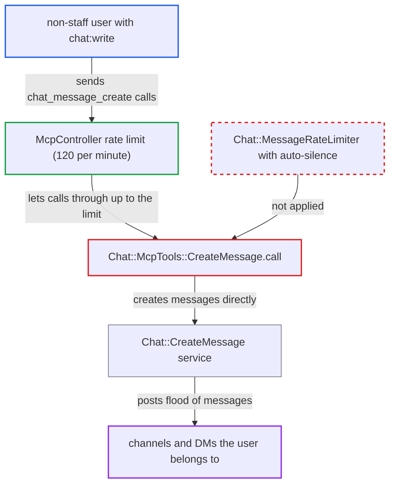

# Chat message flood limit and auto-silence bypassed via MCP chat_message_create tool

| Field | Value |
|---|---|
| ID | `find_0141Ui748J3xVaj3fR9gMXhL` |
| Severity | **Low** |
| Status | open |
| CWE | CWE-799 — Improper Control of Interaction Frequency |
| Created | 2026-10-27T21:51:45.328361Z |
| Claude Security | https://claude.ai/security/findings/find_0141Ui748J3xVaj3fR9gMXhL |

## Description

A registered non-staff user can post chat messages through the MCP tool `chat_message_create` much faster than chat normally allows, and is never auto-silenced. This needs an admin to have enabled `mcp_server_enabled`, exposed the tool and granted `chat:write` to the user's group. `Chat::McpTools::CreateMessage.call` skips `Chat::MessageRateLimiter`, which only the HTTP controller applies.

1. **attacker** authorizes an MCP OAuth client. The attacker is a non-staff user in a group that an admin has granted the `chat:write` scope. ([`plugins/chat/plugin.rb:763-792`](https://github.com/cx-benchmark/discourse/blob/e08ed05b4b1ef773b2de7948a8f88a7c182a3520/plugins/chat/plugin.rb#L763-L792))
2. **attacker** sends repeated `tools/call chat_message_create` requests to `/mcp`. Each call targets a channel or DM the attacker is already a member of. ([`app/controllers/mcp_controller.rb:75-91`](https://github.com/cx-benchmark/discourse/blob/e08ed05b4b1ef773b2de7948a8f88a7c182a3520/app/controllers/mcp_controller.rb#L75-L91))
3. **the tool `Chat::McpTools::CreateMessage.call`** calls `Chat::CreateMessage.call` directly with the token user's guardian. It never calls `Chat::MessageRateLimiter.run!`, so the per-user chat flood limit is skipped. ([`plugins/chat/lib/chat/mcp_tools.rb:111-121`](https://github.com/cx-benchmark/discourse/blob/e08ed05b4b1ef773b2de7948a8f88a7c182a3520/plugins/chat/lib/chat/mcp_tools.rb#L111-L121))
4. **the HTTP controller `Chat::Api::ChannelMessagesController#create`** is the only place that runs `Chat::MessageRateLimiter`. The service `Chat::CreateMessage` has no rate-limit step of its own, so the MCP route gets no limit from it. ([`plugins/chat/app/controllers/chat/api/channel_messages_controller.rb:79-82`](https://github.com/cx-benchmark/discourse/blob/e08ed05b4b1ef773b2de7948a8f88a7c182a3520/plugins/chat/app/controllers/chat/api/channel_messages_controller.rb#L79-L82))
5. **`McpController#enforce_rate_limits!`** applies only the generic `mcp_global_rate_limit_per_minute` limit. The default is 120 per minute per user+OAuth-client and per IP, and it never silences the user, so the `no_silenced_user` policy never stops the flood. ([`app/controllers/mcp_controller.rb:75-91`](https://github.com/cx-benchmark/discourse/blob/e08ed05b4b1ef773b2de7948a8f88a7c182a3520/app/controllers/mcp_controller.rb#L75-L91))

## Assessment

The attacker is a registered non-staff user, for example trust level 0, in a group an admin has granted MCP `chat:write`. This needs non-default admin setup: `mcp_server_enabled` on, the tool `chat_message_create` exposed, and the scope granted. The attacker authorizes an MCP OAuth client and repeatedly calls the tool on `/mcp` for any channel or DM they belong to. The report names no other way in.

Impact: The attacker can keep posting chat messages at the MCP limit, 120 per minute per IP by default, and more with extra OAuth clients and IPs. That limit is up to 3x the TL0 chat allowance and 1.5x the allowance for other trust levels. Each message triggers notifications and push, and the flood degrades those channels for other users. The attacker only posts content they may already post and reads nothing new.

## Recommendation

`Chat::MessageRateLimiter` runs in one HTTP controller instead of in the `Chat::CreateMessage` service or in every end-user entry point. The MCP `chat_message_create` tool therefore skips the per-user flood limit and auto-silence.

Fix criteria: Every path that creates a chat message for a non-staff end user applies the same per-user 30-second limit and auto-silence as HTTP, including the MCP tool. As a TL0 user, send more than `chat_allowed_messages_for_trust_level_0` `chat_message_create` MCP calls within 30 seconds. The excess calls must be refused and the user silenced, exactly as over HTTP. Bot and system callers stay exempt as before.

## Evidence

**https://github.com/cx-benchmark/discourse**

- [`plugins/chat/lib/chat/mcp_tools.rb:111-121`](https://github.com/cx-benchmark/discourse/blob/e08ed05b4b1ef773b2de7948a8f88a7c182a3520/plugins/chat/lib/chat/mcp_tools.rb#L111-L121)
- [`plugins/chat/app/controllers/chat/api/channel_messages_controller.rb:79-82`](https://github.com/cx-benchmark/discourse/blob/e08ed05b4b1ef773b2de7948a8f88a7c182a3520/plugins/chat/app/controllers/chat/api/channel_messages_controller.rb#L79-L82)
- [`plugins/chat/lib/chat/message_rate_limiter.rb:14-50`](https://github.com/cx-benchmark/discourse/blob/e08ed05b4b1ef773b2de7948a8f88a7c182a3520/plugins/chat/lib/chat/message_rate_limiter.rb#L14-L50)
- [`plugins/chat/plugin.rb:763-792`](https://github.com/cx-benchmark/discourse/blob/e08ed05b4b1ef773b2de7948a8f88a7c182a3520/plugins/chat/plugin.rb#L763-L792)
- [`app/controllers/mcp_controller.rb:75-91`](https://github.com/cx-benchmark/discourse/blob/e08ed05b4b1ef773b2de7948a8f88a7c182a3520/app/controllers/mcp_controller.rb#L75-L91)
- [`plugins/live/app/controllers/live/rooms_controller.rb:708-711`](https://github.com/cx-benchmark/discourse/blob/e08ed05b4b1ef773b2de7948a8f88a7c182a3520/plugins/live/app/controllers/live/rooms_controller.rb#L708-L711)
- [`plugins/chat/app/services/chat/create_message.rb:36`](https://github.com/cx-benchmark/discourse/blob/e08ed05b4b1ef773b2de7948a8f88a7c182a3520/plugins/chat/app/services/chat/create_message.rb#L36)

