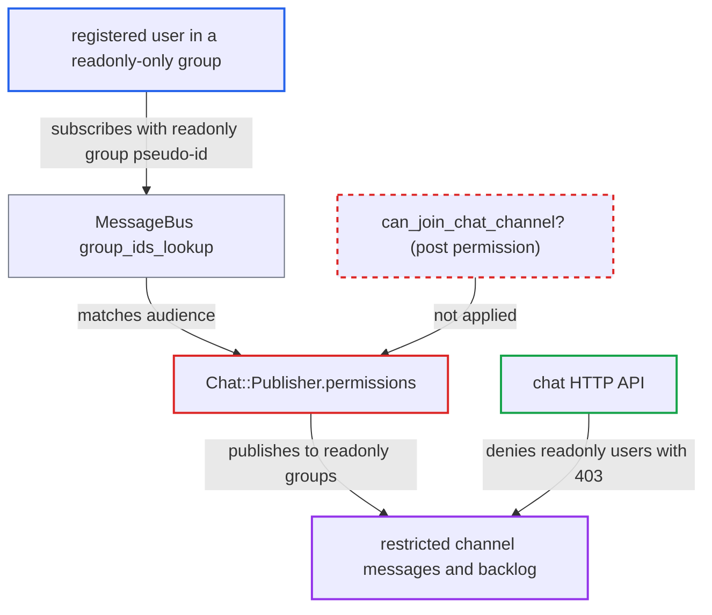

# Chat MessageBus publishes restricted category channel messages to readonly-permission groups

| Field | Value |
|---|---|
| ID | `find_01Nz4eFvESu7tnX7BW4Q4oSi` |
| Severity | **Low** |
| Status | open |
| CWE | CWE-285 — Missing authorization |
| Created | 2026-10-27T21:17:45.074274Z |
| Claude Security | https://claude.ai/security/findings/find_01Nz4eFvESu7tnX7BW4Q4oSi |

## Description

A registered user whose group has only `readonly` permission on a private category can read that category's chat channel messages through MessageBus, even though the chat HTTP API refuses them. The attack needs no victim action, only that permission layout. `Chat::Publisher.permissions` builds the audience from `secure_group_ids`, which includes `readonly` groups, instead of requiring post permission.

1. **the attacker** joins or already belongs to a group with only `readonly` on a private category that has a chat channel. An admin must have given the group that permission. The attacker is a registered user, so they are chat-allowed by default.
2. **the attacker** finds the channel id and subscribes to `/chat/<id>`, `/chat/<id>/new-messages` and thread channels through a `/message-bus/<client_id>/poll` request. The id comes from a hashtag, the channel serializer or by guessing small integers. A last id of 0 asks for the backlog and -1 asks for live traffic.
3. **the hook `Chat.message_bus_group_ids_for`** adds a `chat-restricted-category-group-<id>` pseudo-id for each group the attacker belongs to. It is wired into `MessageBus.group_ids_lookup`, so the attacker's client group set matches the publication audience. ([`plugins/chat/plugin.rb:49-56`](https://github.com/cx-benchmark/discourse/blob/e08ed05b4b1ef773b2de7948a8f88a7c182a3520/plugins/chat/plugin.rb#L49-L56))
4. **`Chat::Publisher.permissions`** puts every id from `allowed_group_ids` into the audience of a read-restricted category channel. `allowed_group_ids` comes from `category.secure_group_ids`, which lists every group on the category whatever its permission type, so `readonly` groups are included. ([`plugins/chat/app/services/chat/publisher.rb:511-518`](https://github.com/cx-benchmark/discourse/blob/e08ed05b4b1ef773b2de7948a8f88a7c182a3520/plugins/chat/app/services/chat/publisher.rb#L511-L518))
5. **MessageBus** delivers each message payload to the attacker. MessageBus only filters by `group_ids` and has no check when a client subscribes. `publish_new!` sends the full serialized message, and edits, processed and restore events use the same audience. ([`plugins/chat/app/services/chat/publisher.rb:37-81`](https://github.com/cx-benchmark/discourse/blob/e08ed05b4b1ef773b2de7948a8f88a7c182a3520/plugins/chat/app/services/chat/publisher.rb#L37-L81))

## Assessment

The attacker is a registered user in a group that an admin gave `readonly` permission on a private category with a chat channel. No victim action is needed. The attacker subscribes with a MessageBus poll request and, with a last id of 0, also gets the retained backlog. A similar gap exists for public categories set to `everyone: readonly`, but only when anonymous chat access is turned off. By default (`anonymous_users` in `chat_allowed_groups`) the HTTP API already lets any user read those channels, so it is not a gap there.

Impact: The attacker reads the raw and cooked text, author, uploads and mentions of every new, edited or restored message in the restricted channel. They also read the recent backlog, up to 100 publications per channel by default (`message_bus_max_backlog_size`). Exposure is limited to channels of categories the attacker can already see as readonly. Nothing can be modified and availability is not affected.

## Recommendation

`Chat::Publisher.permissions` builds the MessageBus audience for read-restricted category channels from every category permission group (`secure_group_ids`). The rest of the plugin requires post permission (`can_join_chat_channel?`) to read messages, so readonly members receive publications the API denies them.

Fix criteria: Publications on `/chat/<id>`, `/chat/<id>/thread/<tid>` and `/chat/<id>/new-messages` for a category channel reach only users for whom `can_join_chat_channel?` holds, or the anonymous-preview rule where it applies. Subscribing as a chat-allowed user whose only group has `readonly` on a private category delivers neither live messages nor backlog payloads. A `create_post` member and staff still receive them. If anonymous chat access is disabled, the same holds for `everyone: readonly` public categories.

## Evidence

**https://github.com/cx-benchmark/discourse**

- [`plugins/chat/app/services/chat/publisher.rb:511-518`](https://github.com/cx-benchmark/discourse/blob/e08ed05b4b1ef773b2de7948a8f88a7c182a3520/plugins/chat/app/services/chat/publisher.rb#L511-L518)
- [`plugins/chat/app/models/chat/category_channel.rb:16-20`](https://github.com/cx-benchmark/discourse/blob/e08ed05b4b1ef773b2de7948a8f88a7c182a3520/plugins/chat/app/models/chat/category_channel.rb#L16-L20)
- [`app/models/category.rb:1046-1048`](https://github.com/cx-benchmark/discourse/blob/e08ed05b4b1ef773b2de7948a8f88a7c182a3520/app/models/category.rb#L1046-L1048)
- [`plugins/chat/lib/chat/engine.rb:35-55`](https://github.com/cx-benchmark/discourse/blob/e08ed05b4b1ef773b2de7948a8f88a7c182a3520/plugins/chat/lib/chat/engine.rb#L35-L55)
- [`plugins/chat/plugin.rb:49-56`](https://github.com/cx-benchmark/discourse/blob/e08ed05b4b1ef773b2de7948a8f88a7c182a3520/plugins/chat/plugin.rb#L49-L56)
- [`plugins/chat/app/services/chat/publisher.rb:37-81`](https://github.com/cx-benchmark/discourse/blob/e08ed05b4b1ef773b2de7948a8f88a7c182a3520/plugins/chat/app/services/chat/publisher.rb#L37-L81)
- [`plugins/chat/lib/chat/guardian_extensions.rb:171-199`](https://github.com/cx-benchmark/discourse/blob/e08ed05b4b1ef773b2de7948a8f88a7c182a3520/plugins/chat/lib/chat/guardian_extensions.rb#L171-L199)
- [`plugins/chat/lib/chat/channel_fetcher.rb:411-424`](https://github.com/cx-benchmark/discourse/blob/e08ed05b4b1ef773b2de7948a8f88a7c182a3520/plugins/chat/lib/chat/channel_fetcher.rb#L411-L424)
- [`plugins/chat/spec/requests/chat/api/channel_messages_controller_spec.rb:117-141`](https://github.com/cx-benchmark/discourse/blob/e08ed05b4b1ef773b2de7948a8f88a7c182a3520/plugins/chat/spec/requests/chat/api/channel_messages_controller_spec.rb#L117-L141)

