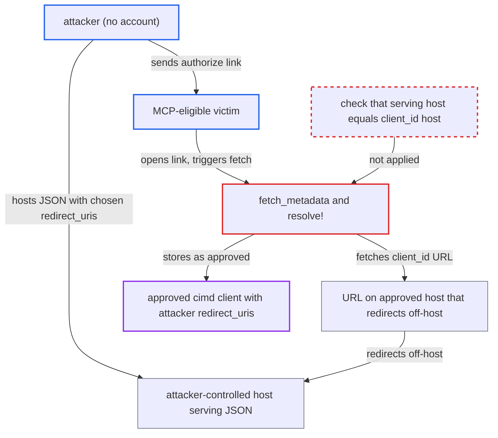

# CIMD metadata fetch follows cross-host redirects, bypassing approved-domains client allow-list

| Field | Value |
|---|---|
| ID | `find_01KCnJv8AZGYRUEK68PcRWx8` |
| Severity | **Low** |
| Status | open |
| CWE | CWE-346 — Origin Validation Error |
| Created | 2026-10-27T21:12:50.023372Z |
| Claude Security | https://claude.ai/security/findings/find_01KCnJv8AZGYRUEK68PcRWx8 |

## Description

An attacker with no account can register their own server as an approved MCP OAuth client, even though the admin restricted clients to approved domains. A logged-in, MCP-eligible victim must still click Approve, and the resulting token is limited to that victim's MCP scopes. It only matters where `mcp_oauth_client_id_metadata_policy` is `approved_domains`. The cause is that `fetch_metadata` follows redirects off-host, while `resolve!` trusts only the host in `client_id`.

1. **attacker** hosts a JSON metadata document on their own server. The document repeats the exact `client_id` (an approved-host URL that redirects to the attacker's document) and lists `redirect_uris` such as `https://evil/cb`.
2. **attacker** sends an MCP-eligible victim an `/oauth2/mcp/authorize` link. The link carries that `client_id` and the attacker's own PKCE challenge, and opening it is enough to start the fetch. ([`app/controllers/mcp_oauth_authorizations_controller.rb:13-45`](https://github.com/cx-benchmark/discourse/blob/e08ed05b4b1ef773b2de7948a8f88a7c182a3520/app/controllers/mcp_oauth_authorizations_controller.rb#L13-L45))
3. **the resolver `ClientResolver.resolve!`** checks the policy against the `client_id` host only. `approved_domain?(uri.host)` passes because the URL is on an approved host, and `trust_state_for(uri.host)` yields `approved`. ([`lib/discourse_mcp/oauth.rb:11-31`](https://github.com/cx-benchmark/discourse/blob/e08ed05b4b1ef773b2de7948a8f88a7c182a3520/lib/discourse_mcp/oauth.rb#L11-L31))
4. **the method `fetch_metadata`** fetches the document and follows the redirect to the attacker's host. `FinalDestination#get` follows `Location` headers to any host that passes the URI-format and SSRF checks, up to `max_redirects: 3`, and the block ignores the `_resolved_uri` it receives. ([`lib/discourse_mcp/oauth.rb:140-160`](https://github.com/cx-benchmark/discourse/blob/e08ed05b4b1ef773b2de7948a8f88a7c182a3520/lib/discourse_mcp/oauth.rb#L140-L160))
5. **the method `validate_metadata!`** accepts the attacker's document. It only checks that the document repeats `client_id` and that `redirect_uris` are `https` URLs on any host, so the document from the unlisted host passes. ([`lib/discourse_mcp/oauth.rb:162-174`](https://github.com/cx-benchmark/discourse/blob/e08ed05b4b1ef773b2de7948a8f88a7c182a3520/lib/discourse_mcp/oauth.rb#L162-L174))
6. **the resolver `ClientResolver.resolve!`** stores the client as an `approved` `cimd` client with the attacker's `client_name` and `redirect_uris`. `allowed_by_current_policy?` later checks only the `client_id` host too, so nothing catches the off-host document. ([`lib/discourse_mcp/oauth.rb:79-93`](https://github.com/cx-benchmark/discourse/blob/e08ed05b4b1ef773b2de7948a8f88a7c182a3520/lib/discourse_mcp/oauth.rb#L79-L93))
7. **victim** clicks Approve on the consent screen. The authorization code is redirected to the attacker's `redirect_uri`, and the attacker exchanges it for a token using their PKCE verifier. ([`app/controllers/mcp_oauth_authorizations_controller.rb:13-45`](https://github.com/cx-benchmark/discourse/blob/e08ed05b4b1ef773b2de7948a8f88a7c182a3520/app/controllers/mcp_oauth_authorizations_controller.rb#L13-L45))

## Assessment

The site must use `approved_domains` for `mcp_oauth_client_id_metadata_policy`. Under the default `any_domain` policy this gives nothing new, because any host is already accepted. Some approved host must also have a URL that redirects off-host to a target the attacker can influence. Examples are a parameterised redirect, an outbound-link tracker, a shortener, or a raw-content redirect. The attacker needs no account. A logged-in, MCP-eligible victim must open the link, because their GET runs `resolve!`, and must click Approve. A second entry point is the `create` action, which also calls `resolve!`.

Impact: The attacker bypasses the admin's allow-list of hosts that may provide client metadata. They register a client they control as `approved`, with redirect targets they choose. They get tokens only from victims who approve on a consent screen that still shows the full `client_id` and the `redirect_uri`. Those tokens are limited to the victim's granted MCP scopes and Guardian, and consent, PKCE and exact redirect matching still apply. A minor side effect: the per-host CIMD rate limit in `enforce_rate_limits!` is keyed on the `client_id` host, not the host actually fetched.

## Recommendation

`ClientResolver.fetch_metadata` accepts a metadata document from whichever host a redirect chain ends on. `resolve!` and `allowed_by_current_policy?` base trust on the `client_id` host. The two are never compared, so the `approved_domains` allow-list does not limit who serves the document.

Fix criteria: A metadata document is accepted only if it is served over `https` by the exact host named in `client_id`. Either redirects are refused, or every hop and the final host are checked against that host. Test: point `client_id` at an approved-host URL that 302-redirects to another host serving valid JSON. `resolve!` must raise `Discourse::InvalidAccess`, and no `McpOauthClient` may be persisted.

## Evidence

**https://github.com/cx-benchmark/discourse**

- [`lib/discourse_mcp/oauth.rb:140-160`](https://github.com/cx-benchmark/discourse/blob/e08ed05b4b1ef773b2de7948a8f88a7c182a3520/lib/discourse_mcp/oauth.rb#L140-L160)
- [`lib/discourse_mcp/oauth.rb:11-31`](https://github.com/cx-benchmark/discourse/blob/e08ed05b4b1ef773b2de7948a8f88a7c182a3520/lib/discourse_mcp/oauth.rb#L11-L31)
- [`lib/discourse_mcp/oauth.rb:162-174`](https://github.com/cx-benchmark/discourse/blob/e08ed05b4b1ef773b2de7948a8f88a7c182a3520/lib/discourse_mcp/oauth.rb#L162-L174)
- [`lib/discourse_mcp/oauth.rb:79-93`](https://github.com/cx-benchmark/discourse/blob/e08ed05b4b1ef773b2de7948a8f88a7c182a3520/lib/discourse_mcp/oauth.rb#L79-L93)
- [`lib/final_destination.rb:164-212`](https://github.com/cx-benchmark/discourse/blob/e08ed05b4b1ef773b2de7948a8f88a7c182a3520/lib/final_destination.rb#L164-L212)
- [`app/controllers/mcp_oauth_authorizations_controller.rb:13-45`](https://github.com/cx-benchmark/discourse/blob/e08ed05b4b1ef773b2de7948a8f88a7c182a3520/app/controllers/mcp_oauth_authorizations_controller.rb#L13-L45)
- [`config/locales/server.en.yml:3104`](https://github.com/cx-benchmark/discourse/blob/e08ed05b4b1ef773b2de7948a8f88a7c182a3520/config/locales/server.en.yml#L3104)

