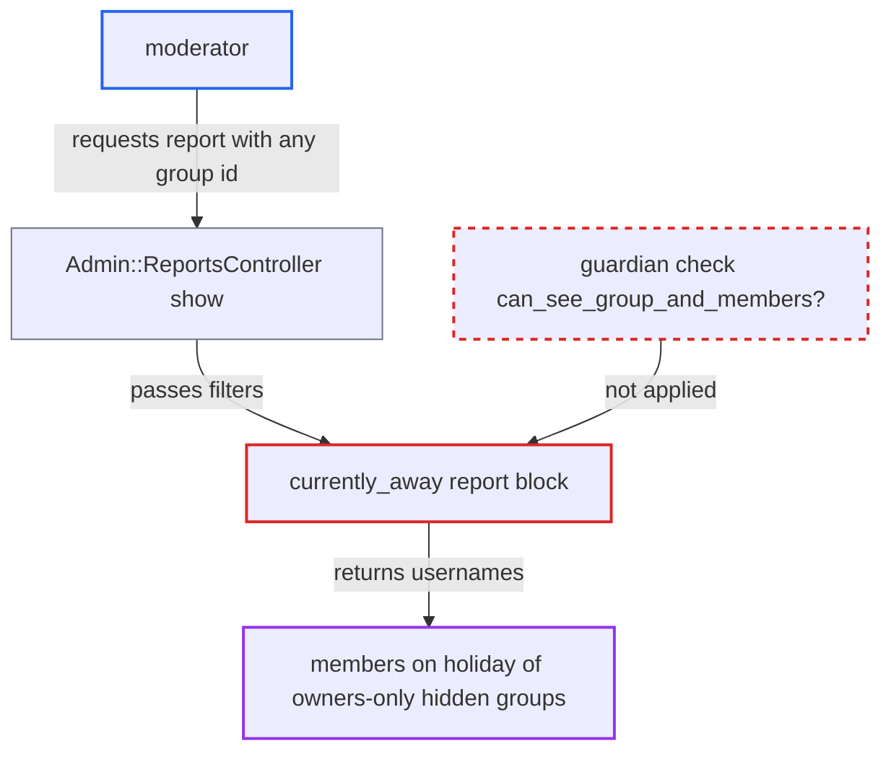

# currently_away report reveals members of owner-only hidden groups to moderators

| Field | Value |
|---|---|
| ID | `find_01QtEYjQvEbWxNcUNRpwbkNY` |
| Severity | **Low** |
| Status | open |
| CWE | CWE-862 — Missing authorization |
| Created | 2026-10-27T21:46:53.704453Z |
| Claude Security | https://claude.ai/security/findings/find_01QtEYjQvEbWxNcUNRpwbkNY |

## Description

A moderator can learn that an owners-only hidden group exists and which of its members are currently on holiday. This needs a moderator account on a site with discourse-events enabled and a holiday calendar configured. The `currently_away` report in `plugins/discourse-events/plugin.rb` loads any group by id and never checks the requester's guardian.

1. **moderator** requests the report with a group id. The request is `GET /admin/reports/currently_away.json?filters[group]=<id>`, and the moderator repeats it for successive group ids. ([`app/controllers/admin/reports_controller.rb:48-71`](https://github.com/cx-benchmark/discourse/blob/e08ed05b4b1ef773b2de7948a8f88a7c182a3520/app/controllers/admin/reports_controller.rb#L48-L71))
2. **`Admin::StaffController`** lets the moderator in. `ensure_staff` admits moderators as well as admins, and `currently_away` is not on the admin-only report list. ([`app/controllers/admin/staff_controller.rb:3-6`](https://github.com/cx-benchmark/discourse/blob/e08ed05b4b1ef773b2de7948a8f88a7c182a3520/app/controllers/admin/staff_controller.rb#L3-L6))
3. **the report block for `currently_away`** loads the group with `Group.find_by(id: group_filter)`. The block reads `filters[:group]` from the request and never consults `report.guardian`, so a group with `visibility_level: owners` is found like any other. ([`plugins/discourse-events/plugin.rb:937-951`](https://github.com/cx-benchmark/discourse/blob/e08ed05b4b1ef773b2de7948a8f88a7c182a3520/plugins/discourse-events/plugin.rb#L937-L951))
4. **the report block for `currently_away`** returns the usernames of the group's members who are on holiday. It intersects `group.users.pluck(:username)` with `DiscourseEvents.users_on_holiday`, so a hidden group's holiday-takers appear as report rows. ([`plugins/discourse-events/plugin.rb:937-951`](https://github.com/cx-benchmark/discourse/blob/e08ed05b4b1ef773b2de7948a8f88a7c182a3520/plugins/discourse-events/plugin.rb#L937-L951))
5. **moderator** reads the rows. Rows that come back for a group id show the group exists and show which of its members are on holiday, although core guardian checks would hide the group from this moderator. ([`lib/guardian.rb:304-356`](https://github.com/cx-benchmark/discourse/blob/e08ed05b4b1ef773b2de7948a8f88a7c182a3520/lib/guardian.rb#L304-L356))

## Assessment

The attacker is a moderator. No victim action is needed. The site must have discourse-events enabled and a holiday calendar configured, because the holiday list is filled only when `discourse_events_enabled` is on and `holiday_calendar_topic_id` is set. The moderator requests the report for successive group ids and looks at which ones return usernames.

Impact: The moderator learns that a group with `visibility_level: owners` exists and which of its members are currently on holiday. The group name and members who are not on holiday are not returned. Nothing is modified. For groups whose existence staff can already see, the report adds nothing, because moderators already get every user's visible groups from `/admin/users/:id.json`.

## Recommendation

The `currently_away` report in `plugins/discourse-events/plugin.rb` resolves a caller-supplied group id and lists its members without checking the requesting user's guardian. Groups restricted to owners and admins leak to moderators.

Fix criteria: The report returns rows only when the requesting user may see the group and its members (an admin, or `can_see_group_and_members?` is true). Otherwise it returns no rows or a not-found error. To verify, request the report as a non-owner moderator with the id of a `visibility_level: owners` group that contains an on-holiday user and confirm no usernames come back. Confirm that an admin or group owner still receives them.

## Evidence

**https://github.com/cx-benchmark/discourse**

- [`plugins/discourse-events/plugin.rb:937-951`](https://github.com/cx-benchmark/discourse/blob/e08ed05b4b1ef773b2de7948a8f88a7c182a3520/plugins/discourse-events/plugin.rb#L937-L951)
- [`app/controllers/admin/reports_controller.rb:48-71`](https://github.com/cx-benchmark/discourse/blob/e08ed05b4b1ef773b2de7948a8f88a7c182a3520/app/controllers/admin/reports_controller.rb#L48-L71)
- [`app/controllers/admin/staff_controller.rb:3-6`](https://github.com/cx-benchmark/discourse/blob/e08ed05b4b1ef773b2de7948a8f88a7c182a3520/app/controllers/admin/staff_controller.rb#L3-L6)
- [`app/models/group.rb:197-214`](https://github.com/cx-benchmark/discourse/blob/e08ed05b4b1ef773b2de7948a8f88a7c182a3520/app/models/group.rb#L197-L214)
- [`lib/guardian.rb:304-356`](https://github.com/cx-benchmark/discourse/blob/e08ed05b4b1ef773b2de7948a8f88a7c182a3520/lib/guardian.rb#L304-L356)
- [`app/models/concerns/reports/posters_by_member_type.rb:154-160`](https://github.com/cx-benchmark/discourse/blob/e08ed05b4b1ef773b2de7948a8f88a7c182a3520/app/models/concerns/reports/posters_by_member_type.rb#L154-L160)
- [`plugins/discourse-events/jobs/scheduled/update_holiday_usernames.rb:8-15`](https://github.com/cx-benchmark/discourse/blob/e08ed05b4b1ef773b2de7948a8f88a7c182a3520/plugins/discourse-events/jobs/scheduled/update_holiday_usernames.rb#L8-L15)

