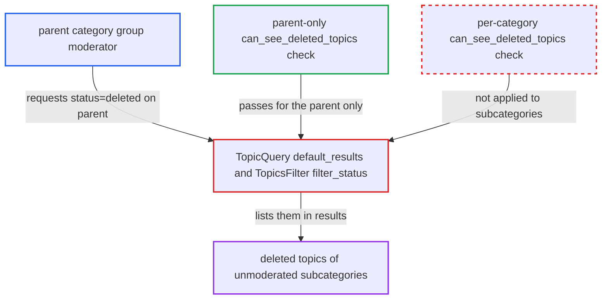

# Deleted-topic list check on parent category exposes deleted topics of unmoderated subcategories

| Field | Value |
|---|---|
| ID | `find_01G2qwYgXqu1GC77CaqybbBv` |
| Severity | **Low** |
| Status | open |
| CWE | CWE-863 — Improper authorization |
| Created | 2026-10-27T21:20:45.892194Z |
| Claude Security | https://claude.ai/security/findings/find_01G2qwYgXqu1GC77CaqybbBv |

## Description

A member of a parent category's moderation group can list soft-deleted topics from subcategories they do not moderate. They see titles, slugs, poster ids, counts, timestamps, tags and excerpts, but not topic bodies. This needs `enable_category_group_moderation` turned on (default false). `TopicQuery#default_results` checks deleted-topic access only for the parent category, then removes the deleted filter from the whole scope, including subcategories.

1. **attacker in the parent category's moderation group** requests the parent category's list with `status=deleted`. The request is `GET /c/
/<P-id>/l/latest.json?status=deleted`, and `status` comes from the public query parameters. ([`app/controllers/list_controller.rb:122-125`](https://github.com/cx-benchmark/discourse/blob/e08ed05b4b1ef773b2de7948a8f88a7c182a3520/app/controllers/list_controller.rb#L122-L125))
2. **`TopicQuery#default_results`** widens the scope to the parent and all its subcategories. It uses `Category.subcategory_ids(category_id)` unless `no_subcategories` is set. ([`lib/topic_query.rb:844-851`](https://github.com/cx-benchmark/discourse/blob/e08ed05b4b1ef773b2de7948a8f88a7c182a3520/lib/topic_query.rb#L844-L851))
3. **`TopicQuery`** calls `filter_status` with only the requested parent category. It passes `category_id: options[:category]`, while the relation already covers every subcategory. ([`lib/topic_query.rb:967-973`](https://github.com/cx-benchmark/discourse/blob/e08ed05b4b1ef773b2de7948a8f88a7c182a3520/lib/topic_query.rb#L967-L973))
4. **`TopicsFilter#filter_status`** authorizes once for the parent category. `can_see_deleted_topics?` passes for the attacker because `is_category_group_moderator?` tests the exact `category.id`, and the attacker moderates the parent. ([`lib/guardian/topic_guardian.rb:213-215`](https://github.com/cx-benchmark/discourse/blob/e08ed05b4b1ef773b2de7948a8f88a7c182a3520/lib/guardian/topic_guardian.rb#L213-L215))
5. **`TopicsFilter#filter_status`** removes the `deleted_at` filter from the whole relation. It calls `unscope(where: :deleted_at)` on the scope that includes subcategories, so their deleted topics are included. ([`lib/topics_filter.rb:136-143`](https://github.com/cx-benchmark/discourse/blob/e08ed05b4b1ef773b2de7948a8f88a7c182a3520/lib/topics_filter.rb#L136-L143))
6. **the topic list response** returns deleted topics of subcategories the attacker does not moderate. `Guardian#can_see_topic?` would refuse each of these topics individually, but the list path skips that per-category rule. ([`lib/guardian/topic_guardian.rb:249-252`](https://github.com/cx-benchmark/discourse/blob/e08ed05b4b1ef773b2de7948a8f88a7c182a3520/lib/guardian/topic_guardian.rb#L249-L252))

## Assessment

The attacker is a logged-in, non-staff user in the moderation group of a parent category P. The site must have `enable_category_group_moderation` on, which defaults to false. P needs at least one subcategory C that the attacker does not moderate. The attacker sends a normal list request with `status=deleted`. No victim action is needed. The same code also runs for tag lists filtered on a category, in `app/controllers/tags_controller.rb`.

Impact: The attacker reads list-level data of soft-deleted topics in categories they do not moderate: title, slug, poster ids, counts, timestamps, tags, and excerpts where excerpts are serialized. Topic bodies are not exposed, because opening a topic is still refused. Nothing can be changed or disrupted.

## Recommendation

The deleted-topic authorization runs once for the requested parent category, but the relation it relaxes covers every subcategory too. The check and the data it protects do not match.

Fix criteria: Deleted topics appear in a list only for categories where the requesting user individually satisfies `can_see_deleted_topics?` (staff or global permission, or that specific category's moderation group). Test: a parent-category group moderator requests `status=deleted` on the parent. Deleted topics of unmoderated subcategories are absent. Deleted topics of the parent, and of subcategories they do moderate, are still returned.

## Evidence

**https://github.com/cx-benchmark/discourse**

- [`lib/topics_filter.rb:136-143`](https://github.com/cx-benchmark/discourse/blob/e08ed05b4b1ef773b2de7948a8f88a7c182a3520/lib/topics_filter.rb#L136-L143)
- [`lib/topic_query.rb:967-973`](https://github.com/cx-benchmark/discourse/blob/e08ed05b4b1ef773b2de7948a8f88a7c182a3520/lib/topic_query.rb#L967-L973)
- [`lib/topic_query.rb:844-851`](https://github.com/cx-benchmark/discourse/blob/e08ed05b4b1ef773b2de7948a8f88a7c182a3520/lib/topic_query.rb#L844-L851)
- [`lib/guardian/topic_guardian.rb:213-215`](https://github.com/cx-benchmark/discourse/blob/e08ed05b4b1ef773b2de7948a8f88a7c182a3520/lib/guardian/topic_guardian.rb#L213-L215)
- [`lib/guardian.rb:156-162`](https://github.com/cx-benchmark/discourse/blob/e08ed05b4b1ef773b2de7948a8f88a7c182a3520/lib/guardian.rb#L156-L162)
- [`lib/guardian/topic_guardian.rb:249-252`](https://github.com/cx-benchmark/discourse/blob/e08ed05b4b1ef773b2de7948a8f88a7c182a3520/lib/guardian/topic_guardian.rb#L249-L252)
- [`app/controllers/list_controller.rb:122-125`](https://github.com/cx-benchmark/discourse/blob/e08ed05b4b1ef773b2de7948a8f88a7c182a3520/app/controllers/list_controller.rb#L122-L125)

