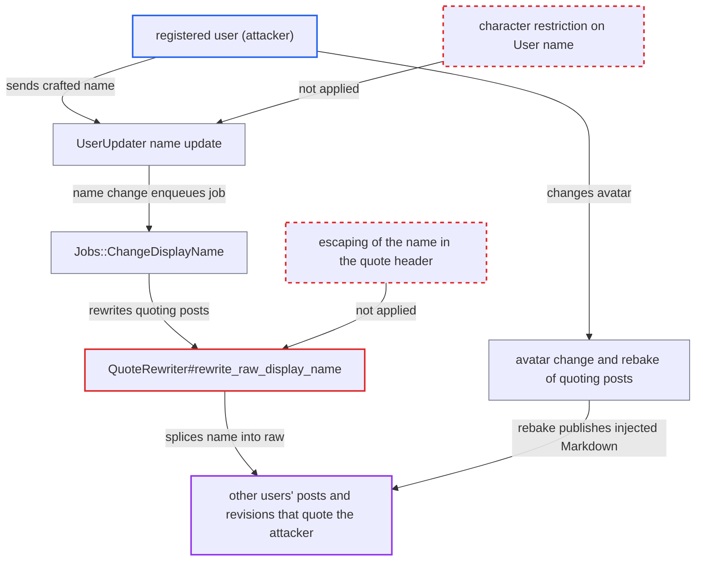

# Display-name rename job splices unescaped name into other users' post raw

| Field | Value |
|---|---|
| ID | `find_01YXK57buoFFLpDm6qDgGq3v` |
| Severity | **Low** |
| Status | open |
| CWE | CWE-74 — Injection |
| Created | 2026-10-27T21:39:50.616143Z |
| Claude Security | https://claude.ai/security/findings/find_01YXK57buoFFLpDm6qDgGq3v |

## Description

A registered user can put their own Markdown into other users' posts that quote them. It appears as the victim's own words, with no edit history. It needs a victim post that quotes the attacker in the display-name header form. The cause is `QuoteRewriter#rewrite_raw_display_name`, which inserts the new `name` into other users' post source without escaping it.

1. **attacker (registered user)** sends a crafted `name` in a profile update. `PUT /u/:username.json` assigns `name` exactly as sent when the user edits their own name, which is allowed with default settings. ([`app/services/user_updater.rb:136`](https://github.com/cx-benchmark/discourse/blob/e08ed05b4b1ef773b2de7948a8f88a7c182a3520/app/services/user_updater.rb#L136))
2. **`User` model** saves the name and enqueues `Jobs::ChangeDisplayName`. The only checks on `name` are presence and a length of at most 255, so `"`, `[`, `]` and line breaks are accepted. ([`app/models/user.rb:161-162`](https://github.com/cx-benchmark/discourse/blob/e08ed05b4b1ef773b2de7948a8f88a7c182a3520/app/models/user.rb#L161-L162))
3. **the job `Jobs::ChangeDisplayName`** loads every post that quotes a post of the renamed user, plus those posts' revisions. It includes deleted posts and makes no Guardian check. ([`app/jobs/regular/change_display_name.rb:31-64`](https://github.com/cx-benchmark/discourse/blob/e08ed05b4b1ef773b2de7948a8f88a7c182a3520/app/jobs/regular/change_display_name.rb#L31-L64))
4. **`QuoteRewriter#rewrite_raw_display_name`** replaces the old name in each quote header with the new name as is. The name can close the quote attribute and the quote block, so attacker-chosen Markdown lands in the victim's post body outside the quote. ([`lib/quote_rewriter.rb:73-93`](https://github.com/cx-benchmark/discourse/blob/e08ed05b4b1ef773b2de7948a8f88a7c182a3520/lib/quote_rewriter.rb#L73-L93))
5. **the job `Jobs::ChangeDisplayName`** saves the rewritten raw with `update_columns`. This skips `PostRevisor`, so no revision or edit indicator is created, and the stored revisions are rewritten as well. ([`app/jobs/regular/change_display_name.rb:31-64`](https://github.com/cx-benchmark/discourse/blob/e08ed05b4b1ef773b2de7948a8f88a7c182a3520/app/jobs/regular/change_display_name.rb#L31-L64))
6. **attacker** changes their avatar to force a rebake. The avatar change leads to `Post.rebake_all_quoted_posts`, which clears `baked_version` on every post quoting the attacker. `Post.rebake_old` then recooks the posts. ([`app/models/user_avatar.rb:139-151`](https://github.com/cx-benchmark/discourse/blob/e08ed05b4b1ef773b2de7948a8f88a7c182a3520/app/models/user_avatar.rb#L139-L151))
7. **the rebake** turns the injected Markdown into the post's rendered HTML. Before the rebake the cooked HTML holds the name only as escaped text, so the injection becomes visible only after it. ([`app/models/user_avatar.rb:139-151`](https://github.com/cx-benchmark/discourse/blob/e08ed05b4b1ef773b2de7948a8f88a7c182a3520/app/models/user_avatar.rb#L139-L151))

## Assessment

The attacker is a registered user who edits their own `name`, which default settings allow (`enable_names` true, `auth_overrides_name` false). A victim's post must quote one of the attacker's posts with a header of the form `[quote="Name, post:N, topic:M, username:u"]`. Either route works. First, every composer quote produces that header when `display_name_on_posts` is true and `prioritize_username_in_ux` is false, and both are non-default. Second, with default settings, the victim uses the composer's "Quote post" import on an attacker post whose raw holds a hand-typed display-name quote header. That import links the victim's post to the attacker's in `quoted_posts`, so the job rewrites it. The attacker can force the rebake that publishes the text by changing their avatar, so no further victim action is needed. Each later rename replaces the injected text again. The username version of the rewrite (`rewrite_raw_username`) is not exploitable because usernames are restricted to a limited character set.

Impact: The attacker can write Markdown that passes the normal sanitizer (links, images, bbcode, oneboxes) into the raw, stored revisions and rendered HTML of other users' posts. This includes staff posts, PMs and private-category posts that quote the attacker. It is shown as the victim's own text, with no revision trail. The reach is limited to posts that quote the attacker, and it is content injection, not script execution. No data is disclosed and service is unaffected.

## Recommendation

(1) `QuoteRewriter#rewrite_raw_display_name` (`lib/quote_rewriter.rb:91`) treats the user-controlled display name as a trusted literal and splices it into the quote header of other users' raw posts. The name can therefore end the attribute and inject Markdown into content its author does not own.

Fix criteria: The value written into a quote header cannot end the attribute, the header or the line. Quotation marks, square brackets, line breaks and other control characters are removed or neutralised before interpolation. The rewrite is skipped if nothing usable remains. Renaming a quoted user to `Z"]\n[/quote]\n\n**pwn**\n\n[quote="Z` leaves the quoting post's raw with exactly one well-formed header per original quote and no content outside it.

(2) `User#name` (`app/models/user.rb:161-162`) accepts any characters up to 255. Values that mean something to the Markdown and bbcode parser can be stored and later written into other users' content.

Fix criteria: Names must be single-line and free of control characters at the model level. `PUT /u/:username.json` with a name containing a line break is rejected or normalised before it is saved.

## Evidence

**https://github.com/cx-benchmark/discourse**

- [`lib/quote_rewriter.rb:73-93`](https://github.com/cx-benchmark/discourse/blob/e08ed05b4b1ef773b2de7948a8f88a7c182a3520/lib/quote_rewriter.rb#L73-L93)
- [`app/jobs/regular/change_display_name.rb:31-64`](https://github.com/cx-benchmark/discourse/blob/e08ed05b4b1ef773b2de7948a8f88a7c182a3520/app/jobs/regular/change_display_name.rb#L31-L64)
- [`app/models/user.rb:161-162`](https://github.com/cx-benchmark/discourse/blob/e08ed05b4b1ef773b2de7948a8f88a7c182a3520/app/models/user.rb#L161-L162)
- [`app/services/user_updater.rb:136`](https://github.com/cx-benchmark/discourse/blob/e08ed05b4b1ef773b2de7948a8f88a7c182a3520/app/services/user_updater.rb#L136)
- [`frontend/discourse/app/lib/quote.js:35-61`](https://github.com/cx-benchmark/discourse/blob/e08ed05b4b1ef773b2de7948a8f88a7c182a3520/frontend/discourse/app/lib/quote.js#L35-L61)
- [`frontend/discourse/app/services/composer.js:1093-1126`](https://github.com/cx-benchmark/discourse/blob/e08ed05b4b1ef773b2de7948a8f88a7c182a3520/frontend/discourse/app/services/composer.js#L1093-L1126)
- [`app/models/user_avatar.rb:139-151`](https://github.com/cx-benchmark/discourse/blob/e08ed05b4b1ef773b2de7948a8f88a7c182a3520/app/models/user_avatar.rb#L139-L151)

