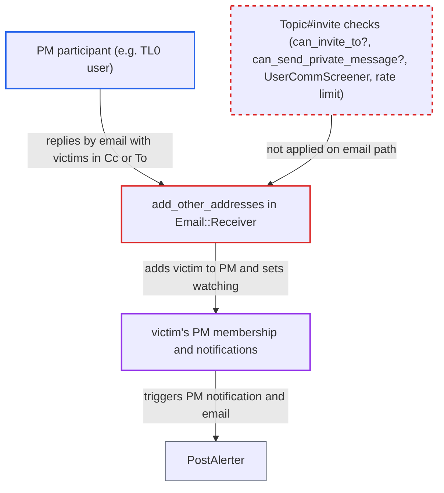

# Email CC/To headers add registered users to a PM, bypassing PM opt-out and invite permission

| Field | Value |
|---|---|
| ID | `find_01HnM9w9c9vdmWdnwUfoQeKW` |
| Severity | **Low** |
| Status | open |
| CWE | CWE-862 — Missing authorization |
| Created | 2026-10-27T21:24:07.977382Z |
| Claude Security | https://claude.ai/security/findings/find_01HnM9w9c9vdmWdnwUfoQeKW |

## Description

A participant in a private message (PM) can pull other registered users into it by putting their addresses in the To or Cc headers of an email reply. This works even for users who turned off PMs, and even when the sender is not allowed to send or invite PMs, such as a TL0 user. It needs reply-by-email enabled (default off) and the victim's email address. `add_other_addresses` in `lib/email/receiver.rb` adds them, and its only check is `can_invite?`, which tests that the user is not already a participant.

1. **attacker** replies by email to a PM notification using its reply key. The attacker is a PM participant and holds the reply key from the notification email. They put the victims' email addresses in `To:` or `Cc:`, up to `maximum_recipients_per_new_group_email`. ([`lib/email/receiver.rb:923-942`](https://github.com/cx-benchmark/discourse/blob/e08ed05b4b1ef773b2de7948a8f88a7c182a3520/lib/email/receiver.rb#L923-L942))
2. **Guardian** allows the reply. `can_create_post?` is the only permission needed, and for a PM it does not check `personal_message_enabled_groups`, so a TL0 user gets through. ([`lib/guardian/post_guardian.rb:461-472`](https://github.com/cx-benchmark/discourse/blob/e08ed05b4b1ef773b2de7948a8f88a7c182a3520/lib/guardian/post_guardian.rb#L461-L472))
3. **the receiver `create_post`** calls `add_other_addresses` with the mail headers. This happens for every non-bounce post created from email in a PM, and it also passes the headers of a forwarded embedded email. ([`lib/email/receiver.rb:1571-1577`](https://github.com/cx-benchmark/discourse/blob/e08ed05b4b1ef773b2de7948a8f88a7c182a3520/lib/email/receiver.rb#L1571-L1577))
4. **the method `add_other_addresses`** resolves each header address to a user and adds it to the PM. It creates a `topic_allowed_users` row, sets the user to auto-watch and posts an `invited_user` small action. Its only gate, `can_invite?`, checks that the user is not already a participant. ([`lib/email/receiver.rb:1606-1653`](https://github.com/cx-benchmark/discourse/blob/e08ed05b4b1ef773b2de7948a8f88a7c182a3520/lib/email/receiver.rb#L1606-L1653))
5. **`PostAlerter`** notifies and emails the added users. It filters only on the target ignoring or muting the actor, not on the target's PM opt-out, so a user who disabled PMs still gets the PM notification and email. ([`app/services/post_alerter.rb:555-583`](https://github.com/cx-benchmark/discourse/blob/e08ed05b4b1ef773b2de7948a8f88a7c182a3520/app/services/post_alerter.rb#L555-L583))

## Assessment

The attacker is any registered participant of a PM who holds its reply key, which every PM notification email contains. That includes TL0 users who by default cannot send or invite PMs, for example through the system welcome PM when `enable_system_message_replies` is on (default). The site must have reply-by-email configured, which is off by default. The attacker must know the victim's email address, and the victim needs to do nothing. A second route is the group inbox: an anonymous sender CCs a registered user on mail to a group address, which follows the same code. The report says this is closer to the intended support workflow and gives little beyond emailing the victim directly.

Impact: The attacker changes PM membership without authorization. Victims who disabled PMs, are suspended or are over the recipient limit are forced into the conversation and receive PM notifications and emails. Users barred from PMs can in effect message others. The attacker gains no data they could not already see, and availability is not affected. Muting or ignoring the attacker still suppresses notifications for the attacker's own posts, but not the forced membership.

## Recommendation

`add_other_addresses` adds existing registered users named in sender-controlled email headers straight to a PM. It skips the invite checks the web path applies: `can_invite_to?`, `can_send_private_message?`, `UserCommScreener`, the muted-topic check, the recipient limit and the invite rate limit.

Fix criteria: Adding an existing non-staged user to a PM from email headers passes the same checks `Topic#invite` applies for the sending user. A sender outside `personal_message_enabled_groups` creates no `topic_allowed_users` row. The same holds for a target who disallows PMs, ignores or mutes the sender, or has muted the topic. The recipient limit holds. To verify, reply by email to a PM with Cc set to such a user and confirm they are not added and receive no notification.

## Evidence

**https://github.com/cx-benchmark/discourse**

- [`lib/email/receiver.rb:1606-1653`](https://github.com/cx-benchmark/discourse/blob/e08ed05b4b1ef773b2de7948a8f88a7c182a3520/lib/email/receiver.rb#L1606-L1653)
- [`lib/email/receiver.rb:1660-1667`](https://github.com/cx-benchmark/discourse/blob/e08ed05b4b1ef773b2de7948a8f88a7c182a3520/lib/email/receiver.rb#L1660-L1667)
- [`lib/email/receiver.rb:1571-1577`](https://github.com/cx-benchmark/discourse/blob/e08ed05b4b1ef773b2de7948a8f88a7c182a3520/lib/email/receiver.rb#L1571-L1577)
- [`lib/email/receiver.rb:923-942`](https://github.com/cx-benchmark/discourse/blob/e08ed05b4b1ef773b2de7948a8f88a7c182a3520/lib/email/receiver.rb#L923-L942)
- [`lib/guardian/post_guardian.rb:461-472`](https://github.com/cx-benchmark/discourse/blob/e08ed05b4b1ef773b2de7948a8f88a7c182a3520/lib/guardian/post_guardian.rb#L461-L472)
- [`app/models/topic.rb:1386-1419`](https://github.com/cx-benchmark/discourse/blob/e08ed05b4b1ef773b2de7948a8f88a7c182a3520/app/models/topic.rb#L1386-L1419)
- [`app/models/topic.rb:2331-2336`](https://github.com/cx-benchmark/discourse/blob/e08ed05b4b1ef773b2de7948a8f88a7c182a3520/app/models/topic.rb#L2331-L2336)
- [`lib/guardian/invite_guardian.rb:24-43`](https://github.com/cx-benchmark/discourse/blob/e08ed05b4b1ef773b2de7948a8f88a7c182a3520/lib/guardian/invite_guardian.rb#L24-L43)
- [`app/services/post_alerter.rb:555-583`](https://github.com/cx-benchmark/discourse/blob/e08ed05b4b1ef773b2de7948a8f88a7c182a3520/app/services/post_alerter.rb#L555-L583)

