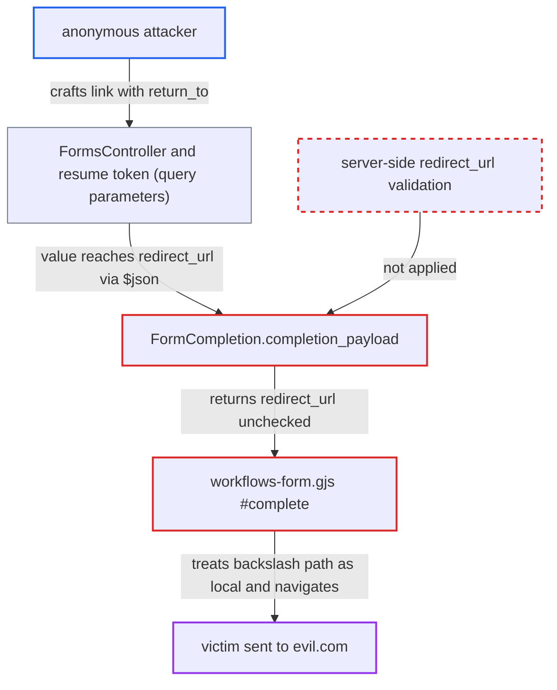

# Form completion redirect same-origin check bypassed by backslash path (/\host)

| Field | Value |
|---|---|
| ID | `find_01H9BzrPdGhJTZnu8wUF9iaM` |
| Severity | **Low** |
| Status | open |
| CWE | CWE-601 — Open redirect |
| Created | 2026-10-27T21:18:26.156355Z |
| Claude Security | https://claude.ai/security/findings/find_01H9BzrPdGhJTZnu8wUF9iaM |

## Description

An anonymous attacker can send a victim to a site the attacker picks, right after the victim submits a workflow form on the forum. This needs `enable_discourse_workflows` turned on (default off, beta) and a published form whose completion `redirect_url` is bound to query or hidden-field data. The server returns `redirect_url` unchecked in `completion_payload`, and the client check in `#complete` accepts `/\evil.com`.

1. **attacker** sends the victim a form link with a crafted query parameter. The link looks like `https://forum/workflows/form/<uuid>?return_to=/%5Cevil.com`, and the form URL's query parameters are taken from the request. ([`plugins/discourse-workflows/app/controllers/discourse_workflows/forms_controller.rb:147-152`](https://github.com/cx-benchmark/discourse/blob/e08ed05b4b1ef773b2de7948a8f88a7c182a3520/plugins/discourse-workflows/app/controllers/discourse_workflows/forms_controller.rb#L147-L152))
2. **the controller `FormsController`** signs the query parameters into the resume token. Every parameter except `resume_token` and the signature is kept, so the attacker's value travels with the form. ([`plugins/discourse-workflows/app/controllers/discourse_workflows/forms_controller.rb:147-152`](https://github.com/cx-benchmark/discourse/blob/e08ed05b4b1ef773b2de7948a8f88a7c182a3520/plugins/discourse-workflows/app/controllers/discourse_workflows/forms_controller.rb#L147-L152))
3. **victim** submits the form. `Form::Submit` puts the signed parameters into the item as `form_query_parameters`, and `hidden_value` can also fill a blank hidden field from the query parameter of the same key. ([`plugins/discourse-workflows/app/services/discourse_workflows/form/submit.rb:86-99`](https://github.com/cx-benchmark/discourse/blob/e08ed05b4b1ef773b2de7948a8f88a7c182a3520/plugins/discourse-workflows/app/services/discourse_workflows/form/submit.rb#L86-L99))
4. **the executor `Executor`** resolves the completion node's `redirect_url` expression against the item. An expression such as `={{ $json.form_query_parameters.return_to }}` resolves to the attacker's text, because `redirect_url` is not marked `no_data_expression`. ([`plugins/discourse-workflows/lib/discourse_workflows/executor.rb:1108-1122`](https://github.com/cx-benchmark/discourse/blob/e08ed05b4b1ef773b2de7948a8f88a7c182a3520/plugins/discourse-workflows/lib/discourse_workflows/executor.rb#L1108-L1122))
5. **`FormCompletion.completion_payload`** returns the resolved `redirect_url` to the browser as it is. The title, message and text fields are sanitized, but `redirect_url` gets no validation. ([`plugins/discourse-workflows/lib/discourse_workflows/form_completion.rb:22-38`](https://github.com/cx-benchmark/discourse/blob/e08ed05b4b1ef773b2de7948a8f88a7c182a3520/plugins/discourse-workflows/lib/discourse_workflows/form_completion.rb#L22-L38))
6. **the client method `#complete`** treats `/\evil.com` as a same-origin path and assigns it to `window.location.href`. The test `startsWith("/") && !startsWith("//")` passes, but the browser's URL parser reads the backslash as a slash and resolves the value to `https://evil.com/`. ([`plugins/discourse-workflows/assets/javascripts/discourse/components/workflows-form.gjs:241-259`](https://github.com/cx-benchmark/discourse/blob/e08ed05b4b1ef773b2de7948a8f88a7c182a3520/plugins/discourse-workflows/assets/javascripts/discourse/components/workflows-form.gjs#L241-L259))

## Assessment

The attacker is an anonymous internet user. The setting `enable_discourse_workflows` must be on (default off, beta). An admin must have published a form workflow whose completion Form node (`page_type: completion`, `on_submission: redirect`) uses a `redirect_url` bound to the form URL's query string or to a hidden field. The victim must open the crafted link and submit the form. A value with an embedded tab or newline, such as `/<TAB>/evil.com`, gets past the client check the same way as `/\evil.com`.

Impact: The attacker can send a victim to an attacker-chosen site straight after a form submission on the trusted forum origin. This can be used for phishing. No forum data is read or changed, and the report rates the effect as limited.

## Recommendation

The completion `redirect_url` is checked only in the browser, by `startsWith("/") && !startsWith("//")`. That test ignores how the URL parser treats a backslash as a slash and strips tab and newline characters. The server also returns `redirect_url` unvalidated.

Fix criteria: Before navigating, the client resolves the value against the current origin with `new URL(url, window.location.origin)` and compares origins. The server also validates `redirect_url` when it builds the completion payload, using the same canonical rules as the webhook redirect. The `return_to` values `/\evil.com`, `/%09/evil.com`, `//evil.com` and `///evil.com` cause no cross-origin navigation. Same-origin paths still redirect.

## Evidence

**https://github.com/cx-benchmark/discourse**

- [`plugins/discourse-workflows/assets/javascripts/discourse/components/workflows-form.gjs:241-259`](https://github.com/cx-benchmark/discourse/blob/e08ed05b4b1ef773b2de7948a8f88a7c182a3520/plugins/discourse-workflows/assets/javascripts/discourse/components/workflows-form.gjs#L241-L259)
- [`plugins/discourse-workflows/lib/discourse_workflows/form_completion.rb:22-38`](https://github.com/cx-benchmark/discourse/blob/e08ed05b4b1ef773b2de7948a8f88a7c182a3520/plugins/discourse-workflows/lib/discourse_workflows/form_completion.rb#L22-L38)
- [`plugins/discourse-workflows/lib/discourse_workflows/nodes/form/v1.rb:78-86`](https://github.com/cx-benchmark/discourse/blob/e08ed05b4b1ef773b2de7948a8f88a7c182a3520/plugins/discourse-workflows/lib/discourse_workflows/nodes/form/v1.rb#L78-L86)
- [`plugins/discourse-workflows/app/controllers/discourse_workflows/forms_controller.rb:147-152`](https://github.com/cx-benchmark/discourse/blob/e08ed05b4b1ef773b2de7948a8f88a7c182a3520/plugins/discourse-workflows/app/controllers/discourse_workflows/forms_controller.rb#L147-L152)
- [`plugins/discourse-workflows/app/services/discourse_workflows/form/submit.rb:86-99`](https://github.com/cx-benchmark/discourse/blob/e08ed05b4b1ef773b2de7948a8f88a7c182a3520/plugins/discourse-workflows/app/services/discourse_workflows/form/submit.rb#L86-L99)
- [`plugins/discourse-workflows/lib/discourse_workflows/schemas/form_fields.rb:225-229`](https://github.com/cx-benchmark/discourse/blob/e08ed05b4b1ef773b2de7948a8f88a7c182a3520/plugins/discourse-workflows/lib/discourse_workflows/schemas/form_fields.rb#L225-L229)
- [`plugins/discourse-workflows/lib/discourse_workflows/executor.rb:1108-1122`](https://github.com/cx-benchmark/discourse/blob/e08ed05b4b1ef773b2de7948a8f88a7c182a3520/plugins/discourse-workflows/lib/discourse_workflows/executor.rb#L1108-L1122)

