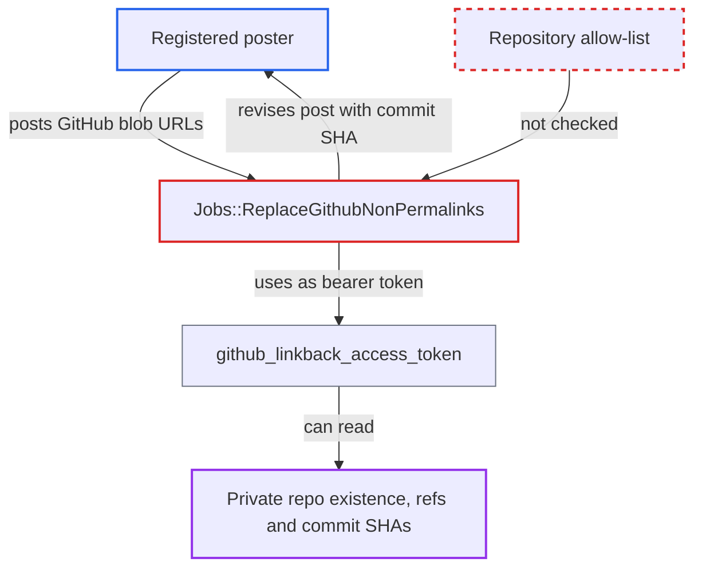

# GitHub permalink job lets posters probe private repos with the site's linkback token

| Field | Value |
|---|---|
| ID | `find_017Ri7uZFBVjovQhFyhb9Zcx` |
| Severity | **Low** |
| Status | open |
| CWE | CWE-200 — Information Exposure |
| Created | 2026-10-27T21:46:53.522246Z |
| Claude Security | https://claude.ai/security/findings/find_017Ri7uZFBVjovQhFyhb9Zcx |

## Description

Any registered user who can post can find out whether private GitHub repositories exist, whether a branch, tag or short SHA exists in them, and the full commit SHA it points to. This only works when `enable_discourse_github_plugin` and `github_permalinks_enabled` are on (both non-default) and the site's linkback token can read private repos. The job `Jobs::ReplaceGithubNonPermalinks` queries GitHub with that token for repository and ref values taken from `post.raw`, with no allow-list.

1. **poster** writes a post containing a GitHub blob URL. The URL has the form `https://github.com/<owner>/<repo>/blob/<ref>/<file>`, and several can go in one post, including inside a code block.
2. **the `before_post_process_cooked` hook** runs for the new or edited post and queues the permalink job. The check queues the job for any post under 60 minutes old, last edited by a real user, whose raw text matches a `github.com/.../blob/...` URL, with no trust-level, category or repository check. ([`plugins/discourse-github/plugin.rb:55-59`](https://github.com/cx-benchmark/discourse/blob/e08ed05b4b1ef773b2de7948a8f88a7c182a3520/plugins/discourse-github/plugin.rb#L55-L59))
3. **the job `Jobs::ReplaceGithubNonPermalinks`** takes the owner, repo and ref from `post.raw` and calls `GET /repos/<owner>/<repo>/commits/<ref>`. The only filter is `github_permalinks_exclude` (default `README.md`), and no repository allow-list is checked. ([`plugins/discourse-github/app/jobs/regular/replace_github_non_permalinks.rb:17-53`](https://github.com/cx-benchmark/discourse/blob/e08ed05b4b1ef773b2de7948a8f88a7c182a3520/plugins/discourse-github/app/jobs/regular/replace_github_non_permalinks.rb#L17-L53))
4. **`Discourse::GithubApi`** sends the request with the site's token. Every request carries `Authorization: Bearer <token>` built from `SiteSetting.github_linkback_access_token`, so it has whatever read access that token has, including private repositories. ([`lib/discourse/github_api.rb:116-119`](https://github.com/cx-benchmark/discourse/blob/e08ed05b4b1ef773b2de7948a8f88a7c182a3520/lib/discourse/github_api.rb#L116-L119))
5. **the job `Jobs::ReplaceGithubNonPermalinks`** revises the poster's post to hold the resolved `commit["sha"]` on success, or leaves it unchanged on a 404. The difference between the two outcomes tells the poster whether the repo and ref exist, and a success also shows the full commit SHA. ([`plugins/discourse-github/app/jobs/regular/replace_github_non_permalinks.rb:17-53`](https://github.com/cx-benchmark/discourse/blob/e08ed05b4b1ef773b2de7948a8f88a7c182a3520/plugins/discourse-github/app/jobs/regular/replace_github_non_permalinks.rb#L17-L53))
6. **poster** reads their own post to see whether it changed. A changed post means the token can read that repo and ref. An unchanged post means it cannot, or the target does not exist.

## Assessment

The attacker is any registered user who can post. The attack needs the non-default settings `enable_discourse_github_plugin` and `github_permalinks_enabled`, and a linkback token that can read private repositories. The attacker posts blob URLs for owners, repos and refs they want to test, several per post if they like, for example inside a code block. The job scans `post.raw`, so those URLs are probed, are not counted by `newuser_max_links`, and nothing caps the number of probes per post. After the editing grace period the job runs, and the attacker reads their own post.

Impact: The attacker learns whether private repositories the site's token can read exist, whether guessed branch, tag or short-SHA refs exist in them, and the full commit SHA each ref points to. No file contents leak, nothing is written to GitHub, and the only edit is a system revision of the attacker's own post.

## Recommendation

Untrusted post content chooses the repository and ref that are queried with the site's privileged GitHub token, and the result is written back into the poster's post.

Fix criteria: Permalink resolution runs only for repositories the admin has explicitly allowed (for example by reusing `github_linkback_projects` or `github_badges_repos`, or a dedicated allow-list), or it uses an unauthenticated request so private resources are never resolved. A post linking a private repo the token can read is left unchanged, and no authenticated API call is made for it. Links to allowed public repos are still rewritten.

## Evidence

**https://github.com/cx-benchmark/discourse**

- [`plugins/discourse-github/app/jobs/regular/replace_github_non_permalinks.rb:17-53`](https://github.com/cx-benchmark/discourse/blob/e08ed05b4b1ef773b2de7948a8f88a7c182a3520/plugins/discourse-github/app/jobs/regular/replace_github_non_permalinks.rb#L17-L53)
- [`plugins/discourse-github/app/lib/github_permalinks.rb:4-23`](https://github.com/cx-benchmark/discourse/blob/e08ed05b4b1ef773b2de7948a8f88a7c182a3520/plugins/discourse-github/app/lib/github_permalinks.rb#L4-L23)
- [`plugins/discourse-github/plugin.rb:55-59`](https://github.com/cx-benchmark/discourse/blob/e08ed05b4b1ef773b2de7948a8f88a7c182a3520/plugins/discourse-github/plugin.rb#L55-L59)
- [`lib/discourse/github_api.rb:116-119`](https://github.com/cx-benchmark/discourse/blob/e08ed05b4b1ef773b2de7948a8f88a7c182a3520/lib/discourse/github_api.rb#L116-L119)

