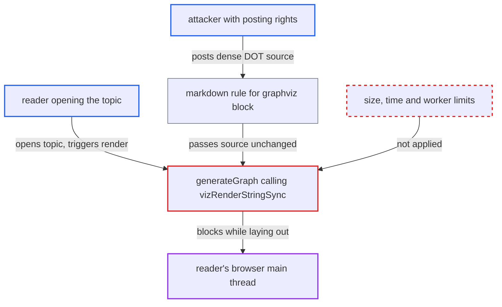

# Graphviz plugin lays out attacker-supplied DOT synchronously on every viewer's main thread

| Field | Value |
|---|---|
| ID | `find_01GyyBGm2KxwHgjbx3ZwdKDJ` |
| Severity | **Low** |
| Status | open |
| CWE | CWE-400 — Uncontrolled Resource Consumption |
| Created | 2026-10-27T21:47:06.236444Z |
| Claude Security | https://claude.ai/security/findings/find_01GyyBGm2KxwHgjbx3ZwdKDJ |

## Description

Any user who can post can freeze the browser tab of everyone who opens their topic. The attack only works on sites where an admin has enabled `discourse_graphviz_enabled`, which is off by default. The cause is `generateGraph`, which lays out the author's DOT source with `vizRenderStringSync` on the main thread, with no limit on size, complexity or time.

1. **attacker** posts a `[graphviz]` block with a short but dense DOT graph. A subgraph edge statement such as `{a0 ... aN} -> {b0 ... bN}` expands to N² edges, so a post under the default `max_post_length` of 32,000 can declare 10^5 to 10^6 edges. The author can also pick the engine through `data-engine` and set attributes such as neato `maxiter` and `epsilon` to raise iteration counts. ([`plugins/discourse-graphviz/assets/javascripts/discourse-markdown/discourse-graphviz.js:26-48`](https://github.com/cx-benchmark/discourse/blob/e08ed05b4b1ef773b2de7948a8f88a7c182a3520/plugins/discourse-graphviz/assets/javascripts/discourse-markdown/discourse-graphviz.js#L26-L48))
2. **markdown rule** stores the block body unchanged in `div.graphviz`. The rule only HTML-escapes the source and applies no length or complexity check, so the whole DOT text reaches every reader. ([`plugins/discourse-graphviz/assets/javascripts/discourse-markdown/discourse-graphviz.js:26-48`](https://github.com/cx-benchmark/discourse/blob/e08ed05b4b1ef773b2de7948a8f88a7c182a3520/plugins/discourse-graphviz/assets/javascripts/discourse-markdown/discourse-graphviz.js#L26-L48))
3. **the initializer `decorateCookedElement`** passes the text and engine of each `div.graphviz` to `GraphvizInline` when a reader opens the post. Viewing the post is enough to trigger this, and no click or opt-in is needed. ([`plugins/discourse-graphviz/assets/javascripts/discourse/api-initializers/discourse-graphviz.js:5-27`](https://github.com/cx-benchmark/discourse/blob/e08ed05b4b1ef773b2de7948a8f88a7c182a3520/plugins/discourse-graphviz/assets/javascripts/discourse/api-initializers/discourse-graphviz.js#L5-L27))
4. **the component `GraphvizDiagram.loadGraph`** hands the source straight to `generateGraph`. `DAsyncContent` calls it as soon as the component renders, and there is no guard. ([`plugins/discourse-graphviz/assets/javascripts/discourse/components/graphviz-diagram.gjs:12-15`](https://github.com/cx-benchmark/discourse/blob/e08ed05b4b1ef773b2de7948a8f88a7c182a3520/plugins/discourse-graphviz/assets/javascripts/discourse/components/graphviz-diagram.gjs#L12-L15))
5. **`generateGraph`** calls `vizRenderStringSync(source, { format: "svg", engine })` on the main thread. The bundled viz.js 3.0.1 build runs the whole layout on the calling thread, with no Web Worker, time budget, cancellation or size or edge cap. ([`plugins/discourse-graphviz/assets/javascripts/discourse/lib/render-graphviz.js:40-52`](https://github.com/cx-benchmark/discourse/blob/e08ed05b4b1ef773b2de7948a8f88a7c182a3520/plugins/discourse-graphviz/assets/javascripts/discourse/lib/render-graphviz.js#L40-L52))
6. **reader's browser** stops responding until layout ends, memory runs out, or the browser kills the page. The render runs again each time the post is decorated again.

## Assessment

The attacker is any registered user allowed to post (TL0 by default). The site must have an admin-enabled `discourse_graphviz_enabled`, which defaults to `false`. The attacker posts a short `[graphviz]` block whose DOT source declares a dense graph, for example an edge statement between two large node sets, or neato with a large `maxiter`. A victim only has to open the topic. No defence has to be bypassed.

Impact: Every reader's Discourse web client stops responding while the layout runs, and again whenever the post is decorated again. This also gets in the way of staff moderating from that page. No data is read or changed. The server and other topics are not affected, and staff can still act through other pages, so the loss of availability is limited.

## Recommendation

Attacker-controlled DOT source of unbounded size and complexity is laid out synchronously on the viewer's UI thread, with no limit, timeout or isolation. One user's content can therefore make every reader's client unusable.

Fix criteria: Rendering a post-supplied graph cannot block the reader's UI indefinitely. Either viz.js runs off the main thread in a Web Worker with a hard time and memory budget and falls back to showing the source on timeout, or a cap on `[graphviz]` source length and node and edge count is enforced at cook time, or both. Posting a dense 30 KB graph leaves the topic page responsive, and the graph degrades to an error or a source view.

## Evidence

**https://github.com/cx-benchmark/discourse**

- [`plugins/discourse-graphviz/assets/javascripts/discourse/lib/render-graphviz.js:40-52`](https://github.com/cx-benchmark/discourse/blob/e08ed05b4b1ef773b2de7948a8f88a7c182a3520/plugins/discourse-graphviz/assets/javascripts/discourse/lib/render-graphviz.js#L40-L52)
- [`plugins/discourse-graphviz/assets/javascripts/discourse-markdown/discourse-graphviz.js:26-48`](https://github.com/cx-benchmark/discourse/blob/e08ed05b4b1ef773b2de7948a8f88a7c182a3520/plugins/discourse-graphviz/assets/javascripts/discourse-markdown/discourse-graphviz.js#L26-L48)
- [`plugins/discourse-graphviz/assets/javascripts/discourse/api-initializers/discourse-graphviz.js:5-27`](https://github.com/cx-benchmark/discourse/blob/e08ed05b4b1ef773b2de7948a8f88a7c182a3520/plugins/discourse-graphviz/assets/javascripts/discourse/api-initializers/discourse-graphviz.js#L5-L27)
- [`plugins/discourse-graphviz/assets/javascripts/discourse/components/graphviz-diagram.gjs:12-15`](https://github.com/cx-benchmark/discourse/blob/e08ed05b4b1ef773b2de7948a8f88a7c182a3520/plugins/discourse-graphviz/assets/javascripts/discourse/components/graphviz-diagram.gjs#L12-L15)
- [`plugins/discourse-graphviz/public/javascripts/viz-3.0.1.js:1-16`](https://github.com/cx-benchmark/discourse/blob/e08ed05b4b1ef773b2de7948a8f88a7c182a3520/plugins/discourse-graphviz/public/javascripts/viz-3.0.1.js#L1-L16)
- [`plugins/discourse-graphviz/config/settings.yml:1-4`](https://github.com/cx-benchmark/discourse/blob/e08ed05b4b1ef773b2de7948a8f88a7c182a3520/plugins/discourse-graphviz/config/settings.yml#L1-L4)

