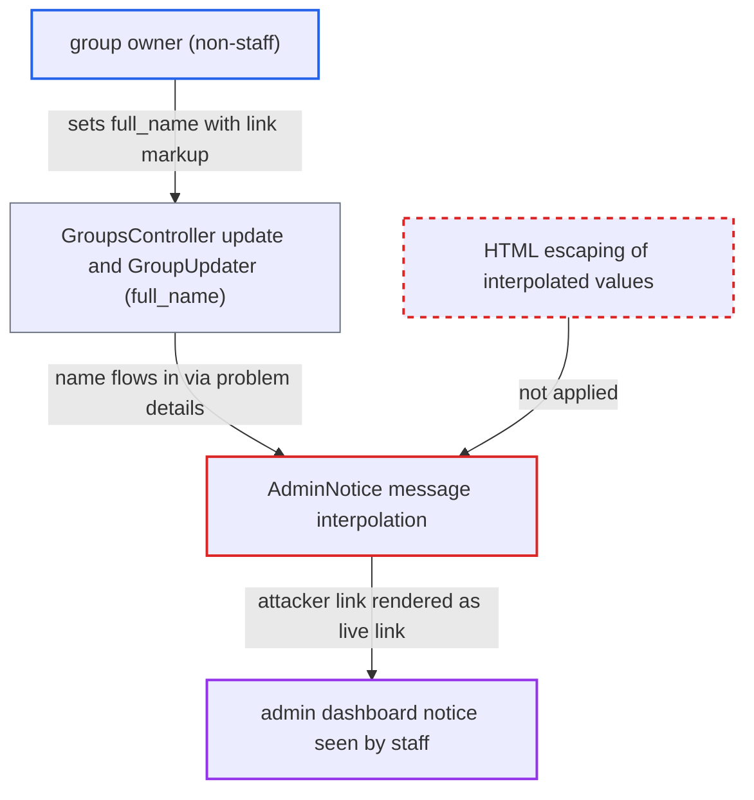

# Group owner's full_name injected as live link markup into admin dashboard SMTP problem notice

| Field | Value |
|---|---|
| ID | `find_01UcEZW55UjoDRwx2Z691Mkz` |
| Severity | **Low** |
| Status | open |
| CWE | CWE-79 — HTML injection |
| Created | 2026-10-27T22:06:54.098853Z |
| Claude Security | https://claude.ai/security/findings/find_01UcEZW55UjoDRwx2Z691Mkz |

## Description

A non-staff group owner can put a link of their choice into a high-priority SMTP problem notice on the staff admin dashboard. A staff member would have to click it, so it can be used to phish credentials. It needs an admin-configured group SMTP setup whose check later fails. The cause is that `AdminNotice#message` fills the group's `full_name` into an HTML translation without escaping it, and the sanitizer still allows `<a>` tags.

1. **group owner** sets the group's `full_name` to text containing link markup. The value starts with `</a>` to close the notice's own link and then adds an `<a href="https://evil.example/smtp" target="_blank">` link. The owner sends it with `PUT /groups/:id`, and the only check on the value is a length of at most 100. ([`lib/group_updater.rb:51-58`](https://github.com/cx-benchmark/discourse/blob/e08ed05b4b1ef773b2de7948a8f88a7c182a3520/lib/group_updater.rb#L51-L58))
2. **`can_edit_group?`** lets the group owner make the change. It returns true for group owners, so staff rights are not needed to control `full_name` on a non-automatic group. ([`lib/guardian/group_guardian.rb:13-19`](https://github.com/cx-benchmark/discourse/blob/e08ed05b4b1ef773b2de7948a8f88a7c182a3520/lib/guardian/group_guardian.rb#L13-L19))
3. **the check `ProblemCheck::GroupEmailCredentials`** passes `group.full_name` on unescaped as `group_full_name`. `translation_data` hands over the raw value when the scheduled SMTP credentials check fails for that group. ([`app/services/problem_check/group_email_credentials.rb:35-37`](https://github.com/cx-benchmark/discourse/blob/e08ed05b4b1ef773b2de7948a8f88a7c182a3520/app/services/problem_check/group_email_credentials.rb#L35-L37))
4. **`ProblemCheckTracker`** copies the details onto an `AdminNotice`. Each time the 30-minute check fails, the current `full_name` is stored with the notice. ([`app/models/problem_check_tracker.rb:53-100`](https://github.com/cx-benchmark/discourse/blob/e08ed05b4b1ef773b2de7948a8f88a7c182a3520/app/models/problem_check_tracker.rb#L53-L100))
5. **`AdminNotice#message`** interpolates the details into the HTML translation and then sanitizes it. `%{group_full_name}` sits inside the anchor text of `dashboard.problem.group_email_credentials`, so the injected `</a>` closes that anchor. The sanitizer allows `a` with `href`, `target`, `rel` and `class`, so the attacker's link survives. ([`app/models/admin_notice.rb:15-27`](https://github.com/cx-benchmark/discourse/blob/e08ed05b4b1ef773b2de7948a8f88a7c182a3520/app/models/admin_notice.rb#L15-L27))
6. **admin dashboard component** renders the notice message as trusted HTML. `admin-notice.gjs` uses `trustHTML`, so the injected link shows up as a clickable link in the notice. ([`frontend/discourse/admin/components/admin-notice.gjs:23-26`](https://github.com/cx-benchmark/discourse/blob/e08ed05b4b1ef773b2de7948a8f88a7c182a3520/frontend/discourse/admin/components/admin-notice.gjs#L23-L26))

## Assessment

The attacker is an owner of a non-automatic group, not a staff member. An admin must have configured group SMTP for that group (`enable_smtp` on, and `smtp_enabled` on the group). The attacker sends `PUT /groups/:id` with a `group[full_name]` value such as `</a><a href="https://evil.example" target="_blank">Re-enter SMTP password</a>`. The attacker does not control when the notice appears. It appears only when the scheduled `GroupEmailCredentials` check later fails, for example after a credential rotation or an outage. A staff member must then click the link. The same template also interpolates `%{error}`, which for auth and unhandled SMTP errors holds the SMTP server's reply text. That server is configured by an admin, so the report does not treat it as an attacker route.

Impact: The attacker gets a link and label of their choice inside a trusted system notice that only staff see. This can be used to phish SMTP or admin credentials. The sanitizer strips script and event handlers and blocks `javascript:` URLs, so there is no code execution and no direct data access. The effect is limited to content spoofing.

## Recommendation

Problem-check data values (`group_full_name`, `error`, and any other interpolated detail) go into HTML-bearing translations as raw strings before sanitization. User-authored text is therefore parsed as markup, and allowed tags such as `<a href>` survive.

Fix criteria: Every interpolated value in an admin notice is HTML-escaped before it is treated as HTML, so only the translation's own markup is live. To verify, set a group full name containing `</a><a href="https://example.com">x</a>` and make the group's SMTP check fail. The dashboard notice must then show that string literally inside the original `/g/<name>/manage/email` link and contain no other anchor.

## Evidence

**https://github.com/cx-benchmark/discourse**

- [`app/models/admin_notice.rb:15-27`](https://github.com/cx-benchmark/discourse/blob/e08ed05b4b1ef773b2de7948a8f88a7c182a3520/app/models/admin_notice.rb#L15-L27)
- [`app/services/problem_check/group_email_credentials.rb:35-37`](https://github.com/cx-benchmark/discourse/blob/e08ed05b4b1ef773b2de7948a8f88a7c182a3520/app/services/problem_check/group_email_credentials.rb#L35-L37)
- [`config/locales/server.en.yml:2102`](https://github.com/cx-benchmark/discourse/blob/e08ed05b4b1ef773b2de7948a8f88a7c182a3520/config/locales/server.en.yml#L2102)
- [`lib/group_updater.rb:51-58`](https://github.com/cx-benchmark/discourse/blob/e08ed05b4b1ef773b2de7948a8f88a7c182a3520/lib/group_updater.rb#L51-L58)
- [`lib/guardian/group_guardian.rb:13-19`](https://github.com/cx-benchmark/discourse/blob/e08ed05b4b1ef773b2de7948a8f88a7c182a3520/lib/guardian/group_guardian.rb#L13-L19)
- [`app/models/problem_check_tracker.rb:53-100`](https://github.com/cx-benchmark/discourse/blob/e08ed05b4b1ef773b2de7948a8f88a7c182a3520/app/models/problem_check_tracker.rb#L53-L100)
- [`frontend/discourse/admin/components/admin-notice.gjs:23-26`](https://github.com/cx-benchmark/discourse/blob/e08ed05b4b1ef773b2de7948a8f88a7c182a3520/frontend/discourse/admin/components/admin-notice.gjs#L23-L26)

