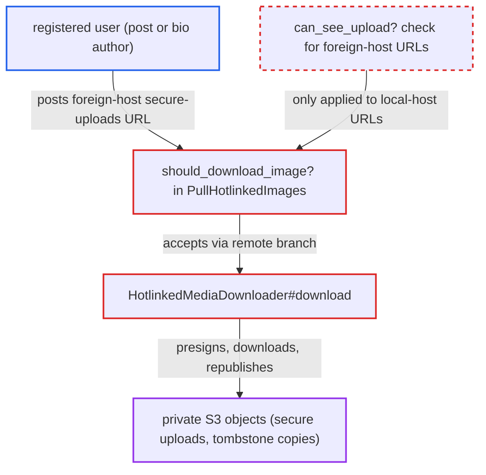

# Hotlinked image pull presigns any S3 key named by a foreign-host secure-uploads URL

| Field | Value |
|---|---|
| ID | `find_01XAHCs4cNoPpkknAEiqi6mX` |
| Severity | **Low** |
| Status | open |
| CWE | CWE-639 — Insecure direct object reference |
| Created | 2026-10-27T21:21:29.320874Z |
| Claude Security | https://claude.ai/security/findings/find_01XAHCs4cNoPpkknAEiqi6mX |

## Description

A registered user can read private uploaded files from the forum's S3 bucket and republish them under their own post or bio. They need the file's exact secret key, for example from a private message they have since lost access to. The post and profile-bio hotlink jobs only check permission for local URLs, so a foreign-host `/secure-uploads/` URL is signed and fetched without any check.

1. **attacker** posts an image link with a foreign host and a known secure-upload key. The link looks like !`[x](https://their-host.example/secure-uploads/<key>.png)`. It can go in a post or in a profile bio. ([`app/jobs/regular/pull_user_profile_hotlinked_images.rb:17-33`](https://github.com/cx-benchmark/discourse/blob/e08ed05b4b1ef773b2de7948a8f88a7c182a3520/app/jobs/regular/pull_user_profile_hotlinked_images.rb#L17-L33))
2. **the job `PullHotlinkedImages`** accepts the URL in `should_download_image?` through the remote branch. The `Upload.fetch_from` and `can_see_upload?` check sits only in the local-host branch. The remote branch only needs `download_remote_images_to_local` (default true) and a host not in `disabled_image_download_domains` (default empty). ([`app/jobs/regular/pull_hotlinked_images.rb:113-160`](https://github.com/cx-benchmark/discourse/blob/e08ed05b4b1ef773b2de7948a8f88a7c182a3520/app/jobs/regular/pull_hotlinked_images.rb#L113-L160))
3. **the downloader `HotlinkedMediaDownloader#download`** swaps the URL for a presigned S3 URL. `Upload.secure_uploads_url?` matches on the URL path only and ignores the host. No `Upload` record is looked up and no guardian check runs. ([`lib/hotlinked_media_downloader.rb:41-46`](https://github.com/cx-benchmark/discourse/blob/e08ed05b4b1ef773b2de7948a8f88a7c182a3520/lib/hotlinked_media_downloader.rb#L41-L46))
4. **`Upload.signed_url_from_secure_uploads_url`** turns the path from the URL into a presigned GET. `signed_url_for_path` signs the key with the site's S3 credentials, so a private object becomes readable. ([`lib/file_store/s3_store.rb:242-257`](https://github.com/cx-benchmark/discourse/blob/e08ed05b4b1ef773b2de7948a8f88a7c182a3520/lib/file_store/s3_store.rb#L242-L257))
5. **the downloader** fetches the private object and stores it as a new upload owned by the poster. The post's image is re-pointed at this copy and the raw text is rewritten. The copy's access control is the attacker's own post, so the attacker can view it, and in a public topic so can everyone. ([`lib/hotlinked_media_downloader.rb:41-46`](https://github.com/cx-benchmark/discourse/blob/e08ed05b4b1ef773b2de7948a8f88a7c182a3520/lib/hotlinked_media_downloader.rb#L41-L46))

## Assessment

The attacker is a registered user who can post or edit their bio (trust level 0 and up). They must already know the exact key of a secure upload, for example from a PM or private category they lost access to, or from a URL someone else leaked. With `secure_uploads` on, keys contain a random `sha1` and cannot be guessed. The key must end in a supported media extension and the object must fit within `max_image_size_kb`. Both the post job and the profile-bio job `PullUserProfileHotlinkedImages` reach the flaw. No victim action is needed. The S3 file store must be in use, and the meaningful impact also needs `secure_uploads` enabled.

Impact: The attacker can read private bucket objects that `show_secure` would refuse them, and can republish them under their own post. This includes secure PM or private-category uploads and `tombstone/` copies of deleted uploads. In a multisite bucket it also includes other sites' keys. The reach is limited to objects whose exact key the attacker holds and that have a media extension. Stored objects are not modified and availability is not affected.

## Recommendation

(1) `HotlinkedMediaDownloader#download` presigns any path of the secure-uploads shape whatever the URL's host. The only authorization is in `should_download_image?` and covers local-host URLs only.

Fix criteria: A secure-uploads-shaped URL is signed only after it resolves to an existing `Upload` or `OptimizedImage` of this site and the post author or profile owner passes `can_see_upload?`. A foreign-host URL with a `/secure-uploads/` path is never signed. Verify with a post containing `https://other.example/secure-uploads/<key-of-a-private-upload>.png`: it triggers no S3 GET and creates no `Upload`.

(2) `Upload.signed_url_from_secure_uploads_url` is a raw signing primitive that turns caller-supplied path text into a presigned GET. Every caller must re-implement authorization, and `CookedProcessorMixin#fetch_image_info` uses it unguarded too.

Fix criteria: Signing derives the key from an authorized upload record rather than from URL text, or refuses when the acting user cannot see the upload. A test that passes a key for an upload the user cannot see, on any host, gets no signed URL.

## Evidence

**https://github.com/cx-benchmark/discourse**

- [`lib/hotlinked_media_downloader.rb:41-46`](https://github.com/cx-benchmark/discourse/blob/e08ed05b4b1ef773b2de7948a8f88a7c182a3520/lib/hotlinked_media_downloader.rb#L41-L46)
- [`app/jobs/regular/pull_hotlinked_images.rb:113-160`](https://github.com/cx-benchmark/discourse/blob/e08ed05b4b1ef773b2de7948a8f88a7c182a3520/app/jobs/regular/pull_hotlinked_images.rb#L113-L160)
- [`app/models/upload.rb:244-260`](https://github.com/cx-benchmark/discourse/blob/e08ed05b4b1ef773b2de7948a8f88a7c182a3520/app/models/upload.rb#L244-L260)
- [`lib/file_store/s3_store.rb:242-257`](https://github.com/cx-benchmark/discourse/blob/e08ed05b4b1ef773b2de7948a8f88a7c182a3520/lib/file_store/s3_store.rb#L242-L257)
- [`app/controllers/uploads_controller.rb:190-221`](https://github.com/cx-benchmark/discourse/blob/e08ed05b4b1ef773b2de7948a8f88a7c182a3520/app/controllers/uploads_controller.rb#L190-L221)
- [`app/jobs/regular/pull_user_profile_hotlinked_images.rb:17-33`](https://github.com/cx-benchmark/discourse/blob/e08ed05b4b1ef773b2de7948a8f88a7c182a3520/app/jobs/regular/pull_user_profile_hotlinked_images.rb#L17-L33)
- [`plugins/chat/app/models/chat/message_hotlinked_media.rb:28-34`](https://github.com/cx-benchmark/discourse/blob/e08ed05b4b1ef773b2de7948a8f88a7c182a3520/plugins/chat/app/models/chat/message_hotlinked_media.rb#L28-L34)

