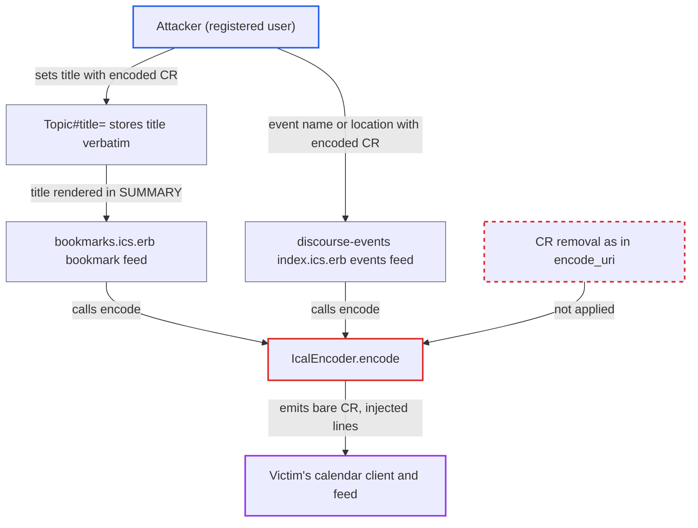

# ICS text encoder emits entity-decoded lone CR, letting topic titles inject calendar feed lines

| Field | Value |
|---|---|
| ID | `find_01VtU1pLQiaSZ2D9mWXfKia3` |
| Severity | **Low** |
| Status | open |
| CWE | CWE-93 — CRLF injection |
| Created | 2026-10-27T22:08:01.183838Z |
| Claude Security | https://claude.ai/security/findings/find_01VtU1pLQiaSZ2D9mWXfKia3 |

## Description

A registered user can make another user's calendar feed contain extra lines of the attacker's choosing, such as alarms, URLs, attendees and extra events. The attacker needs only to write a topic title, and the victim must bookmark the topic with a reminder and subscribe to the feed. The cause is `IcalEncoder.encode`, which decodes `&#13;` into a bare carriage return and never escapes it. Only calendar clients that end a line on a bare carriage return are affected.

1. **Attacker (registered user)** creates a topic whose title contains the literal text `&#13;`. The title is stored as typed, because `TextCleaner.clean_title` does not touch `&`, `#` or `;`, so the literal `&#13;` stays in the database. ([`app/models/topic.rb:1596-1601`](https://github.com/cx-benchmark/discourse/blob/e08ed05b4b1ef773b2de7948a8f88a7c182a3520/app/models/topic.rb#L1596-L1601))
2. **Victim** bookmarks the topic with a reminder and subscribes a calendar client to the bookmark feed. The Calendar Subscriptions page issues `bookmarks.ics?user_api_key=` URLs for external calendar clients. ([`app/controllers/calendar_subscriptions_controller.rb:69-73`](https://github.com/cx-benchmark/discourse/blob/e08ed05b4b1ef773b2de7948a8f88a7c182a3520/app/controllers/calendar_subscriptions_controller.rb#L69-L73))
3. **the `format.ics` handler in `UsersController#bookmarks`** serialises the victim's bookmarks with reminders, including the attacker's topic. For topic and post bookmarks the serializer's `title` is the raw `Topic#title`, written by the topic creator rather than the subscriber. ([`app/controllers/users_controller.rb:1987-2008`](https://github.com/cx-benchmark/discourse/blob/e08ed05b4b1ef773b2de7948a8f88a7c182a3520/app/controllers/users_controller.rb#L1987-L2008))
4. **the view `bookmarks.ics.erb`** passes `bookmark.name.presence || bookmark.title` to `IcalEncoder.encode` for the `SUMMARY` line. The feed is an LF-delimited document, and the encoder's output is emitted verbatim. ([`app/views/users/bookmarks.ics.erb:11`](https://github.com/cx-benchmark/discourse/blob/e08ed05b4b1ef773b2de7948a8f88a7c182a3520/app/views/users/bookmarks.ics.erb#L11))
5. **`IcalEncoder.encode`** decodes `&#13;` into a raw carriage return and leaves it in the output. It escapes only backslash, `,`, `;`, `\r\n` and `\n`, so a carriage return not followed by a line feed passes through, and the result is marked `html_safe`. ([`lib/ical_encoder.rb:8-19`](https://github.com/cx-benchmark/discourse/blob/e08ed05b4b1ef773b2de7948a8f88a7c182a3520/lib/ical_encoder.rb#L8-L19))
6. **the victim's calendar client** treats each bare carriage return as the end of a line and reads the text after it as new content lines. Parsers such as ical4j and the Python `icalendar` package split lines this way, so the injected lines (for example a `BEGIN:VALARM` block) become part of the feed.

## Assessment

The attacker is a registered user who can create topics (TL0 by default). The victim must bookmark the attacker's topic with a reminder and have a calendar subscription, and the victim's calendar client must end lines on a bare carriage return. An example title is `Weekly sync notes&#13;BEGIN:VALARM&#13;ACTION:DISPLAY&#13;TRIGGER:-PT5M&#13;DESCRIPTION:Re-verify at https://evil.example&#13;END:VALARM`. A second route exists when the bundled discourse-events plugin and post events are enabled (both off by default). Event `name`, `location`, description and the topic-title fallback then reach `/discourse-post-event/events.ics` through the same `encode`. `Parser.extract_events` keeps `data-name` and `data-location` verbatim. Subscribers to that events feed are affected without any bookmark.

Impact: The attacker controls the line structure of a calendar feed that Discourse serves to another user. Injected `BEGIN:VALARM` blocks, `URL:` lines, `ATTENDEE:mailto:` lines, extra `VEVENT`s and an early `END:VCALENDAR` are all possible, and the early `END:VCALENDAR` drops the victim's later reminders. Injected lines cannot contain unescaped `,` or `;`, so property parameters are unavailable. Nothing is read, and the forum itself is unaffected.

Subsequent-system impact: The subscriber's calendar application ingests attacker-chosen alarms, URLs, attendees and extra events that the forum UI never shows. This is a spoofing and phishing primitive inside the victim's calendar. The injected data does not execute and does not read victim data.

## Recommendation

(1) `IcalEncoder.encode` escapes `\r\n` and `\n` but not a lone `\r` or other control characters. A carriage return in a value therefore becomes a line terminator for lenient ICS parsers.

Fix criteria: After all decoding steps, no raw CR, LF or other C0 control character remains in an `encode` result. A lone CR is escaped or removed like LF. Encoding a value with a bare CR or the literal `&#13;` gives output with no U+000D byte. A topic titled with `&#13;BEGIN:VALARM` renders as a single unbroken `SUMMARY` line in `bookmarks.ics`.

(2) `encode` treats plain-text columns (topic titles, event name, location and description, bookmark names) as HTML and decodes character references at render time, after any input validation. Stored text can therefore turn into control characters.

Fix criteria: Entity decoding cannot introduce line-break characters into the output. Either neutralisation runs on the fully decoded value, or plain-text inputs are not entity-decoded. Stored values containing `&#13;`, `&#xD;` and `&amp;#13;` produce rendered bookmark and events feeds with no injected content lines.

## Evidence

**https://github.com/cx-benchmark/discourse**

- [`lib/ical_encoder.rb:8-19`](https://github.com/cx-benchmark/discourse/blob/e08ed05b4b1ef773b2de7948a8f88a7c182a3520/lib/ical_encoder.rb#L8-L19)
- [`app/views/users/bookmarks.ics.erb:11`](https://github.com/cx-benchmark/discourse/blob/e08ed05b4b1ef773b2de7948a8f88a7c182a3520/app/views/users/bookmarks.ics.erb#L11)
- [`app/serializers/user_post_topic_bookmark_base_serializer.rb:26-28`](https://github.com/cx-benchmark/discourse/blob/e08ed05b4b1ef773b2de7948a8f88a7c182a3520/app/serializers/user_post_topic_bookmark_base_serializer.rb#L26-L28)
- [`app/controllers/users_controller.rb:1987-2008`](https://github.com/cx-benchmark/discourse/blob/e08ed05b4b1ef773b2de7948a8f88a7c182a3520/app/controllers/users_controller.rb#L1987-L2008)
- [`app/models/topic.rb:1596-1601`](https://github.com/cx-benchmark/discourse/blob/e08ed05b4b1ef773b2de7948a8f88a7c182a3520/app/models/topic.rb#L1596-L1601)
- [`app/controllers/calendar_subscriptions_controller.rb:69-73`](https://github.com/cx-benchmark/discourse/blob/e08ed05b4b1ef773b2de7948a8f88a7c182a3520/app/controllers/calendar_subscriptions_controller.rb#L69-L73)
- [`plugins/discourse-events/app/views/discourse_events/events/index.ics.erb:21-24`](https://github.com/cx-benchmark/discourse/blob/e08ed05b4b1ef773b2de7948a8f88a7c182a3520/plugins/discourse-events/app/views/discourse_events/events/index.ics.erb#L21-L24)
- [`plugins/discourse-events/lib/discourse_events/events/parser.rb:59-66`](https://github.com/cx-benchmark/discourse/blob/e08ed05b4b1ef773b2de7948a8f88a7c182a3520/plugins/discourse-events/lib/discourse_events/events/parser.rb#L59-L66)
- [`lib/ical_encoder.rb:21-31`](https://github.com/cx-benchmark/discourse/blob/e08ed05b4b1ef773b2de7948a8f88a7c182a3520/lib/ical_encoder.rb#L21-L31)

