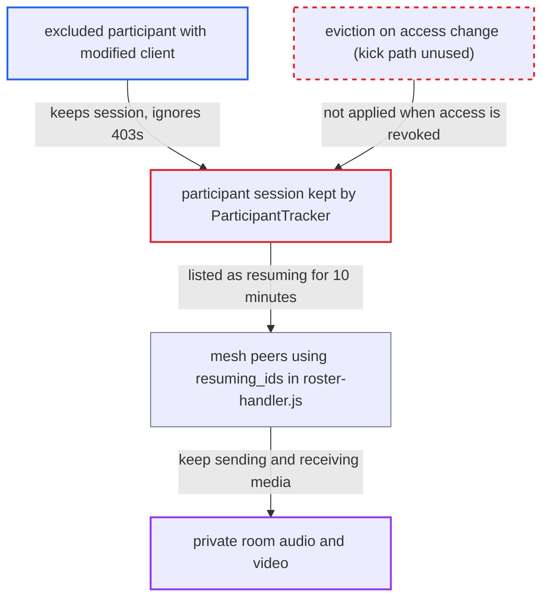

# Live room access revocation leaves ex-participants receiving the call's media

| Field | Value |
|---|---|
| ID | `find_0148rWQs1v18KKt1WLvABG4e` |
| Severity | **Low** |
| Status | open |
| CWE | CWE-613 — Insufficient Session Expiration |
| Created | 2026-10-27T21:44:11.958547Z |
| Claude Security | https://claude.ai/security/findings/find_0148rWQs1v18KKt1WLvABG4e |

## Description

A user who was removed from a private Live room, or who was in a public room that later became private, can keep sending and receiving the call's audio and video. On the default mesh transport this lasts up to 10 minutes. On the optional LiveKit transport it has no end. It needs a modified client and a manager changing access while the user is in the call. The cause is that the room update handlers and `RoomMembershipsController#destroy` change the access record but never end the user's live session.

1. **authenticated Live user** joins a public room and takes part in the call. The default `live_allowed_groups` covers logged-in users, and the report names no further requirement.
2. **room manager or staff member** makes the room private, or on LiveKit removes the user's membership. This happens while the user is in the call, and the attacker does not control it. ([`plugins/live/app/controllers/live/rooms_controller.rb:105-117`](https://github.com/cx-benchmark/discourse/blob/e08ed05b4b1ef773b2de7948a8f88a7c182a3520/plugins/live/app/controllers/live/rooms_controller.rb#L105-L117))
3. **the handlers `RoomsController#update` and `AdminRoomsController#update`** save the new setting and broadcast a directory entry, nothing more. Presence metadata, the participant session and the SFU connection of users who can no longer join are left in place. ([`plugins/live/app/controllers/live/rooms_controller.rb:105-117`](https://github.com/cx-benchmark/discourse/blob/e08ed05b4b1ef773b2de7948a8f88a7c182a3520/plugins/live/app/controllers/live/rooms_controller.rb#L105-L117))
4. **attacker's modified client** ignores the 403 answers to its heartbeat and keeps its peer connections. The server re-checks access only on the next HTTP request, so the existing media session is not touched.
5. **`ParticipantTracker.resuming_user_ids`** keeps listing the user after presence lapses. Presence lapses after 30 s, but the session key lasts `PARTICIPANT_SESSION_RESUME_WINDOW` (10 minutes) and nothing revokes it. ([`plugins/live/app/services/live/participant_tracker.rb:182-211`](https://github.com/cx-benchmark/discourse/blob/e08ed05b4b1ef773b2de7948a8f88a7c182a3520/plugins/live/app/services/live/participant_tracker.rb#L182-L211))
6. **mesh peers running `roster-handler.js`** keep their RTCPeerConnection to the user. `RoomBroadcaster` sends the list as `resuming_ids`, and the peers deliberately do not tear down connections to users in it. Audio and video flow both ways. ([`plugins/live/assets/javascripts/discourse/lib/live/roster-handler.js:128-143`](https://github.com/cx-benchmark/discourse/blob/e08ed05b4b1ef773b2de7948a8f88a7c182a3520/plugins/live/assets/javascripts/discourse/lib/live/roster-handler.js#L128-L143))
7. **`RoomServiceClient.update_participant`** re-grants SFU rights after a membership is deleted (LiveKit). It always sets `canSubscribe: true` and takes `canPublish` from `can_speak_in_live_room?`, which is true for open rooms. Nothing removes the participant. ([`plugins/live/lib/live/livekit/room_service_client.rb:29-56`](https://github.com/cx-benchmark/discourse/blob/e08ed05b4b1ef773b2de7948a8f88a7c182a3520/plugins/live/lib/live/livekit/room_service_client.rb#L29-L56))

## Assessment

The attacker is an authenticated Live user who is in a public room. A room manager or staff member then makes the room private through the room update or the admin room update. On LiveKit, which is optional and needs `live_livekit_room_policy` plus a configured server, deleting the user's membership also triggers the gap. Success depends on the revocation happening while the attacker is in the call. With the default mesh transport the media continues for up to 10 minutes after the last accepted heartbeat. Deleting a membership on mesh does not leak, because peers close the connection on `role_change` and the user cannot negotiate a new one, since `signal` requires `can_join_live_room?`. The LiveKit lifetime relies on an assumption that the report does not verify: a connected participant stays connected after its join token expires, and only `RemoveParticipant` or `DeleteRoom` disconnects it.

Impact: The excluded user keeps receiving the private room's live audio and video and can keep sending their own to peers. The roster shows them as gone or reconnecting. On mesh this is limited to the 10-minute session window. Indefinite access needs LiveKit. Availability is not affected.

## Recommendation

(1) Membership deletion and public-to-private changes (room update and admin update) change the authorization record but do not end the participation of users who are no longer eligible. Presence metadata, the participant session and the LiveKit participant survive, so peers still treat the user as resumable.

Fix criteria: Any change that makes a present or resuming participant fail `can_join_live_room?` evicts that participant through one authoritative path. That path closes the analytics session, removes presence and metadata, revokes the participant session so the user leaves `resuming_ids`, sends the targeted `kicked` event, broadcasts the roster, and calls `RemoveParticipant` on LiveKit. To verify, flip a public room with a connected non-member to private. Mesh peers must drop the connection at once, and LiveKit must report the participant removed.

(2) `RoomServiceClient.update_participant` derives SFU permissions from `can_speak_in_live_room?` and always sets `canSubscribe: true`. It never checks whether the user may still join the room.

Fix criteria: SFU permission syncs are based on full join authorization. A user who can no longer join gets no subscribe or publish rights, or is removed. To verify, delete a connected member's membership in a private open room. No permission update may re-grant `canSubscribe` or `canPublish`.

## Evidence

**https://github.com/cx-benchmark/discourse**

- [`plugins/live/app/controllers/live/rooms_controller.rb:105-117`](https://github.com/cx-benchmark/discourse/blob/e08ed05b4b1ef773b2de7948a8f88a7c182a3520/plugins/live/app/controllers/live/rooms_controller.rb#L105-L117)
- [`plugins/live/app/controllers/live/room_memberships_controller.rb:57-75`](https://github.com/cx-benchmark/discourse/blob/e08ed05b4b1ef773b2de7948a8f88a7c182a3520/plugins/live/app/controllers/live/room_memberships_controller.rb#L57-L75)
- [`plugins/live/app/services/live/participant_tracker.rb:182-211`](https://github.com/cx-benchmark/discourse/blob/e08ed05b4b1ef773b2de7948a8f88a7c182a3520/plugins/live/app/services/live/participant_tracker.rb#L182-L211)
- [`plugins/live/assets/javascripts/discourse/lib/live/roster-handler.js:128-143`](https://github.com/cx-benchmark/discourse/blob/e08ed05b4b1ef773b2de7948a8f88a7c182a3520/plugins/live/assets/javascripts/discourse/lib/live/roster-handler.js#L128-L143)
- [`plugins/live/lib/live/livekit/room_service_client.rb:29-56`](https://github.com/cx-benchmark/discourse/blob/e08ed05b4b1ef773b2de7948a8f88a7c182a3520/plugins/live/lib/live/livekit/room_service_client.rb#L29-L56)
- [`plugins/live/lib/live/guardian_extension.rb:140-145`](https://github.com/cx-benchmark/discourse/blob/e08ed05b4b1ef773b2de7948a8f88a7c182a3520/plugins/live/lib/live/guardian_extension.rb#L140-L145)
- [`plugins/live/app/controllers/live/admin_rooms_controller.rb:29-37`](https://github.com/cx-benchmark/discourse/blob/e08ed05b4b1ef773b2de7948a8f88a7c182a3520/plugins/live/app/controllers/live/admin_rooms_controller.rb#L29-L37)
- [`plugins/live/app/controllers/live/rooms_controller.rb:533-546`](https://github.com/cx-benchmark/discourse/blob/e08ed05b4b1ef773b2de7948a8f88a7c182a3520/plugins/live/app/controllers/live/rooms_controller.rb#L533-L546)

