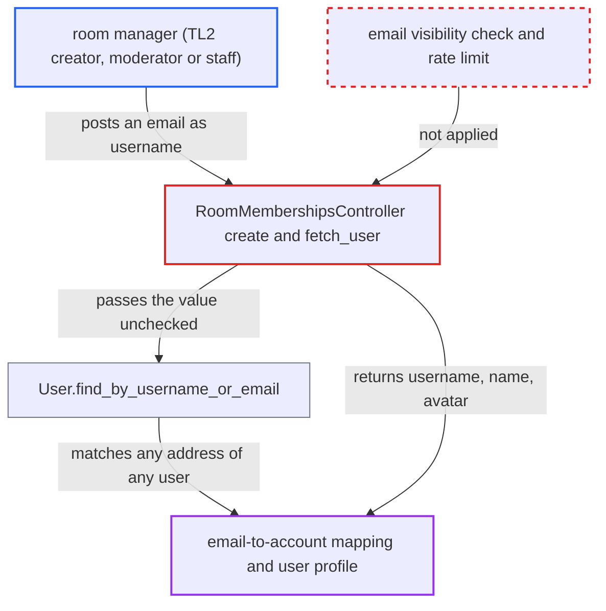

# Live room membership endpoint resolves emails, exposing email-to-account mapping to room creators

| Field | Value |
|---|---|
| ID | `find_01QB8kePRmQ4cGU93amtb6wk` |
| Severity | **Low** |
| Status | open |
| CWE | CWE-359 — Private information exposure |
| Created | 2026-10-27T21:42:27.338028Z |
| Claude Security | https://claude.ai/security/findings/find_01QB8kePRmQ4cGU93amtb6wk |

## Description

A logged-in user who can manage a Live room can find out whether an email address belongs to a forum account, and which account it is. They also get that account's username, name and avatar. This needs the bundled Live plugin enabled (`live_enabled`, off by default) and a room the user manages; by default any TL2 user can create one. The cause is `fetch_user`, which passes the `username` value to `User.find_by_username_or_email`, so email addresses are resolved.

1. **attacker (TL2 user)** creates a Live room or uses one they moderate. By default `live_create_room_allowed_groups` lets TL2 users create rooms, and `can_manage_live_room?` is true for the room creator, its moderators and staff. ([`plugins/live/config/settings.yml:26-35`](https://github.com/cx-benchmark/discourse/blob/e08ed05b4b1ef773b2de7948a8f88a7c182a3520/plugins/live/config/settings.yml#L26-L35))
2. **attacker** sends `POST /live/rooms/<id>/memberships` with a target email address as `username`. `create` checks only `ensure_can_manage_live_room!`, applies no rate limiter, and checks nothing about whether the caller may see emails. ([`plugins/live/app/controllers/live/room_memberships_controller.rb:12-31`](https://github.com/cx-benchmark/discourse/blob/e08ed05b4b1ef773b2de7948a8f88a7c182a3520/plugins/live/app/controllers/live/room_memberships_controller.rb#L12-L31))
3. **the method `fetch_user`** looks up the supplied value as an email. `User.find_by_username_or_email` branches on `@` to `find_by_email`, which matches primary, secondary and staged addresses of every user. ([`plugins/live/app/controllers/live/room_memberships_controller.rb:83-91`](https://github.com/cx-benchmark/discourse/blob/e08ed05b4b1ef773b2de7948a8f88a7c182a3520/plugins/live/app/controllers/live/room_memberships_controller.rb#L83-L91))
4. **the matching code in `User`** returns the account that owns the address. The `with_email` scope matches any address of any user. ([`app/models/user.rb:558-572`](https://github.com/cx-benchmark/discourse/blob/e08ed05b4b1ef773b2de7948a8f88a7c182a3520/app/models/user.rb#L558-L572))
5. **the controller `create`** saves a membership and returns the user in the response. The serializer embeds the matched user via `BasicUserSerializer`, which shows username, name and avatar. ([`plugins/live/app/serializers/live/room_membership_serializer.rb:5-7`](https://github.com/cx-benchmark/discourse/blob/e08ed05b4b1ef773b2de7948a8f88a7c182a3520/plugins/live/app/serializers/live/room_membership_serializer.rb#L5-L7))
6. **the controller `create`** fails with a 500 when no account matches. `fetch_user` returns `nil` and `ensure_agent_role_allowed!` calls `nil.bot?`. A 200 with a user versus a 500 tells the attacker whether the address is registered. ([`plugins/live/app/controllers/live/room_memberships_controller.rb:12-31`](https://github.com/cx-benchmark/discourse/blob/e08ed05b4b1ef773b2de7948a8f88a7c182a3520/plugins/live/app/controllers/live/room_memberships_controller.rb#L12-L31))

## Assessment

The attacker is a logged-in user who can manage a Live room. By default that means any TL2 user, who can create a room. A room moderator or staff member also qualifies. An admin must have enabled the bundled Live plugin with `live_enabled`, which is off by default. The attacker posts one candidate email per request and repeats this for each address, since the action has no rate limit. Only addresses the attacker chooses are answered.

Impact: The attacker learns whether chosen email addresses (primary, secondary or staged) belong to forum accounts. For each match they also learn the username, name and avatar. Core Discourse hides this mapping from ordinary users. No list of emails is dumped, and a membership added by the request is something a manager could already do by username.

## Recommendation

`fetch_user` resolves the manager-supplied `username` with `User.find_by_username_or_email`, so any room manager can use the email-to-account lookup and see the result in the response. A miss also ends in a 500.

Fix criteria: The membership endpoint resolves targets only by username or id, unless the caller may see emails. An email-shaped value gets the same status and body as an unknown username. An unknown user gets a 4xx, not a 500. To verify, post an existing user's primary and secondary email as `username` as a TL2 room creator. The response must match the one for a non-existent username, and no membership may be created.

## Evidence

**https://github.com/cx-benchmark/discourse**

- [`plugins/live/app/controllers/live/room_memberships_controller.rb:83-91`](https://github.com/cx-benchmark/discourse/blob/e08ed05b4b1ef773b2de7948a8f88a7c182a3520/plugins/live/app/controllers/live/room_memberships_controller.rb#L83-L91)
- [`plugins/live/app/controllers/live/room_memberships_controller.rb:12-31`](https://github.com/cx-benchmark/discourse/blob/e08ed05b4b1ef773b2de7948a8f88a7c182a3520/plugins/live/app/controllers/live/room_memberships_controller.rb#L12-L31)
- [`app/models/user.rb:558-572`](https://github.com/cx-benchmark/discourse/blob/e08ed05b4b1ef773b2de7948a8f88a7c182a3520/app/models/user.rb#L558-L572)
- [`plugins/live/app/serializers/live/room_membership_serializer.rb:5-7`](https://github.com/cx-benchmark/discourse/blob/e08ed05b4b1ef773b2de7948a8f88a7c182a3520/plugins/live/app/serializers/live/room_membership_serializer.rb#L5-L7)
- [`plugins/live/lib/live/guardian_extension.rb:53-58`](https://github.com/cx-benchmark/discourse/blob/e08ed05b4b1ef773b2de7948a8f88a7c182a3520/plugins/live/lib/live/guardian_extension.rb#L53-L58)
- [`plugins/live/config/settings.yml:26-35`](https://github.com/cx-benchmark/discourse/blob/e08ed05b4b1ef773b2de7948a8f88a7c182a3520/plugins/live/config/settings.yml#L26-L35)
- [`app/controllers/topics_controller.rb:903-909`](https://github.com/cx-benchmark/discourse/blob/e08ed05b4b1ef773b2de7948a8f88a7c182a3520/app/controllers/topics_controller.rb#L903-L909)

