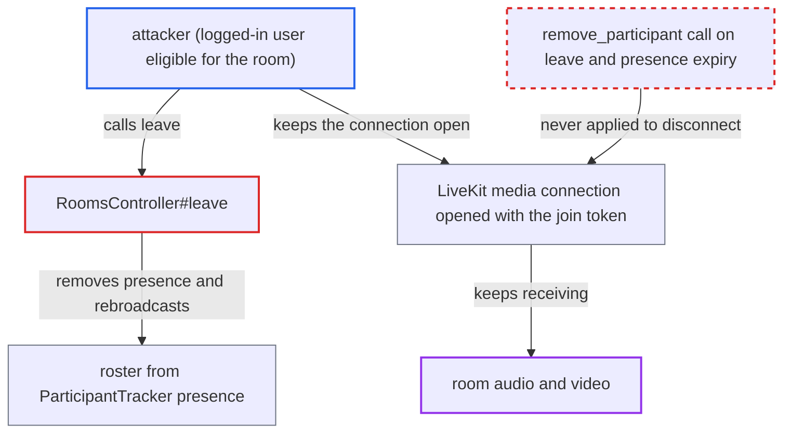

# LiveKit SFU session outlives Discourse leave/presence expiry, enabling invisible listening

| Field | Value |
|---|---|
| ID | `find_0111rsjVY6zWtyZLLFkNuZAS` |
| Severity | **Low** |
| Status | open |
| CWE | CWE-613 — Insufficient Session Expiration |
| Created | 2026-10-27T21:45:29.256134Z |
| Claude Security | https://claude.ai/security/findings/find_0111rsjVY6zWtyZLLFkNuZAS |

## Description

A logged-in user who is allowed into a LiveKit room can secretly keep listening after the other participants are told they left. They can also inject media for short windows. It needs a site with LiveKit enabled (`live_livekit_room_policy` defaults to `disabled`) and a client that keeps its media connection open after leaving. The cause is that `RoomsController#leave`, the presence expiry and `CloseOrphanedSessions` never remove the person from the LiveKit media server.

1. **attacker (logged-in user)** joins the room and receives a LiveKit token. The token from `Live::Livekit.mint_token` grants `canSubscribe: true` and expires after 10 minutes, but the media server checks that expiry only when the client connects. ([`plugins/live/lib/live/livekit.rb:87-116`](https://github.com/cx-benchmark/discourse/blob/e08ed05b4b1ef773b2de7948a8f88a7c182a3520/plugins/live/lib/live/livekit.rb#L87-L116))
2. **attacker** connects to the media server with the token and stays connected. The `participant_joined` webhook only stores the session ID and never checks that the connecting identity is present in Discourse. ([`plugins/live/app/controllers/live/livekit_webhooks_controller.rb:55-69`](https://github.com/cx-benchmark/discourse/blob/e08ed05b4b1ef773b2de7948a8f88a7c182a3520/plugins/live/app/controllers/live/livekit_webhooks_controller.rb#L55-L69))
3. **attacker** calls `DELETE /live/rooms/:id/leave` or stops sending heartbeats, keeping the media connection open. The connection can be held by a separate LiveKit client that has the token. ([`plugins/live/app/controllers/live/rooms_controller.rb:360-383`](https://github.com/cx-benchmark/discourse/blob/e08ed05b4b1ef773b2de7948a8f88a7c182a3520/plugins/live/app/controllers/live/rooms_controller.rb#L360-L383))
4. **the handler `leave`** removes presence, revokes the participant session and rebroadcasts the roster without disconnecting the media session. It never calls `Live::Livekit::RoomServiceClient.remove_participant`, which only `kick` uses. ([`plugins/live/app/controllers/live/rooms_controller.rb:546`](https://github.com/cx-benchmark/discourse/blob/e08ed05b4b1ef773b2de7948a8f88a7c182a3520/plugins/live/app/controllers/live/rooms_controller.rb#L546))
5. **the sweep `CloseOrphanedSessions`** closes only the session row and Redis state when presence lapses after `live_participant_ttl_seconds` (30 s). No server code removes the identity from the media server, so the lapsed-presence path leaves the connection open too. ([`plugins/live/app/jobs/scheduled/live/close_orphaned_sessions.rb:20-48`](https://github.com/cx-benchmark/discourse/blob/e08ed05b4b1ef773b2de7948a8f88a7c182a3520/plugins/live/app/jobs/scheduled/live/close_orphaned_sessions.rb#L20-L48))
6. **honest clients** drop the attacker from the roster and play the 'user left' cue. `LivekitCoordinator#syncRoster` only ends the honest clients' own subscriptions to the attacker's tracks, so it cannot cut the attacker's subscriptions. ([`plugins/live/assets/javascripts/discourse/lib/live/livekit-coordinator.js:162-224`](https://github.com/cx-benchmark/discourse/blob/e08ed05b4b1ef773b2de7948a8f88a7c182a3520/plugins/live/assets/javascripts/discourse/lib/live/livekit-coordinator.js#L162-L224))
7. **attacker** keeps receiving all room audio and video while invisible. This lasts until the last visible participant leaves, because only `RemoveParticipant` or `DeleteRoom` ends the media session.

## Assessment

The attacker is an authenticated user who may join a LiveKit-pinned room. Public rooms default to all logged-in users. The site must have LiveKit configured and enabled, because `live_livekit_room_policy` defaults to `disabled`. The attacker joins, connects to the media server with the returned token, then calls leave or stops heartbeats while holding the connection open. Presence expiry after 30 seconds without heartbeats gives the same result as an explicit leave. The report assumes the external, unpinned LiveKit server does not disconnect a participant when its token expires.

Impact: The attacker covertly keeps receiving the room's audio and video after everyone has been told they left. The attacker was already eligible to hear the room, so this gives no access to other rooms. The attacker can also inject media in short windows, because a new publication is auto-subscribed until the next roster broadcast. Listening is not time-limited.

## Recommendation

When a person's Discourse presence ends in a LiveKit-pinned room, through `leave`, presence expiry or `CloseOrphanedSessions`, the roster entry and session are removed but the person stays connected to the media server. Identities that are connected but absent from presence (`missing_in_presence`, or `participant_joined` without presence) are also left alone.

Fix criteria: Whenever a human participant's presence ends in a LiveKit-pinned room (explicit leave, presence expiry, `CloseOrphanedSessions`), the server removes that identity from the media server. Identities that connect or stay connected while absent from presence (`missing_in_presence`, `participant_joined` without presence) are removed by reconciliation. To verify, join from two accounts and have one call leave while holding its media connection open. Confirm LiveKit reports it removed and it stops receiving tracks within the reconcile interval.

## Evidence

**https://github.com/cx-benchmark/discourse**

- [`plugins/live/app/controllers/live/rooms_controller.rb:360-383`](https://github.com/cx-benchmark/discourse/blob/e08ed05b4b1ef773b2de7948a8f88a7c182a3520/plugins/live/app/controllers/live/rooms_controller.rb#L360-L383)
- [`plugins/live/app/controllers/live/rooms_controller.rb:546`](https://github.com/cx-benchmark/discourse/blob/e08ed05b4b1ef773b2de7948a8f88a7c182a3520/plugins/live/app/controllers/live/rooms_controller.rb#L546)
- [`plugins/live/lib/live/livekit.rb:87-116`](https://github.com/cx-benchmark/discourse/blob/e08ed05b4b1ef773b2de7948a8f88a7c182a3520/plugins/live/lib/live/livekit.rb#L87-L116)
- [`plugins/live/app/jobs/scheduled/live/close_orphaned_sessions.rb:20-48`](https://github.com/cx-benchmark/discourse/blob/e08ed05b4b1ef773b2de7948a8f88a7c182a3520/plugins/live/app/jobs/scheduled/live/close_orphaned_sessions.rb#L20-L48)
- [`plugins/live/app/controllers/live/livekit_webhooks_controller.rb:55-69`](https://github.com/cx-benchmark/discourse/blob/e08ed05b4b1ef773b2de7948a8f88a7c182a3520/plugins/live/app/controllers/live/livekit_webhooks_controller.rb#L55-L69)
- [`plugins/live/app/services/live/agent_manager.rb:100-144`](https://github.com/cx-benchmark/discourse/blob/e08ed05b4b1ef773b2de7948a8f88a7c182a3520/plugins/live/app/services/live/agent_manager.rb#L100-L144)
- [`plugins/live/lib/live/livekit/health_check.rb:101-129`](https://github.com/cx-benchmark/discourse/blob/e08ed05b4b1ef773b2de7948a8f88a7c182a3520/plugins/live/lib/live/livekit/health_check.rb#L101-L129)
- [`plugins/live/assets/javascripts/discourse/lib/live/livekit-coordinator.js:162-224`](https://github.com/cx-benchmark/discourse/blob/e08ed05b4b1ef773b2de7948a8f88a7c182a3520/plugins/live/assets/javascripts/discourse/lib/live/livekit-coordinator.js#L162-L224)
- [`plugins/live/docs/security-review-2026-08-26.md:454-472`](https://github.com/cx-benchmark/discourse/blob/e08ed05b4b1ef773b2de7948a8f88a7c182a3520/plugins/live/docs/security-review-2026-08-26.md#L454-L472)

