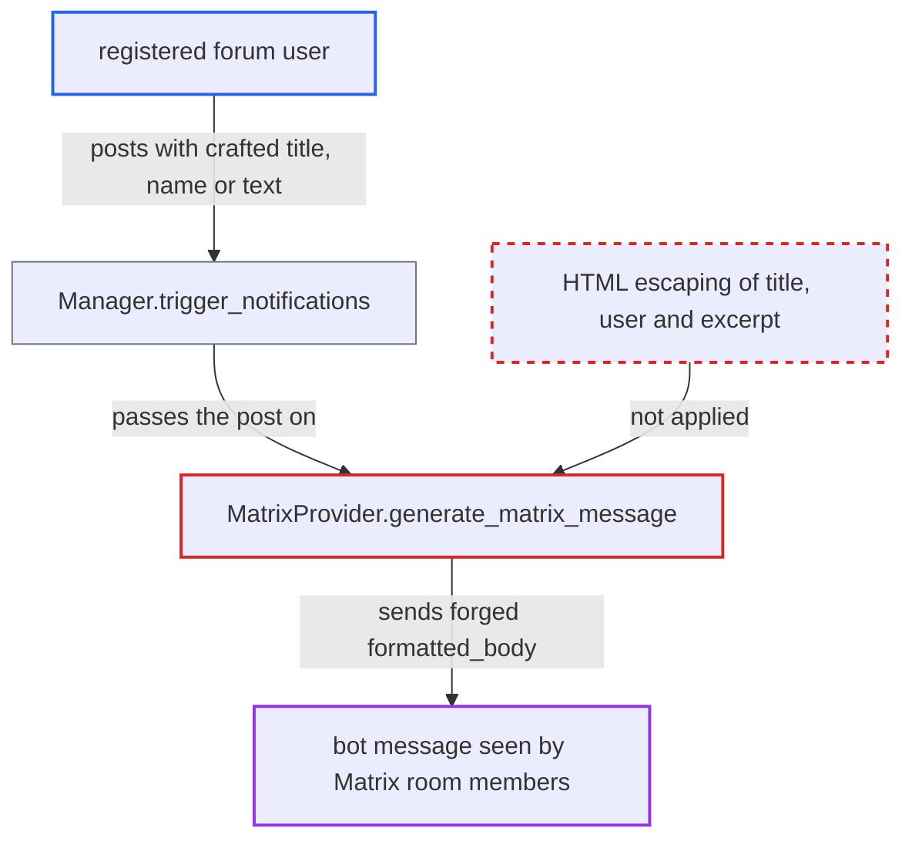

# Matrix notification formatted_body interpolates unescaped topic title, author name and excerpt

| Field | Value |
|---|---|
| ID | `find_01PRHQ1rckDkf8MV7G2PJGKX` |
| Severity | **Low** |
| Status | open |
| CWE | CWE-116 — Improper output encoding |
| Created | 2026-10-27T21:41:07.306197Z |
| Claude Security | https://claude.ai/security/findings/find_01PRHQ1rckDkf8MV7G2PJGKX |

## Description

A registered forum user can put their own HTML into the forum bot's Matrix messages. This allows spoofed or re-targeted links and phishing. It does not allow script execution, and it assumes Matrix clients sanitise to their allow-list. It needs an admin to have enabled the Matrix provider and a matching rule. `MatrixProvider.generate_matrix_message` puts the topic title, display name and excerpt into `formatted_body` without HTML escaping.

1. **attacker (registered user)** writes HTML into a topic title, full name or post text. `topic.title` keeps `<`, `>` and quotes as typed, because only `fancy_title` is escaped. ([`app/models/topic.rb:649-653`](https://github.com/cx-benchmark/discourse/blob/e08ed05b4b1ef773b2de7948a8f88a7c182a3520/app/models/topic.rb#L649-L653))
2. **`Manager.trigger_notifications`** passes the post to the provider for a matching rule. Every regular post the integration user can see, in a category or group covered by a rule, is sent on, and its content is not filtered beyond the visibility check. ([`plugins/discourse-chat-integration/app/services/manager.rb:9-109`](https://github.com/cx-benchmark/discourse/blob/e08ed05b4b1ef773b2de7948a8f88a7c182a3520/plugins/discourse-chat-integration/app/services/manager.rb#L9-L109))
3. **`ExcerptParser.get_excerpt`** turns escaped text in the post back into live markup. With `text_entities: true` it ends with `CGI.unescapeHTML`, so text written as `&lt;a href=…&gt;` becomes a real tag. ([`lib/excerpt_parser.rb:45`](https://github.com/cx-benchmark/discourse/blob/e08ed05b4b1ef773b2de7948a8f88a7c182a3520/lib/excerpt_parser.rb#L45))
4. **the `chat_integration.provider.matrix.formatted_message` template** inserts `%{user}`, `%{title}` and `%{excerpt}` as they are. `I18n.t` interpolation does not escape, so attacker text can close `<b>`, `<a>` and `<blockquote>` and open its own tags. ([`plugins/discourse-chat-integration/config/locales/server.en.yml:313-317`](https://github.com/cx-benchmark/discourse/blob/e08ed05b4b1ef773b2de7948a8f88a7c182a3520/plugins/discourse-chat-integration/config/locales/server.en.yml#L313-L317))
5. **`MatrixProvider.generate_matrix_message`** sends the unescaped result as `formatted_body` with `format: "org.matrix.custom.html"`. The event is posted as the forum's bot account. ([`plugins/discourse-chat-integration/lib/discourse_chat_integration/provider/matrix/matrix_provider.rb:50-64`](https://github.com/cx-benchmark/discourse/blob/e08ed05b4b1ef773b2de7948a8f88a7c182a3520/plugins/discourse-chat-integration/lib/discourse_chat_integration/provider/matrix/matrix_provider.rb#L50-L64))
6. **Matrix room members** view the bot's message with the forged markup. The client renders the HTML within what its sanitiser allows.

## Assessment

The attacker is any registered user who can post in a category, or message a group, that an admin's chat-integration rule sends to a Matrix room. The admin must have enabled the Matrix provider and created a matching rule. There are three ways in: the topic title, the user's full name, and post text containing escaped HTML. The full name is included under the default settings, where `enable_names` and `prioritize_username_in_ux` are both true, and is only limited to 255 characters. Example title: `Release notes</a><a href='https://evil.example/login'>Release notes`. Example post text: `&lt;/blockquote&gt;&lt;a href="https://evil.example"&gt;Read more&lt;/a&gt;`.

Impact: The attacker controls the HTML of a message attributed to the forum's bot. No Discourse data is disclosed, changed or made unavailable. The effect is limited to what the receiving Matrix client's sanitiser allows.

Subsequent-system impact: In the Matrix room, the attacker can re-target the topic link, add masked links (even though the provider strips links from excerpts), and fake author or title lines. They can also add colours or `mxc://` images. This is limited content spoofing and phishing with no data access.

## Recommendation

The topic title, display name and excerpt are interpolated into the Matrix `formatted_body` without HTML escaping. The excerpt is also entity-decoded by `text_entities: true`, which turns escaped text back into live tags.

Fix criteria: Every value interpolated into `formatted_body` (`user`, `title`, `excerpt`) arrives HTML-escaped. For example, use an excerpt that keeps its entities and escape the title and name. A topic titled `x</a><a href='https://evil.example'>y` must produce a `formatted_body` where the markup shows as literal text. A full name containing `<b>` must do the same. So must a post containing `&lt;/blockquote&gt;&lt;a href="https://evil.example"&gt;z&lt;/a&gt;`. In each case the only `href` in `formatted_body` is `post_url`.

## Evidence

**https://github.com/cx-benchmark/discourse**

- [`plugins/discourse-chat-integration/lib/discourse_chat_integration/provider/matrix/matrix_provider.rb:50-64`](https://github.com/cx-benchmark/discourse/blob/e08ed05b4b1ef773b2de7948a8f88a7c182a3520/plugins/discourse-chat-integration/lib/discourse_chat_integration/provider/matrix/matrix_provider.rb#L50-L64)
- [`plugins/discourse-chat-integration/config/locales/server.en.yml:313-317`](https://github.com/cx-benchmark/discourse/blob/e08ed05b4b1ef773b2de7948a8f88a7c182a3520/plugins/discourse-chat-integration/config/locales/server.en.yml#L313-L317)
- [`lib/excerpt_parser.rb:45`](https://github.com/cx-benchmark/discourse/blob/e08ed05b4b1ef773b2de7948a8f88a7c182a3520/lib/excerpt_parser.rb#L45)
- [`app/models/topic.rb:649-653`](https://github.com/cx-benchmark/discourse/blob/e08ed05b4b1ef773b2de7948a8f88a7c182a3520/app/models/topic.rb#L649-L653)
- [`plugins/discourse-chat-integration/app/helpers/helper.rb:216-231`](https://github.com/cx-benchmark/discourse/blob/e08ed05b4b1ef773b2de7948a8f88a7c182a3520/plugins/discourse-chat-integration/app/helpers/helper.rb#L216-L231)
- [`plugins/discourse-chat-integration/lib/discourse_chat_integration/provider/telegram/telegram_provider.rb:138`](https://github.com/cx-benchmark/discourse/blob/e08ed05b4b1ef773b2de7948a8f88a7c182a3520/plugins/discourse-chat-integration/lib/discourse_chat_integration/provider/telegram/telegram_provider.rb#L138)
- [`plugins/discourse-chat-integration/app/services/manager.rb:9-109`](https://github.com/cx-benchmark/discourse/blob/e08ed05b4b1ef773b2de7948a8f88a7c182a3520/plugins/discourse-chat-integration/app/services/manager.rb#L9-L109)

