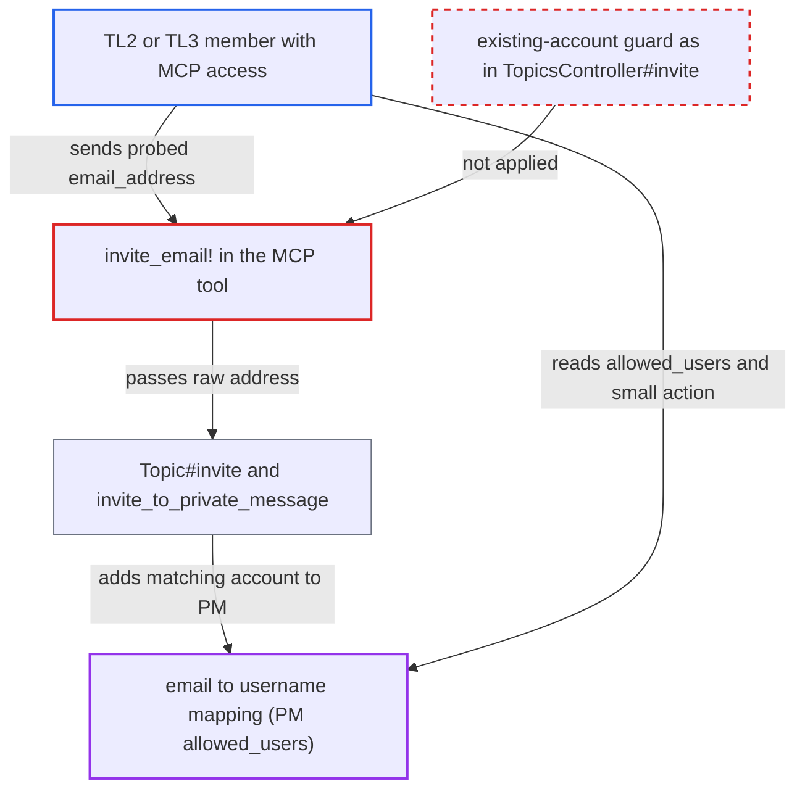

# MCP PM email invite resolves registered emails to accounts, bypassing core's non-disclosure

| Field | Value |
|---|---|
| ID | `find_01C8UYBQNCtNcDACs6RWAi4h` |
| Severity | **Low** |
| Status | open |
| CWE | CWE-359 — Private information exposure |
| Created | 2026-10-27T22:06:53.960853Z |
| Claude Security | https://claude.ai/security/findings/find_01C8UYBQNCtNcDACs6RWAi4h |

## Description

A logged-in member below TL4 can find out whether an email address is registered and which username owns it. This only works where an admin has enabled the MCP server and granted `private_messages:write` to a group containing such users. The tool `discourse_invite_to_private_message` hands the raw address to `Topic#invite`. That method adds the matching account to the PM, so the participant list gives the account away. The HTTP invite path hides this.

1. **attacker (TL2 or TL3 member)** creates a PM and calls `discourse_invite_to_private_message` with `email_address` set to the target address. The attacker uses their own authorized MCP client, and no victim action is needed. ([`lib/discourse_mcp/tools/private_messages.rb:399-417`](https://github.com/cx-benchmark/discourse/blob/e08ed05b4b1ef773b2de7948a8f88a7c182a3520/lib/discourse_mcp/tools/private_messages.rb#L399-L417))
2. **the method `invite_email!`** passes the raw address to `Topic#invite` after only `can_invite_via_email?`. No check for an address that already belongs to an account is applied here. ([`lib/discourse_mcp/tools/private_messages.rb:399-417`](https://github.com/cx-benchmark/discourse/blob/e08ed05b4b1ef773b2de7948a8f88a7c182a3520/lib/discourse_mcp/tools/private_messages.rb#L399-L417))
3. **the method `Topic#invite`** resolves the address with `User.find_by_username_or_email`. For a value containing `@`, the lookup matches both primary and secondary addresses, and a match takes the direct-add branch instead of creating an `Invite`. ([`app/models/topic.rb:1386-1421`](https://github.com/cx-benchmark/discourse/blob/e08ed05b4b1ef773b2de7948a8f88a7c182a3520/app/models/topic.rb#L1386-L1421))
4. **the method `invite_to_private_message`** adds the matched account to the PM and notifies it. It writes a `topic_allowed_users` row, sets the user to watching, posts an `invited_user` small action carrying the username, and notifies the target. ([`app/models/topic.rb:2331-2360`](https://github.com/cx-benchmark/discourse/blob/e08ed05b4b1ef773b2de7948a8f88a7c182a3520/app/models/topic.rb#L2331-L2360))
5. **attacker** reads the PM with `discourse_read_private_message`. The returned `allowed_users` (or the small action) names the account that owns the probed address, although the tool's own output claims `participant_added: false`. ([`lib/discourse_mcp/tools/private_messages.rb:192`](https://github.com/cx-benchmark/discourse/blob/e08ed05b4b1ef773b2de7948a8f88a7c182a3520/lib/discourse_mcp/tools/private_messages.rb#L192))

## Assessment

The attacker is a logged-in member in `invite_allowed_groups` (TL2 by default) and `personal_message_enabled_groups`. They must also belong to a group that an admin granted `private_messages:write`. The MCP server is off by default (`mcp_server_enabled`), and by default only admins hold MCP scopes (`McpGroupScope.ensure_admins!`). The tool must also be exposed by an admin. The attacker creates a PM, invites a chosen email through the tool, then reads the participants or small actions. A new participant shows the address is registered and names its owner. Primary and secondary addresses both match. Each probe counts against `topic-invitations-per-day` (30) and `max_invites_per_day`.

Impact: The attacker learns whether a chosen email belongs to an account and which username owns it. Core hides this from non-staff below TL4 (`hide_email_address_taken`, and the HTTP invite path). Only one address can be tested per invite, and the daily invite limits prevent a bulk dump. The target is also added to the PM and notified. The report rates this as no integrity impact beyond the project's design, since adding by username is already allowed.

## Recommendation

The MCP email-invite path calls `Topic#invite`, which turns an email owned by an existing account into a direct PM add. It lacks the existing-account guard that `TopicsController#invite` applies, so the PM's participants reveal which account owns the email.

Fix criteria: An email invite through MCP behaves like `TopicsController#invite` for callers not entitled to resolve emails. When the address belongs to an account, no participant, small action, notification or other observable PM change results, and the tool output matches the unregistered case. To verify, invoke the tool with a registered and an unregistered email as a TL2 user. Then confirm that `allowed_users`, small actions and tool output give no way to tell the two apart.

## Evidence

**https://github.com/cx-benchmark/discourse**

- [`lib/discourse_mcp/tools/private_messages.rb:399-417`](https://github.com/cx-benchmark/discourse/blob/e08ed05b4b1ef773b2de7948a8f88a7c182a3520/lib/discourse_mcp/tools/private_messages.rb#L399-L417)
- [`app/models/topic.rb:1386-1421`](https://github.com/cx-benchmark/discourse/blob/e08ed05b4b1ef773b2de7948a8f88a7c182a3520/app/models/topic.rb#L1386-L1421)
- [`app/models/topic.rb:2331-2360`](https://github.com/cx-benchmark/discourse/blob/e08ed05b4b1ef773b2de7948a8f88a7c182a3520/app/models/topic.rb#L2331-L2360)
- [`app/models/user.rb:558-572`](https://github.com/cx-benchmark/discourse/blob/e08ed05b4b1ef773b2de7948a8f88a7c182a3520/app/models/user.rb#L558-L572)
- [`lib/discourse_mcp/tools/private_messages.rb:192`](https://github.com/cx-benchmark/discourse/blob/e08ed05b4b1ef773b2de7948a8f88a7c182a3520/lib/discourse_mcp/tools/private_messages.rb#L192)
- [`app/controllers/topics_controller.rb:903-909`](https://github.com/cx-benchmark/discourse/blob/e08ed05b4b1ef773b2de7948a8f88a7c182a3520/app/controllers/topics_controller.rb#L903-L909)
- [`spec/requests/topics_controller_spec.rb:7445-7482`](https://github.com/cx-benchmark/discourse/blob/e08ed05b4b1ef773b2de7948a8f88a7c182a3520/spec/requests/topics_controller_spec.rb#L7445-L7482)
- [`lib/topic_creator.rb:273-275`](https://github.com/cx-benchmark/discourse/blob/e08ed05b4b1ef773b2de7948a8f88a7c182a3520/lib/topic_creator.rb#L273-L275)

