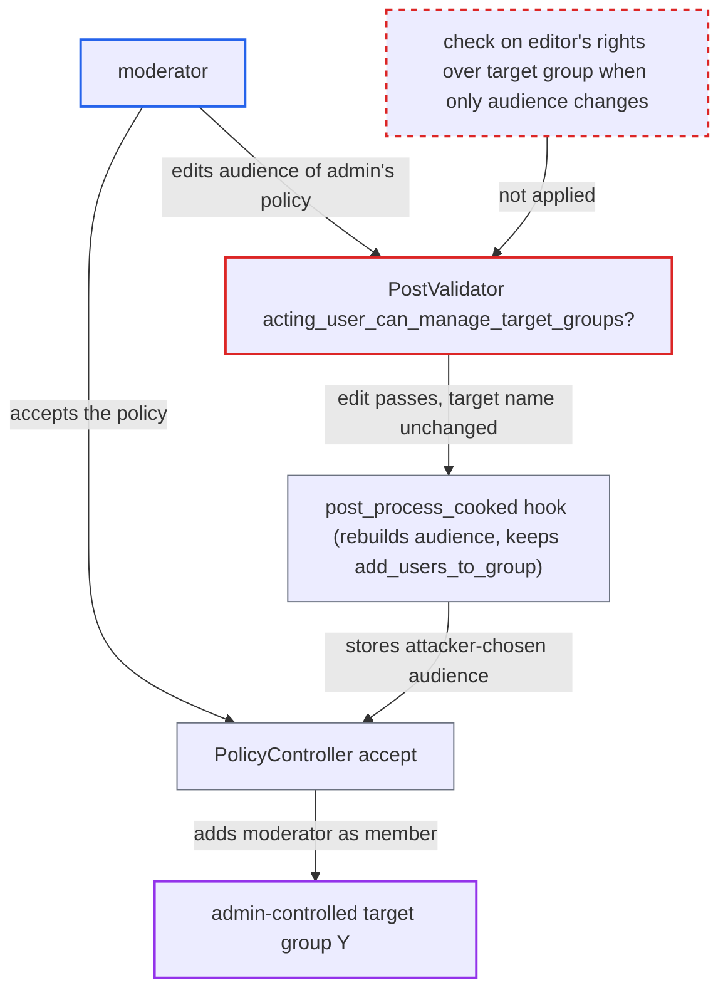

# Moderator repurposes admin add-users-to-group policy by editing audience groups

| Field | Value |
|---|---|
| ID | `find_01HpBve9J6jdsqeA42mz6FSM` |
| Severity | **Low** |
| Status | open |
| CWE | CWE-862 — Missing Authorization |
| Created | 2026-10-27T21:41:46.314617Z |
| Claude Security | https://claude.ai/security/findings/find_01HpBve9J6jdsqeA42mz6FSM |

## Description

A moderator can add themselves to a group that only admins manage. Optionally they can also let any user join it. This works when an admin has written a policy post with `add-users-to-group=Y` and the bundled `discourse-policy` plugin is enabled. The check `acting_user_can_manage_target_groups?` in `PostValidator` only runs when the target group name changes, so editing the policy audience goes unchecked.

1. **moderator** edits an admin's policy post with `PUT /posts/:id`. The moderator changes only `group=` or `groups=` in the `[policy]` tag, for example to `moderators` or `trust_level_0`, and leaves `add-users-to-group=Y` alone. ([`lib/guardian/post_guardian.rb:156-169`](https://github.com/cx-benchmark/discourse/blob/e08ed05b4b1ef773b2de7948a8f88a7c182a3520/lib/guardian/post_guardian.rb#L156-L169))
2. **the validator `PostValidator`** accepts the edit without checking the moderator's rights over the target group. `acting_user_can_manage_target_groups?` returns `true` when the target name is unchanged, and the remaining checks only need the moderator and the author to be in `create_policy_allowed_groups`, which the default `1|2` satisfies. ([`plugins/discourse-policy/lib/post_validator.rb:43-55`](https://github.com/cx-benchmark/discourse/blob/e08ed05b4b1ef773b2de7948a8f88a7c182a3520/plugins/discourse-policy/lib/post_validator.rb#L43-L55))
3. **the `post_process_cooked` hook** rebuilds `post_policy_groups` from the edited audience. The hook only checks that the post author is allowed to create policies. It does not consider who made the edit. ([`plugins/discourse-policy/plugin.rb:74-107`](https://github.com/cx-benchmark/discourse/blob/e08ed05b4b1ef773b2de7948a8f88a7c182a3520/plugins/discourse-policy/plugin.rb#L74-L107))
4. **the `post_process_cooked` hook** keeps `add_users_to_group` for the target group. The check runs against the admin author with `Guardian.new(post.user).can_edit_group?`, and an admin passes it for every non-automatic group. ([`plugins/discourse-policy/plugin.rb:158-166`](https://github.com/cx-benchmark/discourse/blob/e08ed05b4b1ef773b2de7948a8f88a7c182a3520/plugins/discourse-policy/plugin.rb#L158-L166))
5. **moderator** sends `PUT /policy/accept?post_id=…`. `ensure_can_accept` only needs the caller to be in an audience group, which the moderator has just chosen, and the author to be able to edit the target group. ([`plugins/discourse-policy/app/controllers/discourse_policy/policy_controller.rb:59-74`](https://github.com/cx-benchmark/discourse/blob/e08ed05b4b1ef773b2de7948a8f88a7c182a3520/plugins/discourse-policy/app/controllers/discourse_policy/policy_controller.rb#L59-L74))
6. **the `accept` action** adds the moderator to the target group. It runs `@add_users_group&.add(current_user)`, so the moderator becomes a member of `Y`. ([`plugins/discourse-policy/app/controllers/discourse_policy/policy_controller.rb:10-16`](https://github.com/cx-benchmark/discourse/blob/e08ed05b4b1ef773b2de7948a8f88a7c182a3520/plugins/discourse-policy/app/controllers/discourse_policy/policy_controller.rb#L10-L16))

## Assessment

The attacker is a moderator. The bundled policy plugin must be enabled. An admin must have written a policy with `add-users-to-group=Y` whose audience does not include the moderator. By default moderators are in `edit_all_post_groups` and `create_policy_allowed_groups`, so they may edit the admin's post. No victim action is needed. The moderator cannot otherwise change group membership, because `moderators_manage_groups` defaults to false, and the validator would reject an edit that pointed the target at `Y` directly.

Impact: The moderator joins group `Y` and gets its private categories, group messages and any permissions tied to `Y`. By setting the audience to `trust_level_0` they can let every user in. The reach is limited to groups an admin has already attached to a policy as the target.

## Recommendation

(1) `PostValidator#acting_user_can_manage_target_groups?` checks the editor's authority over the target group only when the target group name changes. Any other edit, such as the audience `groups`, inherits the original author's authority.

Fix criteria: When the editor is not the post author and the resulting policy has an `add-users-to-group` target the editor cannot edit, any change to the policy is rejected. Alternatively, the editor must have `can_edit_group?` on the target whether or not the name changed. Check: a moderator who edits an admin's policy post to change `groups=` while `add-users-to-group` targets a group they do not own gets `no_policy_permission`, and `PUT /policy/accept` then does not add them to the group.

(2) `PolicyController#ensure_can_accept` and the `post_process_cooked` hook judge `add_users_to_group` only against the post author's guardian. They assume the author set every attribute of the cooked policy.

Fix criteria: The code records who last set or approved the `add_users_to_group` mapping or the audience. It clears `add_users_to_group` when anyone who cannot edit the target group changes the audience. Check: after a non-owner edit of the audience, `post_policy.add_users_to_group` is nil and accepting adds nobody to the group.

## Evidence

**https://github.com/cx-benchmark/discourse**

- [`plugins/discourse-policy/lib/post_validator.rb:43-55`](https://github.com/cx-benchmark/discourse/blob/e08ed05b4b1ef773b2de7948a8f88a7c182a3520/plugins/discourse-policy/lib/post_validator.rb#L43-L55)
- [`plugins/discourse-policy/lib/post_validator.rb:20-26`](https://github.com/cx-benchmark/discourse/blob/e08ed05b4b1ef773b2de7948a8f88a7c182a3520/plugins/discourse-policy/lib/post_validator.rb#L20-L26)
- [`plugins/discourse-policy/plugin.rb:74-107`](https://github.com/cx-benchmark/discourse/blob/e08ed05b4b1ef773b2de7948a8f88a7c182a3520/plugins/discourse-policy/plugin.rb#L74-L107)
- [`plugins/discourse-policy/plugin.rb:158-166`](https://github.com/cx-benchmark/discourse/blob/e08ed05b4b1ef773b2de7948a8f88a7c182a3520/plugins/discourse-policy/plugin.rb#L158-L166)
- [`plugins/discourse-policy/app/controllers/discourse_policy/policy_controller.rb:59-74`](https://github.com/cx-benchmark/discourse/blob/e08ed05b4b1ef773b2de7948a8f88a7c182a3520/plugins/discourse-policy/app/controllers/discourse_policy/policy_controller.rb#L59-L74)
- [`plugins/discourse-policy/app/controllers/discourse_policy/policy_controller.rb:10-16`](https://github.com/cx-benchmark/discourse/blob/e08ed05b4b1ef773b2de7948a8f88a7c182a3520/plugins/discourse-policy/app/controllers/discourse_policy/policy_controller.rb#L10-L16)
- [`lib/guardian/post_guardian.rb:156-169`](https://github.com/cx-benchmark/discourse/blob/e08ed05b4b1ef773b2de7948a8f88a7c182a3520/lib/guardian/post_guardian.rb#L156-L169)
- [`config/site_settings.yml:3097-3102`](https://github.com/cx-benchmark/discourse/blob/e08ed05b4b1ef773b2de7948a8f88a7c182a3520/config/site_settings.yml#L3097-L3102)
- [`lib/guardian/group_guardian.rb:13-28`](https://github.com/cx-benchmark/discourse/blob/e08ed05b4b1ef773b2de7948a8f88a7c182a3520/lib/guardian/group_guardian.rb#L13-L28)

